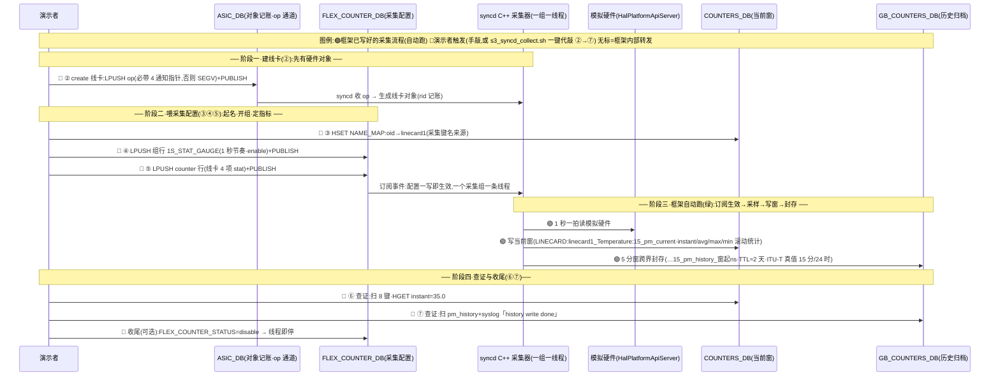

# syncd 数据采集

## §0 新手地图(先读这页)

### 容器各管一摊

```
┌───────────── VM(QEMU,ssh localhost:2222)─────────────┐
│                                                        │
│  pmon 容器              database 容器        syncd 容器 │
│  硬件管家                redis 群(分库)      业务采集   │
│  ├ psud(电源)          ├ db1 ASIC_DB       └ syncd 进程 │
│  ├ thermalctld(温度)   ├ db2 COUNTERS_DB      (C++)     │
│  └ stormond            ├ db5 FLEX_COUNTER_DB              │
│                        ├ db10 GB_COUNTERS_DB              │
│                        └ db15 HISTORY_DB(桩旧账)          │
└────────────────────────────────────────────────────────┘
```

本篇只走 syncd 容器这条线;PMON 硬件采集/设置(场景一/二)见姊妹篇《45-PMON硬件数据采集与设置(初学者版)》。

### 场景三,一条数据链

| 场景 | 一句话 | 数据链 | 看点 |
|:--|:--|:--|:--|
| 三 | 业务数据采集+归档 | FLEX_COUNTER_DB 配置 → syncd C++ 线程 → COUNTERS_DB → 历史封存 | 8 键浮现、窗跨界封存 |

### 名词小词典(够用就好)

| 名词 | 白话 |
|:--|:--|
| FLEX_COUNTER_DB(db5) | 采集配置库:采什么、多久采一次、开不开 |
| COUNTERS_DB(db2) | 采集结果的「当前窗」:当刻值+滚动统计 |
| GB_COUNTERS_DB(db10) | 采集结果的「历史归档」:每窗口一笔定格(C++ 真件写这) |
| HISTORY_DB(db15) | python 桩写的旧账库,真件不用;CLI 惯例还要它,开机重套映射(§4) |
| vid / rid | 同一个硬件对象的两套编号:vid=syncd 内部用,rid=vendor 库用,meta 库互译 |
| op 伫列 | 给 syncd 下指令的通道:LPUSH 一笔 op + PUBLISH 敲一下钟 |

### 登入与演示前快检(30 秒)

```bash
ssh -p 2222 admin@localhost        # 密码 YourPaSsWoRd(VM 内 sudo 同)
```

```bash
sudo docker ps --format "{{.Names}}: {{.Status}}" | head -5
sudo docker exec syncd supervisorctl status | grep -E "^syncd|stub"
sudo docker exec syncd ldd /usr/lib/x86_64-linux-gnu/libswsscommon.so.0.0.0 | grep -c "not found"
```

| 预期 | 说明 |
|:--|:--|
| database/swss/syncd/pmon … Up | 容器都在 |
| `syncd RUNNING` | C++ 采集主体活着(stub 同时 RUNNING 无妨,写的键不冲突) |
| `0` | 依赖三件套齐了(非 0 = 没套好,→`44`) |

### 一键验证脚本(内建于 VM `/usr/local/bin`)

ssh 进 VM 后直接跑:命令回顾 + 预期输出 + ✓/✗ 判定 + PASS/FAIL 总结:

| 脚本 | 内容 | 时长 |
|:--|:--|:--|
| `s3_syncd_stat.sh` | 場景三全流程+STAT 三組一次走通:線卡 GAUGE(8 鍵/歸檔)+ 網卡 STATUS(STATE_DB)+ 網卡 COUNTER(累加/歸檔);冪等護欄(記帳在跳過 create、佇列非空拒推);`--keep` 不收尾、`--wait-history` 真等 5 分窗驗雙源歸檔(輪詢 3 分鐘兜底) | ~2 分(+等窗 5 分) |

脚本源码在 sonic-utilities fork `scripts/`(构建时经 sonic-utilities deb 落到镜像 `/usr/local/bin`)。

---

## §1 本维度在需求中的位置

| 需求段 | 原文(摘) | 本维度对应 |
|:--|:--|:--|
| 输入 | flexCounter 配置(flexcounter.json:STAT_STATUS / STATE_GAUGE / STAT_COUNTER 三组、采样间隔、各对象的 OTAI 统计属性 id) | ✓ 三组全走通(GAUGE=线卡 s3;STATUS/COUNTER=网卡 s4,2026-11-10);配置通道本仿真走 FLEX_COUNTER_DB(db5)组表+counter 行(手工 LPUSH 种,§3.2 ④⑤);flexcounter.json 文件加载代码全库不存在(《25》已证);间隔/属性 id ✓ |
| 处理 | syncd-ot 按配置周期采样对象状态/模拟量/计数器;PM 模块按 15 分/24 时窗累积(均值类取平均、计数类累加);窗满归档 history_db,并按采样情况记 validity(complete/incomplete/invalid) | ✓ 周期采样+双桶+归档+validity 标记(GAUGE 路实测,§3.2);⚠️ 演示窗 5 分(补丁#5);⚠️ 计数累加路未实测(G8) |
| 输出 | 三级数据:当前值(state_db)、当前 pm(counter_db)、历史 pm(history_db);北向按对象/窗口查询及 RMON 清零 | ⚠️ 三级并作两级:当前值由 COUNTERS_DB 的 instant 字段承担(无独立 STATE_DB 当前值层);✓ 当前 pm+历史 pm(§3.2 ⑥⑦);✗ 北向 PM 查询与 RMON 清零全库无实现(RMON 仅 OTAI 头文件有 ETHERNET 属性定义,无消费方) |

## §2 目标表(目标 / 状态 / 验证手段)

状态图例:✅ 已实证 · ⚠️ 部分/代码齐全未实测 · ❌ 缺

| # | 目标 | 状态 | 验证手段 |
|:--|:--|:--|:--|
| G1 | 订阅 FLEX_COUNTER_DB → 一组一线程、配置驱动即开即停 | ✅ | LPUSH 组行 enable/disable → 线程起停日志(§3.2 ④;42 §7) |
| G2 | 按周期采样模拟量 → 写 COUNTERS_DB 当前窗(instant/avg/max/min 滚动) | ✅ | 8 键浮现+instant=35.0+JSON 全栏 interval=5 分窗(§3.2 ⑥) |
| G3 | 15 分/24 时双窗累积(均值类 GAUGE) | ✅(2026-11-10 实测) | 窗界后查 db10:落 `15_pm_history_*` 键(TTL≈2 天)、24 时窗 starttime 不动(§3.2 ⑦) |
| G4 | 窗满归档 GB_COUNTERS_DB(db10,TTL≈2 天) | ✅ | `--wait-history` 验 db10 落键+syslog「history write done」(§3.2 ⑦;42 §8) |
| G5 | 按采样情况记 validity(complete/incomplete/invalid) | ✅(2026-11-10 实测:三个值验了两个——incomplete→complete 翻转正确;invalid 程序中从不使用) | 归档行 validity=complete、进行中窗口=incomplete(§3.2 ⑥⑦) |
| G6 | 北向按对象/窗口查询 PM | ❌ 全库无实现(mgmt-framework 只注册 alarms 应用) | — |
| G7 | RMON 清零 | ❌ 全库无实现 | — |
| G8 | 计数类累加(STAT_COUNTER 组 / OtaiStatCollector) | ✅(2026-11-10 实测:ETHERNET 网卡 + `1S_STAT_COUNTER` 组,sim 计数值恒定 10427→逐拍累加,4 秒两拍 83416→114697(=+3 拍);窗界归档 db10 `ETHERNET:eth1:15_pm_history_*`+validity=complete) | 一键 `s3_syncd_stat.sh`(§0) |
| G9 | 对象状态采样(STAT_STATUS 组 / OtaiAttrCollector → STATE_DB) | ✅(2026-11-10 实测:网卡属性写入 `ETHERNET|eth1`(als-delay=10 等);注意 STATE_DB 键用 `|` 分隔,与 COUNTERS_DB 的 `:` 不同) | 一键 `s3_syncd_stat.sh`(§0) |

---

## §3 场景三:syncd 侧采集(C++ 采集器 → 当前窗 → 历史归档)

### 3.1 这是什么

syncd 进程内的 C++ 采集器(`OtaiGaugeCollector`)是 OTN 真件:**订阅 FLEX_COUNTER_DB,一个采集组一条线程**,组表定节奏与开关、counter 表定「哪个硬件对象、采哪些指标」。采到的读数写 COUNTERS_DB(当前窗滚动统计),窗口走完封存进 db10(历史定格)。



一句话读法:蓝点是演示者的喂料动作(②–⑤ 手敲,或一键脚本 `s3_syncd_stat.sh` 代敲)与查证(⑥⑦),绿点是框架自动的采集封存流水线;图按四个 Note 阶段走:建线卡 → 喂配置 → 框架自动跑 → 查证收尾;收尾敲一次 disable 即停——全程配置驱动、即开即停。

**为什么要「手工种配置」**:正常系统由 orchagent 按业务配置写 db5;本仿真无 orchagent,所以我们用 op 伫列协议手工模拟生产端(原理见《43-OTAI对象编号与op队列协议》)。**先得有硬件对象**(线卡)——手工 create 一次。

> python 桩(stub_collector)是 C++ 真件就位前的补位桩,架构位置相同、模型较简(单窗、写 db15)。真件已闭环,桩仅作对照基线,演示不再用它。

### 3.2 演示步骤(操作 4 分钟 + 等窗 5 分钟)

不想手敲就跑一键脚本 `sudo s3_syncd_stat.sh`(内建 VM `/usr/local/bin`)——線卡 GAUGE + 網卡 STATUS/COUNTER 三組一次走通,自动判定 PASS/FAIL;`--keep` 不收尾、`--wait-history` 真等 5 分窗验 db10。手敲版(本節展示線卡 GAUGE 段;網卡兩組同構,配方見 §2 目標表 G8/G9 驗證欄):

```bash
# ① 快检:syncd 活着、依赖完整
sudo docker exec syncd supervisorctl status | grep ^syncd        # 预期:RUNNING
sudo docker exec syncd ldd /usr/lib/x86_64-linux-gnu/libswsscommon.so.0.0.0 | grep -c "not found"
#    预期:0(非 0 = 三件套没套好,→《44》)

# ② 手工 create 线卡(必带 4 个通知指针,否则 10 秒后 SEGV)
redis-cli -n 1 LPUSH "ASIC_STATE_KEY_VALUE_OP_QUEUE" \
  "OTAI_OBJECT_TYPE_LINECARD:oid:0x1000000000000" \
  '["OTAI_LINECARD_ATTR_LINECARD_STATE_CHANGE_NOTIFY","0xdeadbeef","OTAI_LINECARD_ATTR_LINECARD_ALARM_NOTIFY","0xdeadbeef","OTAI_LINECARD_ATTR_LINECARD_OCM_SPECTRUM_POWER_NOTIFY","0xdeadbeef","OTAI_LINECARD_ATTR_LINECARD_OTDR_RESULT_NOTIFY","0xdeadbeef"]' \
  "Screate"
redis-cli -n 1 PUBLISH "ASIC_STATE_CHANNEL@1" "G"

# ③ 给线卡起个名(采集键名的来源)
redis-cli -n 2 HSET "COUNTERS_LINECARD_NAME_MAP" "oid:0x1000000000000" "linecard1"

# ④ 开采集组(组名含 1S_STAT_GAUGE 才会被采集器认;1 秒采样)
redis-cli -n 5 LPUSH "FLEX_COUNTER_GROUP_TABLE_KEY_VALUE_OP_QUEUE" "1S_STAT_GAUGE" \
  '["POLL_INTERVAL","1000","FLEX_COUNTER_STATUS","enable"]' "SSET"
redis-cli -n 5 PUBLISH "FLEX_COUNTER_GROUP_TABLE_CHANNEL@5" "G"

# ⑤ 指定采什么(线卡的 4 项 stat)
redis-cli -n 5 LPUSH "FLEX_COUNTER_TABLE_KEY_VALUE_OP_QUEUE" "1S_STAT_GAUGE:oid:0x1000000000000" \
  '["id_list","OTAI_LINECARD_STAT_TEMPERATURE,OTAI_LINECARD_STAT_CPU_UTILIZATION,OTAI_LINECARD_STAT_MEMORY_AVAILABLE,OTAI_LINECARD_STAT_MEMORY_UTILIZED"]' "SSET"
redis-cli -n 5 PUBLISH "FLEX_COUNTER_TABLE_CHANNEL@5" "G"

# ⑥ 看当前窗(等几秒)
sudo docker exec database redis-cli -n 2 --scan --pattern 'LINECARD:linecard1_*'
#    预期:8 键(4 stat × 15min/24h 双窗)
sudo docker exec database redis-cli -n 2 HGET "LINECARD:linecard1_Temperature:15_pm_current" instant
#    预期:35.0(与模拟硬件 json 一致;CPU 值目前型别错位,演示挑 Temperature/Memory 讲)

#    看整个对象(全部栏位,--json 出 JSON):
sudo docker exec database redis-cli --json -n 2 HGETALL "LINECARD:linecard1_Temperature:15_pm_current"
#    预期:{"interval":"300000000000",…,"instant":"35.0","avg":"35.0","current_validity":"complete",…}
#    讲点:interval 300000000000 ns = 5 分窗(补丁#5 生效)

# ⑦ 等窗口跨界(5 分钟整点,正好用来答问),看历史归档
sudo docker exec database redis-cli -n 10 --scan --pattern "*pm_history*" | head -3
#    预期:…15_pm_history_<窗起ns>;TTL≈2 天。**注意查 db10,不是 db15**
sudo docker exec database redis-cli --json -n 10 HGETALL "<上面扫到的 pm_history 键>"
#    预期:同款 JSON(max/min/avg/instant/max-time/min-time/interval/starttime/validity),多一个 TTL 归属
sudo grep -E "history write done" /var/log/syslog | tail -2
```

**讲点**:改 db5 配置 → 线程即开即停(配置驱动);COUNTERS_DB 是「滚动中的当前窗」,db10 是「走完的窗口定格」——ITU-T 的 15 分/24 时性能监视模型,演示版压成 5 分钟看得到封存。收尾:`FLEX_COUNTER_STATUS` 改 `disable` 同款 LPUSH 即停线程(数据冻结留库无妨)。

### 3.3 相关改动

**代码**(已 commit:sonic-otairedis main=c0f6760、OTAI submodule=c573de9):

| 文件 | 改动 | 原因 |
|:--|:--|:--|
| `syncd/Syncd.cpp`(补丁#4) | processSingleEvent 对 `op=="notify"` 记 log 后跳过 | 无 orchagent 时通知副本误投 ASIC 工作伫列会 crash;跳过后警报流程实测稳定 |
| `syncd/pm/Collector.h`(补丁#5) | `PM_CYCLE_15_MINS` 改 `5*60` 秒 | 归档每 5 分钟一次,演示现场等得起;ITU-T 真值 15 分/24 时回归真件时还原 |
| `syncd/pm/Collector.cpp`(补丁#5) | 边界判断 `%5`;附 PMDEBUG 逐步日志 | 同上;日志留作现场教学 |
| `configure.ac`(补丁#1) | `-Werror` → `-Wno-error` | gcc-12 对 pm/ 旧码警告过严,放行才能编过 |
| `debian/rules`(补丁#2) | `binary` 目标改走 `binary-syncd-ot-vs` | 本 repo 默认产 SAI 版 syncd,OTN 演示要 OTN 版 |
| `OTAI/meta/Makefile`(补丁#3) | `-Wno-error` | 3.3 万行生成码 otaimetadata.c 的误报放行 |
| 依赖线选择:sonic-swsscommon 用 `otn_pre_202411` 分支 | 非改动、是选型 | syncd 的 pm/ 归档调用 `swss::Table::expire`,只有此分支(及我们的构建)有该符号 |

注:采集侧补丁 #1-#5 在 aee13d7(10-26);c0f6760(10-30)在同基础上追加 **vslib 告警注入旋鈕**(sendAlarmNotification 0 参→5 参、readAlarmConfig 轮询 `otai_linecard_notification_sim.json`、边缘触发)——属告警链路,机制见《53》§3。历史记录 TTL(EXPIRE_TIME_2_DAYS/7_DAYS)**从未改动**,db10 归档 TTL 实测≈2 天。

**非代码**(容器层/运行时,完整重套步骤见《44-容器層修復與重套清單》):

| 文件 | 改动 | 原因 |
|:--|:--|:--|
| syncd 容器:`libswsscommon` + `python3-swsscommon` deb | 换**当日成对**版 | 旧库缺 `Table::expire` 符号 → 跨窗瞬间 exit 127(symbol lookup error);python 模组必须与库同版 |
| syncd 容器:`/usr/lib/x86_64-linux-gnu/libboost_serialization.so.1.74.0` | 从 build slave 镜像提取放入 | 新 libswsscommon 的链接依赖,dpkg 不解依赖 |
| syncd 容器:`/usr/bin/syncd` | 换 OTN 二进制(旧版留 `.sai.bak`) | 场景三主体;`docker cp` 停机容器零赛跑 |
| syncd 容器:`/usr/bin/syncd_init_common.sh` | sed 跳线补丁(otn-kvm 走 ot-vs 初始化) | deb 覆盖 init script 后必须重打,否则闸门①不开 |
| db1 种子:线卡 create op | §3.2 ②(重开机即失,要重种) | 无 orchagent,syncd 不会自己生对象;4 指针防 SEGV |
| db5/db2 种子:组行+counter 行+NAME_MAP | §3.2 ③④⑤(重开机即失,要重种) | 配置驱动的起点;NAME_MAP 缺了采集键名为空 |
| 容器 `database_config.json`:HISTORY_DB 映射(id15) | 开机重套(§4) | tmpfs 开机重生成;桩/CLI 惯例需要;C++ 真件查 db10 不受影响 |

---

## §4 重开机后重套(照抄)

### 4.1 存活矩阵

| 资产 | VM 重启 | 容器重启 | 容器重建 | 备注 |
|:--|:--|:--|:--|:--|
| 三件套+boost、syncd 二进制、init 补丁 | ✅ | ✅ | ❌ | 容器层;重建才要重装(→《44》) |
| HISTORY_DB 映射(id15) | ❌ | ✅ | ❌ | tmpfs,开机重生成 |
| 场景三全部种子+采集数据 | ❌ | ✅ | ❌ | redis 无持久化,重种=重跑 §3.2 |

PMON 侧资产(thermalctl、thermalctld 3 秒参数)的重套在姊妹篇 §3。

### 4.2 重套命令(只列必做)

```bash
# ① HISTORY_DB 映射(VM host;tmpfs 开机重生成)
sudo python3 -c "
import json
p='/var/run/redis/sonic-db/database_config.json'
d=json.load(open(p))
if 'HISTORY_DB' not in d['DATABASES']:
    d['DATABASES']['HISTORY_DB']={'id':15,'separator':'|','instance':'redis'}
    json.dump(d,open(p,'w'),indent=4)
print('ok')"
sonic-db-cli HISTORY_DB PING        # 预期:True

# ② 种子:按序重跑 §3.2 ②③④⑤(线卡 create → 起名 → 组行 → counter 行)
#    推 create op 前先查 op 伫列为空:
redis-cli -n 1 LLEN "ASIC_STATE_KEY_VALUE_OP_QUEUE"        # 预期:0
#    非 0 = 冷启后积压的 orchagent 残留副本,DEL 整键再推;
#    重复推 = 重复 create = syncd 退出,宁慢勿重复。
#    注:一键脚本 s3_syncd_collect.sh 自带同款护栏(记账在→跳过 create、队列非空→拒推),
#    与 seed_linecard.sh 可共存,谁先跑都安全。
#    整机冷启(warm/冷 reboot)redis 清空时,完整 seed SOP 见《43》配方与 AGENTS.md 硬规则 5。

# ③ 验证:场景一快检三连(§0)→ 跑 s3_syncd_collect.sh
```

---

## §5 卡点排解

| 症状 | 处理 |
|:--|:--|
| ssh 连不上 | WSL 查 `pgrep -a qemu-system`;没有就按《40-採集演示操作指南》§0 启动 QEMU |
| syncd 起不来或**精确死在窗口边界、exit 127** | `grep "symbol lookup error" /var/log/syslog`——三件套没套好,→《44》 |
| `ldd` 出现 not found | 缺 boost_serialization:从 slave 镜像捞(→《44》§2) |
| 场景三 COUNTERS_DB 查历史扑空 | 查 **db10**(GB_COUNTERS_DB),不是 db15 |
| 线卡 create 后 syncd 秒退(core) | create op 没带 4 个通知指针 → SEGV;照 §3.2 ② 原文重发 |
| 建 ETHERNET 等其他物件时 syncd 秒退(log:`translateVidToRid: unable to get RID for VID oid:0x1000000000000`) | db1 被清、线卡 RID 蒸发(《54》级联坑):**先跑 seed_linecard.sh 恢复线卡,再建其他物件**;恢复后各组配置要重推(s3) |
| 想重复 create 物件 / 重建网卡 | **别**——线卡重复 create 必死(SIGABRT);网卡重复 create 实测不崩但会重绑 RID、制造孤儿旧件(2026-11-10);要重建就走 syncd 重启+seed/脚本护栏 |
| syncd 容器重启后 db2 当前窗键全消失 | 设计行为:干净退出时析构函数清自己的当前窗键(`OtaiGaugeCollector.cpp:83-88`);**键蒸发≠机制坏了,先查容器 uptime 与 db1 记账** |
| `--wait-history` 一次性扫描扑空 | VM 时钟 NTP 跳跃 + 各采集器归档时刻有抖动(GAUGE 实测晚到过 ~1 分钟)——脚本已改轮询 3 分钟兜底;手动验证同理,别用单次扫描下结论 |
| 采集键名是空的(`LINECARD:_Temperature` 这类) | NAME_MAP 没种:补 §3.2 ③ 再等下一轮采样 |
| 推 op 后 syncd 秒退且之前推过一遍 | 重复 create:重开前先 `LLEN` 查伫列、DEL 再推(§4.2 ②) |

---

## 修订历史

| 日期 | 内容 |
|:--|:--|
| 2026-11-10 | setup.py 註冊換名(s3_syncd_collect→s3_syncd_stat),修復「重編 deb 後腳本消失」的重建斷點;曾試行 WSL 外置版(ssh 包裝)後回退 VM 內,外置副本已刪,單一真相=子模組 scripts/。 |
| 2026-11-10 | 脚本合一:新档 `s3_syncd_stat.sh`(線卡 GAUGE + 網卡 STATUS/COUNTER 三組一次走通),s3_syncd_collect.sh / s4_stat_groups.sh 退役(repo+VM);歸檔驗證改輪詢 3 分鐘(NTP 跳躍+歸檔抖動實測踩過),「history write done」指紋棄用(歸檔發生了、syslog 計數=0);新發現入檔:網卡重複 create 實測不殺 syncd(僅重綁 RID)、析構函數清 db2 當前窗鍵、monit 級聯期間環境噪聲大(--wait-history 兩輪被級聯打斷,機制證據以此前乾淨輪次為準)。 |
| 2026-11-10 | STAT 三组全走通:G8 打勾 + 新增 G9(STATUS);新增一键脚本 s4_stat_groups.sh(ETHERNET 网卡,STATUS→STATE_DB `ETHERNET|eth1`、COUNTER 逐拍累加→db10 归档,VM 实测 PASS=6 FAIL=0);踩坑入库:syncd 重启后 orchagent 级联清 db1,线卡 RID 蒸发期间**任何 create op 都会杀 syncd**——先 seed 线卡再建物件(§5);§0 脚本表/§1 输入行同步。 |
| 2026-11-10 | G3/G5 打勾:G3 窗界后 db10 落 `15_pm_history` 键实测通过;G5 三值验二(invalid 程序中从不使用);计数累加路拆为 G8。 |
| 2026-11-10 | 补 §1 需求定位表与 §2 目标表(G1-G7,样式参照《53》;需求原文口述提供);原 §1-§3 顺延为 §3-§5,全文 § 引用与姊妹篇引用同步;文件更名去「(初学者版)」。 |
| 2026-11-10 | commit 溯源审查:§3.3 hash 更新 aee13d7→c0f6760(10-30 追加 vslib 告警注入,归《53》);澄清「5 分」改的是窗口周期(补丁#5)而非历史 TTL——TTL 2 天/7 天从未动。 |
| 2026-11-10 | s3_syncd_collect.sh 补幂等护栏(fork scripts/ 同步 VM `/usr/local/bin`,实机验证:记账在→跳过 create、连跑两轮 PASS=5 FAIL=0、syncd pid 不变零崩溃)——重复 create 致 syncd 秒退的风险解除,seed/s3 由「二选一」变「可共存」;§0 脚本表与 §4.2 同步注明。下次重编 sonic-utilities deb 前记得先 rm 旧 deb(硬规则 3)。 |
| 2026-11-10 | §3.1 ASCII 链改 mermaid 时序图(样式参照《53》§3):participant 一律用具名库(ASIC_DB/FLEX_COUNTER_DB/COUNTERS_DB/GB_COUNTERS_DB,不用 dbN 指称),Note over 分四阶段(建线卡→喂配置→框架自动跑→查证收尾);绿=框架已写好的采集流程,蓝=演示者触发。§3.2 开头写明一键脚本名与 --keep/--wait-history。 |
| 2026-11-10 | 由《45-三场景演示总览(初学者版)》拆分:本篇承接场景三(syncd C++ 采集),场景一/二移至姊妹篇;命令与预期输出实机验证基准 2026-10-21~26;补 op 伫列空检查、NAME_MAP/重复 create 两行卡点,ssh 卡点改指《40》§0。 |
| 2026-10-26 | 源篇建篇与 s3 一键脚本收编(继承自《45-三场景演示总览》)。 |
