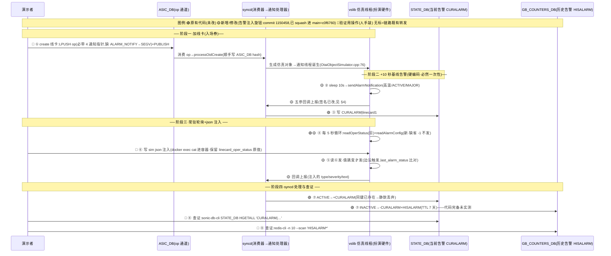

# OTN 告警链路:数据流·注入机制·验证与待办

## §1 本维度在需求中的位置

| 需求段 | 原文(摘) | 本维度对应 |
|:--|:--|:--|
| 输入 | OTAI 告警通知(产生/清除,含告警 id、对象、时间戳、严重度);厂商告警关联规则 | ✓ 前半:vslib 仿真线程扮演硬件——基线告警+json 注入旋钮,五参回调字段齐(§4②);✗ 后半:关联规则全库无实现 |
| 处理 | 写 CURALARM;清除、移出并归档 HISALARM;按关联规则做根因收敛、抑制衍生告警;经 gNMI/NETCONF notification/SNMP trap 实时上报 | ✓ 写库与北向三通道(§2 目标表 G1-G6);✗ 根因收敛/抑制衍生(§2 G8) |
| 输出 | 当前告警列表;历史告警记录;根因分析结果;符合 openconfig alarms 模型的北向告警流 | ✓ 当前列表(db6+NETCONF GET,G6);⚠️ 历史记录(写路径在、落行未单验,G2);✗ 根因结果;⚠️ openconfig 流(NETCONF 符合、gNMI native 不符合,G7) |

## §2 目标表(目标 / 状态 / 验证手段)

状态图例:✅ 已实证 · ⚠️ 部分/代码齐全未实测 · ❌ 缺

| # | 目标 | 状态 | 验证手段 |
|:--|:--|:--|:--|
| G1 | 告警产生 → 写 CURALARM(STATE_DB 六字段) | ✅(基线+注入两条入口都实测) | json 旋钮注入 → `HGETALL 'CURALARM|linecard1#LOW_TEMPERATURE_ALARM'` 六字段(§4③) |
| G2 | 告警清除 → 删 CURALARM + 归档 HISALARM(db10) | ⚠️(清除半实证:SLOT_COMM_FAIL RAISED/CLEARED 对走过删除;json 注入 INACTIVE 入口与 HISALARM 落行未单验) | 旋钮写 `alarm_status:1` → CURALARM 消失 + `redis-cli -n 10 --scan 'HISALARM*'` 落行(§4⑦ 后半段入口) |
| G3 | gNMI 实时上报 | ✅(native 路闭环;同键去重与本篇一致) | gnmic 订阅三幕(《47》) |
| G4 | NETCONF notification(SUBSCRIBE 事件流) | ✅ | ncclient 订阅收帧(《51》;56 G3 重验全绿) |
| G5 | SNMP trap | ✅(RAISED/CLEARED 两对 varbind 全对,snmptrapd 接收端实证) | snmp_verify.sh(《52》;53 G4) |
| G6 | 当前告警列表(NETCONF GET,openconfig-alarms) | ✅(三条全量返回;单测 netconf 4/4、alarm 7/7 绿) | ncclient get `/openconfig-alarms:alarms`(《50》) |
| G7 | 北向流符合 openconfig-alarms 模型 | ⚠️ 部分(NETCONF GET/SUB 符合;gNMI 本镜像只 native、树里无 alarms 模型;EVENTS 事件路待接) | 《50》§2 + 《47》§3 调研结论 |
| G8 | 根因收敛/抑制衍生告警(厂商关联规则) | ❌ 全库无实现(需求项,后续工作) | — |

---

## §3 整体数据流(先看这张图)



一句话:**加线卡是入场券,基线告警和写 DB 是出厂自带行为,轮询查 JSON 是常驻机制,改 json 是人扮演硬件,处理和查 db 看结果。**

---

## §4 逐环解释(执行者 · 文件:行数 · 签名 · 代码 · 命令 · 踩坑)

### ① 加线卡 🔵(执行者:用户;底层链路全为 🟢 原有代码)

**机制**:op 佇列(LPUSH+PUBLISH)→ syncd ASIC 消费器(lua 顺手把对象写进 ASIC_DB hash)→ `processOidCreate` → vslib 生成仿真对象 → 通知线程诞生。

```bash
# 前置:两本名字帐(作用不同,都要种)
redis-cli -n 2 HSET VID2NAME oid:0x1000000000000 linecard1                # 告警 resource 译名用
redis-cli -n 2 HSET COUNTERS_LINECARD_NAME_MAP oid:0x1000000000000 linecard1  # 采集键名用
# create
redis-cli -n 1 LPUSH ASIC_STATE_KEY_VALUE_OP_QUEUE \
  "OTAI_OBJECT_TYPE_LINECARD:oid:0x1000000000000" \
  '["OTAI_LINECARD_ATTR_LINECARD_STATE_CHANGE_NOTIFY","0xdeadbeef",\
     "OTAI_LINECARD_ATTR_LINECARD_ALARM_NOTIFY","0xdeadbeef",\
     "OTAI_LINECARD_ATTR_LINECARD_OCM_SPECTRUM_POWER_NOTIFY","0xdeadbeef",\
     "OTAI_LINECARD_ATTR_LINECARD_OTDR_RESULT_NOTIFY","0xdeadbeef"]' Screate
redis-cli -n 1 PUBLISH ASIC_STATE_CHANNEL@1 G
```

线程诞生点 —— `vslib/OtaiObjectSimulator.cpp:76`:

```cpp
// 线卡对象创建时拉起常驻通知线程(②③④⑤⑥⑦ 的活都从这条线程开始)
m_linecardNotifThread = thread(&OtaiObjectNotificationSim::sendLinecardNotifications, this, linecard_id);
```

**踩坑**:
- 4 个通知指针缺一不可——缺 ALARM_NOTIFY → 10 秒后 vslib 调空回调 → **SEGV**(core 在 /var/core)
- **对已存在线卡重复 create → syncd SIGABRT**(实测 23:26:09,create 处理后 0.8 秒)——重种前先确认对象不存在,或重启 syncd
- syncd 重启不需要重新 LPUSH:ASIC_DB hash 存活,hardReinit 自动重建线卡(实测)
- ALARM_NOTIFY 指针由 syncd 侧补填:op 里 0xdeadbeef 占位,`updateNotificationsPointers` 换成真函数——与真硬件契约同构

### ② +10 秒自触发基线告警 🟡(执行者:vslib 仿真线程)

`vslib/OtaiObjectNotificationSim.cpp:61` 🟢+🟡,签名:

```cpp
// 基线一次性告警 + 常驻轮询(③④⑤⑥ 都活在这条线程里)
[[noreturn]] void OtaiObjectNotificationSim::sendLinecardNotifications(otai_object_id_t linecard_id)
```

`vslib/OtaiObjectNotificationSim.cpp:149` 🟡,**修改**(零参数 → 五参数):

```cpp
// 按给定参数填 otai_alarm_info_t 并经注册回调上报一次(纯送信员,不做决策)
void OtaiObjectNotificationSim::sendAlarmNotification(otai_object_id_t linecard_id,
    otai_alarm_type_t alarm_type, otai_alarm_status_t alarm_status,
    otai_alarm_severity_t alarm_severity, const string& alarm_text)
```

调用点 `:66` 行为不变(高溫/ACTIVE/MAJOR/"high temperature"),但代码已改 → 归黄点。实测日志:
`sendAlarmNotification: Sending notification for linecard:oid:0x10100000001 alarm type:21 status:0 severity:6 text:'high temperature'`

**注意点**:这是「必然触发」的来源——仿真线程扮演了真硬件里"驱动检测到故障"的角色,但只会这一次;[待办] json 含 alarm_status 时应抑制它(见 docs/tmp.md)。

### ③ 写 DB 🟢(执行者:syncd 通知处理器)

`syncd/NotificationProcessor.cpp:475` 🟢,签名:

```cpp
// 解析告警 JSON,同键去重后写入 STATE_DB CURALARM
void NotificationProcessor::handler_alarm_generated(_In_ const std::string data)
```

核心语义(`:502-509`)——同键已存在 → 静默丢弃(首报为准,后续同键告警一律忽略):

```cpp
alarmstatus = m_stateAlarmable->get(keyid, vectortemp);
if (alarmstatus == true)
{
    SWSS_LOG_NOTICE("alarm already generated(%s)", keyid.c_str());
    return;                                  // ← 不重写,连 text 变了也不更新
}
...
m_stateAlarmable->set(keyid, alarmVector);   // ← 只有新键才走到这
```

resource 译名 —— `syncd/NotificationProcessor.cpp:407` 🟢:

```cpp
// rid→vid(meta 译码)→name(查 COUNTERS_DB 的 VID2NAME hash)
std::string NotificationProcessor::get_resource_name_by_rid(_In_ otai_object_id_t rid)
```

键 = `CURALARM|<resource>#<type-id>`,六字段:

| 字段 | 来源 |
|:--|:--|
| id | resource#type-id(处理器层重算) |
| time-created | 上报的 ns epoch |
| text | 上报原文 |
| severity | 上报枚举 |
| type-id | 上报枚举 |
| resource | VID2NAME 查表结果 |

**踩坑**:
- CURALARM 在 **STATE_DB=db6**——用 `redis-cli -n 2` 扫永远空(血泪实测)
- resource 译名读 **VID2NAME**,不是 COUNTERS_LINECARD_NAME_MAP(采集键名才用后者)——两张帐不同
- syncd 重启 → linecard 掉线 → 自产 SLOT_COMM_FAIL 并 **flush() 清空整表 CURALARM**(`NotificationHandler.cpp:263-305`,实测发生)

### ④ 轮询机制 🟢(执行者:vslib 仿真线程)

`vslib/OtaiObjectNotificationSim.cpp:61`(即 ② 的线程主体进入循环)+ `:95` 🟢:

```cpp
// 每 5 秒读 sim json 的线卡 oper_status,变化则发状态通知
otai_oper_status_t OtaiObjectNotificationSim::readOperStatus(string filename)
```

旧循环只管 `linecard_oper_status`;常驻、[[noreturn]]、随线卡诞生。循环体为新旧混合——**新增的注入检查插在其中(代码归 ⑤⑥,黄点)**。

### ⑤ 查 JSON 🟡(执行者:vslib 仿真线程;新增函数)

`vslib/OtaiObjectNotificationSim.cpp:120` 🟡(新增函数):

```cpp
// 读 sim json 的告警注入配置,返回 alarm_status(-1=本轮不发),带出 type/severity/text
int OtaiObjectNotificationSim::readAlarmConfig(otai_alarm_type_t& alarm_type,
        otai_alarm_severity_t& alarm_severity, string& alarm_text)
```

| json 字段 | 含义 | 缺省 |
|:--|:--|:--|
| `alarm_status` | **0=ACTIVE 1=INACTIVE 2=TRANSIENT;-1/缺省=不发** | 不发 |
| `alarm_type` | 21=HIGH_TEMPERATURE_ALARM,22=LOW_TEMPERATURE_ALARM | 21 |
| `alarm_severity` | 4=MINOR 5=WARNING 6=MAJOR 7=CRITICAL | 6 |
| `alarm_text` | 告警文本 | "high temperature" |

### ⑥ 自己改 json 🔵(用户)+ 注入发送 🟡(vslib 仿真线程)

```bash
# 注入(保留 linecard_oper_status 原值!)
echo '{"linecard_oper_status": 0, "alarm_status": 0, "alarm_type": 22, "alarm_severity": 5, "alarm_text": "injected low temperature via sim json"}' \
  | sudo docker exec -i syncd sh -c 'cat > /usr/include/vslib/otai_sim_data/otai_linecard_notification_sim.json'
```

边沿触发 —— `vslib/OtaiObjectNotificationSim.cpp:84-90` 🟡:

```cpp
// json 的 alarm_status 与上次已发值比较,跳变才发
int cfg_status = readAlarmConfig(cfg_type, cfg_severity, cfg_text);
if (cfg_status >= 0 && cfg_status < OTAI_ALARM_STATUS_MAX && cfg_status != last_alarm_status) {
    sendAlarmNotification(linecard_id, cfg_type, (otai_alarm_status_t)cfg_status, cfg_severity, cfg_text);
    last_alarm_status = cfg_status;
}
```

实测证据(23:33:07):

```
sendAlarmNotification: ... alarm type:22 status:0 severity:5 text:'injected low temperature via sim json'
handler_alarm_generated: ALARM generated key:linecard1#LOW_TEMPERATURE_ALARM
```

**踩坑**:
- 写 json 必须保留 `linecard_oper_status` 原值,否则顺带触发线卡状态通知(副作用)
- **线程存活探针**:写一份坏 json,若 syslog 12 秒内不刷 "Failed to parse" → 线程已死(轮询读文件是活的证明);实测线程随 syncd 进程生死
- 复位 = 把 alarm_status 字段拿掉(json 只留 oper_status)→ 回到静默

### ⑦ syncd 处理 🟢(执行者:syncd 通知处理器;-STATE, +HISTORY)

INACTIVE 清除 —— `syncd/NotificationProcessor.cpp:532` 🟢:

```cpp
// INACTIVE 清除:补 time-cleared、封存 HISALARM、删 CURALARM
void NotificationProcessor::handler_alarm_cleared(_In_ const std::string data)
```

封存 —— `syncd/NotificationProcessor.cpp:522` 🟢:

```cpp
// 写 db10 HISALARM(键 <id>#<time-cleared>,TTL 7 天)
void NotificationProcessor::handler_history_alarm(...)
```

- HISALARM 表所在:HISTORY_DB_NAME="GB_COUNTERS_DB"=**db10**(`schema-ot.h:10`)
- ACTIVE 分支见 ③(插入/去重);TRANSIENT 走事件路径(路由点 `:395-399`)
- **注意**:INACTIVE 链代码完备但**未实测**——旋钮写 `alarm_status:1` 即可驱动(后半段验证入口)

### ⑧ 查 db 验证 🔵(执行者:用户)

```bash
sonic-db-cli STATE_DB KEYS 'CURALARM*'                              # 列表
sonic-db-cli STATE_DB HGETALL 'CURALARM|linecard1#LOW_TEMPERATURE_ALARM'   # 单条全字段
redis-cli -n 6 --scan --pattern 'CURALARM*'                          # 等价(n 6 = STATE_DB)
redis-cli -n 10 --scan --pattern 'HISALARM*'                         # 清除记录(db10!)
```

**踩坑**:是 **db6**;`redis-cli -n 2` 是 COUNTERS_DB,扫 CURALARM 永远空(实测浪费一轮的教训)。实测六字段:

```
id          linecard1#LOW_TEMPERATURE_ALARM
time-created 1792798387431506715
text        injected low temperature via sim json
severity    WARNING
type-id     LOW_TEMPERATURE_ALARM
resource    linecard1
```

---

## 修订历史

| 日期 | 内容 |
|:--|:--|
| 2026-11-10 | 补 §1 需求定位表与 §2 目标表(G1-G8,样式参照《53》):北向三通道/GET 全绿 ✅,清除与 openconfig 模型 ⚠️,根因收敛 ❌;原 §1/§2 顺延为 §3/§4,§4 内部引用同步;§4 首个标题重复「②」笔误已修。 |
| 2026-11-10 | §1 ASCII 改 mermaid 时序图(样式参照《53》§3/《45》§1.1):participant 具名,Note over 分四阶段,环号 ①-⑧ 与 §2 对齐(修 §2 首个标题重复「②」笔误);基线告警必然性溯源代码(OtaiObjectNotificationSim.cpp:61-66 硬编码 sleep 10s→send);图例 commit 注记 1150458 已 squash 进 main=c0f6760。 |
