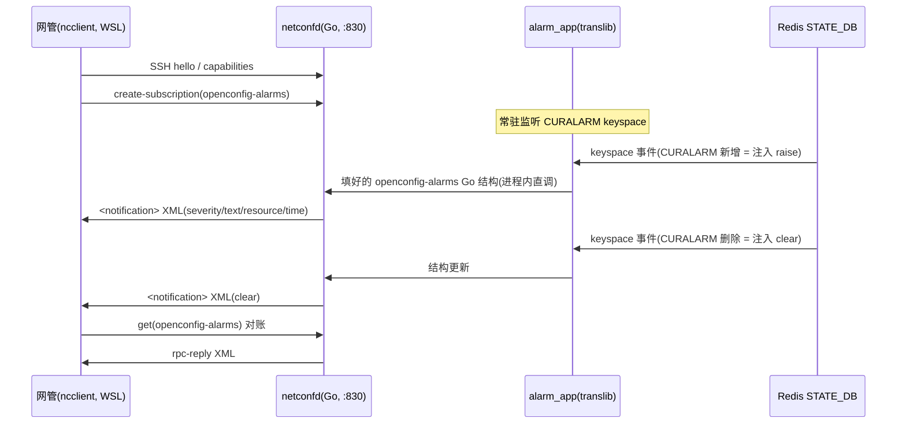

# 告警上报 NETCONF 三大方案对比与推荐

---

## §1 背景与问题

**问题一句话**:OTAI 告警已经能走 gNMI 上报网管(doc 47);本篇回答「NETCONF 通道怎么做」,并从三个可行方案里选一个。

**先解释三个词**(后文反复出现):

| 术语 | 白话解释 |
|:--|:--|
| NETCONF | 网管和设备之间的标准「对话协议」:走 SSH(830 端口),说的内容是 XML,XML 长什么样由 YANG 模型(结构说明书)约束。类比:传真机——网管发一张规定格式的表格过来,设备回一张同样格式的表格 |
| translib | SONiC 管理面的「翻译中间层」(Go 写的库):把管理请求翻译成 Redis 数据库读写,是所有北向协议(CLI/REST/gNMI)共用的翻译员。我们的告警翻译逻辑(alarm_app)就写在这一层 |
| ygot / ocbinds | OpenConfig 模型自动生成的 Go 结构体代码——告警的每个字段(严重度/对象/文本)在 Go 里都有对应的「格子」,填好格子就能序列化成 JSON 或 XML |

**已查证的事实(决定方案格局)**:SONiC 生态**没有任何现成的 NETCONF server**——三案都不是「移植现成的」,而是「组装/自研」:

| 查证处 | 结果 |
|:--|:--|
| 本 fork 的 `src/sonic-mgmt-framework` | 全部历史无 `netconf/` 目录 |
| 上游 sonic-net/sonic-mgmt-framework(master 和 202012 老 release 分支) | 同样没有 |
| 上游 sonic-net/sonic-mgmt-common(新版架构层) | 同样没有 |
| VM 实测 | mgmt-framework 容器只跑 rest_server(:443),无 :830 监听 |

**三案共用的地基(无论选哪个都一样)**:CURALARM 数据源(syncd 已在写)、openconfig-alarms.yang 模型文件(OpenConfig 公开标准,引入即可)、告警语义翻译的概念(六字段 → YANG 结构)、ncclient(网管侧测试客户端)。**差异只在一处:协议壳和翻译层放在哪个进程、用什么语言。**

## §2 三案总图

```
方案一(Go 自研)      方案二(半 C 桥)         方案三(全 C)
┌─────────────┐    ┌──────────┬────────┐   ┌─────────────┐
│ netconfd(Go)│    │netopeer2 │ 桥接器  │   │ 全 C 进程    │
│ SSH+RPC壳   │    │(C,协议壳)│(自设计) │   │ SSH+RPC壳   │
│ XML 序列化  │    │ XML转换  │ 线路协议 │   │ XML转换      │
│ alarm_app   │    └────┬─────┴───┬────┘   │ 语义翻译(C) │
│ (进程内直调)│         │◄─跨语言桥─►│       └──────┬──────┘
└──────┬──────┘         │         │(Go translib) │ 直读 redis
       │ 进程内直调       │         └── translib   (绕开 translib)
       ▼                ▼             ▼             ▼
   ════════════════ Redis STATE_DB CURALARM ════════════════
        自写部分:  方案一=协议壳  方案二=整座桥  方案三=语义翻译
```

## §3 方案一:Go 自研协议壳(推荐)

### 做法

一个 Go 进程(netconfd)装四层,其中只有一层是自己写的:

```
netconfd(一个 Go 进程,:830)
 ├─ SSH 层(:830)          ← golang.org/x/crypto/ssh,现成
 ├─ NETCONF RPC 壳         ← 自写约 600–1000 行:管协议封包和会话,
 │                            不碰告警内容(hello/get/订阅/推送)
 ├─ XML 序列化             ← ygot/ocbinds,现成(填好的 Go 结构体 → XML)
 └─ alarm_app(translib)   ← 进程内直接调用,监听 CURALARM 变化
```

「RPC 壳」解释:网管发来 `<rpc>` 请求,壳负责认出「这是要数据还是要订阅」,转手交给 alarm_app;alarm_app 有新告警,壳负责包成 `<notification>` 帧发给网管。类比:前台接待员——只管收发和登记,不管信里写什么。

### 好处

| # | 好处 | 说明 |
|:--|:--|:--|
| 1 | 零跨语言桥 | alarm_app 和协议壳在同一个进程,函数直接调用 |
| 2 | 告警语义只写一次 | 同一份 alarm_app 将来同时服务 REST(现成 :443)和 NETCONF |
| 3 | 依赖最轻 | 全部 Go 生态现成件,不动 debian 构建链 |
| 4 | 与现有架构同构 | rest_server 也是「Go + translib 进程内」的形态,维护心智一致 |

### 代价

| # | 代价 | 说明 |
|:--|:--|:--|
| 1 | 协议合规性自负 | RFC 6241/6242/5277 细节多,子集之外的操作(validate/unlock/YANG-Push 全量)不支持;合规由 ncclient 测试当裁判 |
| 2 | 协议壳是自己的代码 | 长期维护、踩坑(如 SSH subsystem 细节)都归自己 |
| 3 | 接重型电信 NMS(ODL 级)时可能要补功能 | 子集设计预留扩展点即可,非推倒重来 |

## §4 方案二:半 C 桥(netopeer2 + 桥接 translib)

### 做法

两个进程:netopeer2(C 写的开源标准 NETCONF server)管协议和 XML;中间架一座「桥」把请求转给 Go 的 translib:

```
网管 ──SSH──▶ netopeer2(C,协议壳现成)──桥(自设计)──▶ translib + alarm_app(Go)
                     ◀──────── 双向异步:告警事件要 Go 主动推给 C ────────▶
```

为什么必须有桥:translib 是 Go 库,**C 程序没法直接调用 Go 函数**。现实做法只有单独跑一个 Go 服务,自己设计一套线路协议(或用 gRPC),两端各写序列化;而且 DB 告警事件是 Go 主动推给 C 的,桥是**双向异步**的,两边各持一份会话状态要同步。

### 好处

| # | 好处 | 说明 |
|:--|:--|:--|
| 1 | 协议壳是标准现成件 | netopeer2 经过大量生态验证,兼容性风险低 |
| 2 | 告警语义只写一次(仍在 Go) | translib 复用成功的话 |

### 代价

| # | 代价 | 说明 |
|:--|:--|:--|
| 1 | **桥要整套自设计** | translib 的 C 客户端在工作区零命中(实测 grep),没有可参考的实现;协议设计+两端序列化+状态同步+进程守护,成本很可能超过协议壳本身 |
| 2 | 两头缺点都占 | 既要养 C 依赖链(libyang2/libnetconf2/sysrepo 进 debian 构建),又要养自设计的桥 |
| 3 | 多一个有状态 C 服务 | sysrepo datastore 与 translib 两套数据状态需保持一致 |

类比:请了专业翻译公司(协议壳很好),但他们和公司内部系统之间没有现成的传真协议——你得自己发明一套传真格式,还要保证双向不丢件。

## §5 方案三:全 C(libnetconf2 + 直读 Redis,绕开 translib)

### 做法

一个自包含的 C 进程,完全不经手 translib:

```
全 C 进程
 ├─ hiredis(C 的 redis 客户端,现成)直订 CURALARM keyspace
 ├─ 告警语义翻译(六字段 → openconfig-alarms 结构)  ← 用 C 重写一遍!
 ├─ libyang(现成)把结构转成 XML
 └─ libnetconf2(现成)协议壳 + SSH :830
```

### 好处

| # | 好处 | 说明 |
|:--|:--|:--|
| 1 | 无跨语言桥 | 进程自包含,hiredis 现成 |
| 2 | 协议壳现成 | libnetconf2 是标准件,兼容性风险低 |

### 代价

| # | 代价 | 说明 |
|:--|:--|:--|
| 1 | **告警语义写两遍** | Go alarm_app 一份(服务 REST/未来 gNMI 扩展)、C 版一份(服务 NETCONF),两处维护、两处测试、必然漂移 |
| 2 | 绕开 translib 单一真相 | 违背 SONiC 管理面「所有北向协议共享一个 app 层」的架构原则 |
| 3 | C 依赖链进构建 | libyang/libnetconf2 打包进 debian 流程,长构建成本 |

类比:两个部门各自维护一本客户名册——平时各自能干活,但客户改了地址,总有忘记同步的一天。

## §6 成本总表

| 维度 | 方案一 Go 自研 | 方案二 半 C 桥 | 方案三 全 C |
|:--|:--|:--|:--|
| 协议壳(RFC 6241/5277) | 自写 ~600–1000 行 Go | 现成(netopeer2) | 现成(libnetconf2) |
| 告警语义翻译 | **一次**(Go) | 一次(Go)——但桥两端封包代码 Go/C 各一份(计入下一行) | NETCONF 内一次(C);REST 通道仍需 Go 版 → 系统合计两处 |
| 跨语言桥 | 无 | **自设计全套**(双向异步,封包代码 Go/C 各一份) | 无 |
| 新增依赖 | Go 现成件(x/crypto/ssh、ygot) | libyang2+libnetconf2+sysrepo 进构建链 | libyang+libnetconf2 进构建链 |
| 架构一致性 | 与 rest_server 同构 | 多一个有状态 C 服务 | 绕开 translib |
| 协议合规风险 | 自负(ncclient 当裁判) | 低 | 低 |
| 量级 | 天级~一周 | 周级以上 | 周级 |

## §7 推荐与理由

**推荐:方案一(Go 自研协议壳)。**

三条决定性理由:

1. **方案二出局于桥**:translib 没有 C 客户端(实测),整座桥要从零发明——最贵的部件恰恰是方案二的独有负担;
2. **方案三出局于语义重写**:NETCONF 内虽只写一次(C),但 REST 通道的 Go 版仍在 → 告警语义系统合计两处,是长期漂移的根源;省下的协议壳(~几百行 Go)抵不过两套逻辑的维护;
3. **方案一与现有架构同构**:alarm_app 写一次,REST(:443,现成)先验证,NETCONF 再接上——将来任何新协议出口都能复用同一个 app,这正是 SONiC 管理面自己的设计哲学。

**选它也要吞的代价(诚实声明)**:NETCONF 合规性由我们自付,靠 ncclient 严格测试兜底;子集之外的 RFC 操作先不支持,未来接重型 NMS 出现缺口再补。

**推荐落地顺序**(细节另出 plan):

1. alarm_app 先写,经 REST :443 对账验证(省一次编译迭代);
2. netconfd 接上同一个 alarm_app,:830 起来,capabilities 通;
3. 订阅+notification 打通,`netconf_alarm_demo.sh`(WSL,ncclient)端到端演示。

推荐路线端到端时序(订阅后注入一枪告警):



仓库纪律:代码落在 `src/sonic-mgmt-framework` 新分支 `tom-wsl`(基线 `otn_pre_202411`,父仓库原则一致)。
