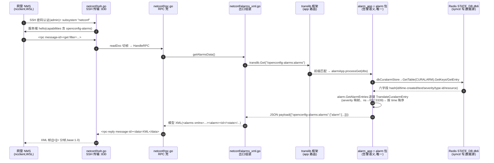

# NETCONF 告警 GET 处理链路(网管查询 → 模型 XML)

---

## §1 整体数据流全景图



一句话:**ncclient 是入场券,ssh/rpc 两层只管信封,翻译语义只在 alarm 包写一次,数据永远是 syncd 写下的那六字段。**

## §2 逐环解释(执行者 · 文件:行数 · 签名 · 意图 · 踩坑)

### ① NMS 建链 🟡(执行者:ncclient,WSL)

`ncclient 0.7.1 transport/ssh.py connect`:

```python
m = manager.connect(host="localhost", port=1830, username="admin",
                    password="YourPaSsWoRd", hostkey_verify=False,
                    allow_agent=False, look_for_keys=False)
```

内部序列:paramiko TCP 连隧道(1830→VM:830)→ SSH 握手 → **密码认证**(设备侧 `ssh.go PasswordCallback` 校验 admin/env 密码)→ `open_channel("session")` + `open_subsystem("netconf")`(RFC 6242)→ 读设备 hello(`<capabilities>` 三项)→ ncclient 发自己的 hello → 会话就绪。

**踩坑**:
- `hostkey_verify=False`:netconfd host key 是进程内临时生成,演示形态
- `allow_agent/look_for_keys=False`:禁密钥探测,纯密码路径,排除环境干扰
- 本地端口 1830:WSL 829–831 属 Windows 保留端口段(bind Permission denied)

### ② NMS 发 GET、等回执 🟡(执行者:ncclient)

```python
r = m.get(filter=("xpath", "/openconfig-alarms:alarms"))
```

内部序列:ncclient 组帧 `<rpc message-id="ncclient_xxx"><get><filter type="xpath" select="..."/></get></rpc>` → subsystem 通道写出 + `]]>]]>`(base:1.0)→ **阻塞等 `<rpc-reply>`**,按 `message-id` 配对 → `r.data_xml`。

**踩坑**:
- 回包必须带回同 `message-id`(netconf/rpc.go 的 `rpcDataReply` 已保证),否则 ncclient 永久等待
- xpath filter 只是建议——netconfd 子集实现**忽略 filter 返回全表**(子集边界,见 §3)

### ③ SSH 传输层 🟡(执行者:netconf/ssh.go)

`src/sonic-mgmt-framework/netconf/ssh.go:29`:

```go
// 起 :830 SSH server;演示级密码认证(admin/NETCONF_PASSWORD env);
// host key 进程内临时生成(ncclient hostkey_verify=false 即可)
func ServeSSH(port int) error
```

`ssh.go:77 handleConn` → `:106 netconfSession`:等 `subsystem "netconf"` 请求 → 先发服务端 hello → 循环 `readDoc`(`:148`,按 `]]>]]>` 切帧,base:1.0)→ `HandleRPC` → `sendDoc`(`:169`)回帧。

**踩坑**:
- x/crypto 2020 版(vendored)没有 `ssh.MarshalPrivateKey` —— 用 `ssh.NewSignerFromKey(ed25519 私钥)` 直生 signer
- WSL 侧 829–831 落在 Windows 保留端口段(镜像网络),隧道本地端口改用 1830
- VM host 运行时依赖 `libyang.so.1`(CGO)——SONiC host 的 FRR 自带,无需额外安装(实测 `ldd` 通过)

### ④ RPC 壳 🟡(执行者:netconf/rpc.go)

`src/sonic-mgmt-framework/netconf/rpc.go:73`:

```go
// 解析一帧文档:hello → 回 capabilities;rpc → 按 operation 分发;
// 不碰告警内容;未知操作回 rpc-error(operation-not-supported)
func HandleRPC(s *Session, doc []byte) (resp []byte, closeConn bool, err error)
```

capabilities 三项(`rpc.go:20` 附近):`base:1.0`、`notification:1.0`(T8 用)、`openconfig-alarms` 模型 URI;只声明 base:1.0,帧格式因此锁定 `]]>]]>`(简化 1.1 chunk 分帧)。

**踩坑**:
- capability URI 里的 `&` 必须转义 `&amp;`,否则网管侧 lxml 解析直接炸(`EntityRef: expecting ';'`)——单测断言同步锁定转义后形态
- 具名返回值 `close` 遮蔽内建,`go vet` 报 "close (built-in) must be called" —— 改名 `closeConn`
- get/get-config 分支调 `getAlarmsData()`(函数变量,单测可 override)

### ⑤ 出口组装 🟡(执行者:netconf/alarms_xml.go)

`src/sonic-mgmt-framework/netconf/alarms_xml.go:22`:

```go
// 生产:translib.Get(进程内调 alarm_app)→ JSON payload → 模型 XML
var getAlarmsData = func() ([]byte, error)
```

`alarms_xml.go:43 alarmsJSONtoXML`:JSON → 模型忠实 XML —— `list alarm` 键为 `id`(= `resource#type-id`),数据在 `state/` 容器下(id/resource/text/time-created/severity/type-id);`time-created` 模型类型 `oc-types:timeticks64`(ns 整数),由 RFC3339 回转 ns。

**踩坑**:
- ocbinds 未含 alarms 结构(构建重生成未接线)→ 不走 ygot binding,手写组装;ygot 迁移列为后续
- RFC3339 秒级精度回转 ns 会丢亚秒(已知,暂受)

### ⑥ translib 路由 🟢(执行者:translib 框架)

`src/sonic-mgmt-common/translib/translib.go:449 Get(req)` → `app_interface.go:146 getAppModuleInfo(path)`:按**前缀匹配**找注册的 app;`alarm_app.go` 的 `init()` 已注册 `/openconfig-alarms:alarms`(`app_interface.go:115 register`)。

**踩坑**:路径必须与注册串完全同前缀;`GetRequest.AuthEnabled=false` 时跳过授权检查(演示形态)。

### ⑦ alarm_app processGet 🟡(执行者:translib/alarm_app.go)

`src/sonic-mgmt-common/translib/alarm_app.go:126`:

```go
// 组 dbCuralarmStore → alarm.GetAlarmEntries → JSON payload
func (app *alarmApp) processGet(dbs [db.MaxDB]*db.DB, fmtType TranslibFmtType) (GetResponse, error)
```

注册形态 `isNative: true`(无 ygotRootType)——payload 即裸 JSON(照 `nonyang_app.go.demo` 先例),绕开 ocbinds 依赖。

### ⑧ 翻译纯函数 🟡(执行者:translib/alarm 包)

`src/sonic-mgmt-common/translib/alarm/store.go:28`:

```go
// 扫全表 → 逐键翻译 → 坏条目跳过 → time-created 降序
func GetAlarmEntries(st CuralarmStore) ([]map[string]interface{}, error)
```

`translate.go:27 TranslateCuralarmEntry`:severity 直通映射(WARNING/MINOR/MAJOR/CRITICAL,越界 → UNKNOWN);`time-created` ns → RFC3339,缺失即报错。**语义只在这一处**,REST/NETCONF 两出口共享。

**踩坑**:translib 主包传递依赖 cvl→antchfx(版本漂移,独立编译即红)→ 纯函数放独立子包,单测免 redis。

### ⑨ db 适配 🟡(执行者:alarm_app.go 内 dbCuralarmStore)

`src/sonic-mgmt-common/translib/alarm_app.go:102/118`:

```go
// 把 translib/db 包装成 alarm.CuralarmStore 接口(Keys/HGetAll)
func (s *dbCuralarmStore) Keys() ([]string, error)
func (s *dbCuralarmStore) HGetAll(key string) (map[string]string, error)
```

底层 `db.GetTable(&TableSpec{Name:"CURALARM"}).GetKeys()` + `db.GetEntry(...)`;STATE_DB = db6(`db.go:142`)。

### ⑩ 数据源 🟢(执行者:syncd,已有)

`CURALARM|<resource>#<type-id>` 六字段(doc 46 §2③ 契约):`id/time-created/text/severity/type-id/resource`。本链路对它**只读**。

## §3 职责分工表(改哪里 = 改什么)

| 层 | 文件 | 管 | 不管 |
|:--|:--|:--|:--|
| SSH 传输 | netconf/ssh.go | 连接/认证/帧 | 告警内容 |
| RPC 封包 | netconf/rpc.go | RFC 6241 信封 | 告警语义 |
| 出口组装 | netconf/alarms_xml.go | JSON→XML | 数据来源 |
| app 路由 | translib 框架 | path→app | 翻译 |
| 告警语义 | translib/alarm 包 | 六字段→YANG 结构 | 协议 |
| 数据源 | Redis db6 | 存储 | 逻辑 |

## §4 NMS 侧(ncclient Python)——你自己的角色

网管侧没有特殊服务,就是一个 **ncclient(Python NETCONF 客户端库)** 进程:连 SSH → 交换 hello → 发 get → 解析 XML。以下是完整可跑的消费端:

**前置两件**:

```bash
python3 -m pip install --user --break-system-packages ncclient   # 库(0.7.1 实测)
# 隧道(WSL 829–831 属 Windows 保留端口段,本地端口用 1830)
ssh -f -N -L 1830:localhost:830 -p 2222 admin@localhost
```

**连接 + GET + 渲染告警表**:

```python
from ncclient import manager
from lxml import etree

m = manager.connect(
    host="localhost", port=1830,      # 1830 = WSL 隧道 → VM :830
    username="admin",
    password="YourPaSsWoRd",          # netconfd PasswordCallback 校验
    hostkey_verify=False,             # 演示:netconfd host key 为进程内临时生成
    allow_agent=False,                # 禁 ssh-agent/密钥探测,纯密码
    look_for_keys=False)

r = m.get(filter=("xpath", "/openconfig-alarms:alarms"))

NS = "{http://openconfig.net/yang/alarms}"
root = etree.fromstring(r.data_xml)   # r.data_xml = <data> 内的 XML 字符串
print(f"{'SEVERITY':10}| {'RESOURCE':12}| TEXT")
for alarm in root.iter(NS + "alarm"):
    rid  = alarm.findtext(NS + "id")
    sev  = alarm.findtext(NS + "state/" + NS + "severity")
    res  = alarm.findtext(NS + "state/" + NS + "resource")
    txt  = alarm.findtext(NS + "state/" + NS + "text")
    print(f"{sev:10}| {res:12}| {txt}   [id={rid}]")
m.close_session()
```

**参数/返回值速查**:

| 项 | 值 | 对应设备侧 |
|:--|:--|:--|
| port | 1830(隧道)| netconfd `:830` |
| 认证 | admin + 密码 | `ssh.go PasswordCallback`(env `NETCONF_PASSWORD` 可覆盖) |
| capabilities | base:1.0 / notification:1.0 / openconfig-alarms | `rpc.go buildHello` |
| `r.data_xml` | `<data><alarms>...` 模型 XML | `alarmsJSONtoXML` 组装(§2③) |
| 命名空间 | `http://openconfig.net/yang/alarms` | openconfig-alarms.yang 模型 |

真 NMS(GUI 告警台)做的事一模一样:同一份 XML,渲染成表格/配色/确认流程而已。

## §5 验证

一键脚本(注入 raise → ncclient GET → DB 对账):

```bash
./scripts/netconf_get_verify.sh
```

手动复现(最小版,见 §4 完整消费端):

```python
from ncclient import manager
m = manager.connect(host="localhost", port=1830, username="admin",
                    password="YourPaSsWoRd", hostkey_verify=False,
                    allow_agent=False, look_for_keys=False)
r = m.get(filter=("xpath", "/openconfig-alarms:alarms"))
print(r.data_xml)   # 对照: ssh VM "redis-cli -n 6 --scan --pattern 'CURALARM*'"
```

实测证据(2026-10-30):三条告警全量返回,`text=netconf get verify`/`severity=WARNING` 与 `sonic-db-cli HGETALL` 一致;单测 `go test ./netconf/ 4/4 绿`、`./translib/alarm 7/7 绿`。
