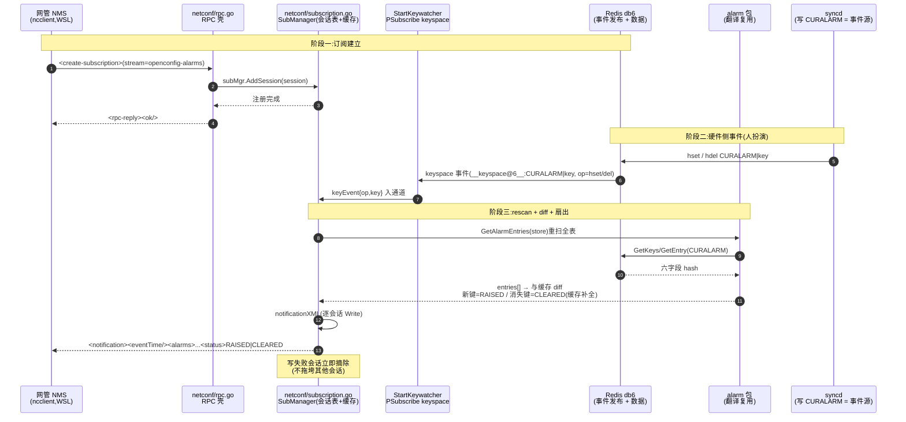

# NETCONF 告警 SUBSCRIBE 处理链路(create-subscription → notification 推送)

---

## §1 整体数据流全景图



一句话:**create-subscription 只是登记,事件源是 redis keyspace,翻语义复用 GET 的 alarm 包,diff 缓存定 RAISED/CLEARED,坏会话写崩就摘。**

## §2 逐环解释(执行者 · 文件:行数 · 签名 · 意图 · 踩坑)

### ① NMS 订阅 🟡(执行者:ncclient,WSL)

```python
m.create_subscription()   # RFC 5277:<create-subscription>
```

发 `<create-subscription xmlns="urn:ietf:params:xml:ns:netconf:notification:1.0"/>` → 等 `<ok/>` → 之后同一 SSH 通道上等 `<notification>` 帧。

**踩坑**:
- ncclient 0.7.1 的 `create_subscription()` **不收 `stream=` 关键字参数**(TypeError)——无参调用即可
- 本实现忽略 stream 名:注册即收所有 alarm 通知(单流子集)

### ② 会话注册 🟡(执行者:netconf/rpc.go:105 + subscription.go:47)

`src/sonic-mgmt-framework/netconf/rpc.go:105`:

```go
case rpc.CreateSubscription != nil:
    subMgr.AddSession(s)            // 会话进表(subscription.go:47)
    return rpcOKReply(rpc.MsgID), false, nil
```

`Session.Write` 就是该会话的 SSH 发送函数——推送即"往这条 SSH 流写一帧"。

### ③ 事件源 🟢(执行者:syncd,已有)

syncd 写 CURALARM:hset(告警上报/同键去重静默)与 hdel(清除,INACTIVE→删表)。这就是事件的唯一来源——**netconfd 自己不产生告警**。

**踩坑**:同键重复上报被 syncd 静默去重(doc 46 §2③)→ 不产生 hset → 不触发通知(与 gNMI 行为一致)。

### ④ redis 事件发布 🟢(执行者:redis-server,配置已有)

`notify-keyspace-events = AKE`(实测 `CONFIG GET`)→ hash 写入/删除发 `__keyspace@6__:CURALARM|<key>` 事件(频道名含 db 号与完整键)。

**踩坑**:
- 验证事件存在要用 **PSUBSCRIBE**(模式匹配);`SUBSCRIBE "__keyspace@6__:CURALARM*"` 订阅的是**字面频道名**,永不匹配——第一版探测脚本因此误判"无事件"
- SONiC 默认已开(KEA,swss 依赖);变更需 `CONFIG SET` 且重启失效,确认以 `CONFIG GET` 为准

### ⑤ keywatcher 🟡(执行者:netconf/subscription.go:133)

```go
// glob 模式必须 PSubscribe(SUBSCRIBE 是精确频道名)——实测踩坑①
sub := rc.PSubscribe(ctx, "__keyspace@6__:CURALARM*")
// Receive 首帧 = *Subscription 确认(跳过);其后 *Message{Channel, Payload}
// Channel 剥前缀 "__keyspace@6__:CURALARM|" → 裸键;Payload = hset/hdel/del/unlink
// → keyEvent 入通道(满则丢,记 Warning)
func StartKeywatcher(events chan<- keyEvent, redisAddr string)
```

**踩坑**:
- go-redis v9 统一返回 `*redis.Message`,**没有 `PMessage` 类型**(v7 才有)——类型断言写 PMessage 编译错
- `redisAddr` = `localhost:6379`(VM host 单实例,STATE_DB 所在);`db.NewDB` 裸 Options 会炸(见 ⑥ 前置)

### ⑥ 重扫全表 🟡(执行者:subscription.go:69 onEvent → alarm 包)

```go
// subscription.go:69 onEvent:收到事件 → 全表重扫(不是增量)
entries, err := alarm.GetAlarmEntries(m.store)   // 复用 GET 同一翻译(store = translib.NewCuralarmStore())
```

store 来自 `translib.NewCuralarmStore()`(`alarm_app.go:130`)——**必须显式 `TableNameSeparator/KeySeparator = "|"`**:裸 `db.Options{DBNo: db.StateDB}` 分隔符为空串,`redis2key` 按 "" 分裂产生垃圾键(实测报 `Entry does not exist: CURALARMU`)。

**踩坑**:事件驱动 + 全表重扫是刻意选择——逻辑零新增(复用 GET 翻译),代价是每次事件一次全表读(告警表小,可接受)。

### ⑦ 缓存 diff:RAISED / CLEARED 🟡(执行者:subscription.go:69 内)

```go
now := 资源#类型 → entry
for now 中有、缓存无  → push(RAISED)     // 新告警
for 缓存有、now 中无  → push(CLEARED)    // 告警清除
m.cache = now
```

**踩坑**:redis 的 `del` 事件**不携带内容**——CLEARED 通知的字段靠**缓存里的上次条目补全**(gNMI delete 表级粒度教训在这里的解法);进程重启缓存为空 → 清除类事件无通知(首次状态靠 GET 对账,与 gNMI 快照语义对齐)。

### ⑧ 通知组帧 🟡(执行者:subscription.go:114 notificationXML)

```go
// RFC 5277:<notification><eventTime/><payload>;status 仅通知携带(GET 的 XML 无此叶)
func notificationXML(e map[string]interface{}, status string) ([]byte, error)
```

帧形:`<notification xmlns=".../notification:1.0"><eventTime>RFC3339</eventTime><alarm><id>/<state>/{...<status>RAISED|CLEARED}</state></alarm></notification>`;text 内 `&<>` 转义;`time-created` RFC3339 → ns 整数(timeticks64)。

### ⑨ 扇出与摘除 🟡(执行者:subscription.go:99 push)

```go
// 逐会话 Write;失败立即从会话表摘除(下一事件起不再打扰)
for id, s := range m.sessions { if err := s.Write(frame); err != nil { delete(...) } }
```

**踩坑**:NMS 进程退出后的僵尸会话——第一次写失败才暴露(实测:ncclient 40s 窗口退出后,残留会话在下一次事件时 `write failed, removing`)。

### ⑩ NMS 收帧 🟡(执行者:ncclient)

```python
n = m.take_notification(block=True, timeout=60)
print(n.notification_xml)
```

ncclient 监听线程按 `<notification>` 根标签分发进通知队列;`create-subscription` 的 `<ok/>` 走 rpc-reply 路径,与通知互不干扰(实测 debug 日志:"dispatching message to listener: NotificationHandler")。

## §3 职责分工表

| 层 | 文件 | 管 | 不管 |
|:--|:--|:--|:--|
| NMS 订阅/收帧 | ncclient | RFC 5277 客户端 | 语义 |
| 订阅注册 | netconf/rpc.go | 会话登记 | 事件 |
| 事件源 | syncd + redis | CURALARM 写/删 + 事件发布 | 消费 |
| 监听 | netconf/subscription.go:133 | keyspace→事件通道 | 翻译 |
| diff 与扇出 | netconf/subscription.go:69/99 | RAISED/CLEARED 判定、推送 | 协议封包 |
| 翻译 | translib/alarm 包 | 六字段→YANG | 事件 |

## §4 NMS 侧(订阅消费端 Python,完整可跑)

```python
from ncclient import manager
m = manager.connect(host="localhost", port=1830, username="admin",
                    password="YourPaSsWoRd", hostkey_verify=False,
                    allow_agent=False, look_for_keys=False)
m.create_subscription()                      # RFC 5277(无参)
while True:
    n = m.take_notification(block=True, timeout=60)
    print(n.notification_xml)                # <notification>...<status>RAISED|CLEARED...
```

真 NMS:同一帧 → 更新告警表行(新增=RAISED 着色/移除=CLEARED 灰化)。

## §5 验证(2026-10-30 实测)

```bash
# 终端 1(WSL):订阅挂起 60 秒
python3 /tmp/opencode/ncclient_sub.py 60     # create_subscription → take_notification 循环
# 终端 2(VM):注入 raise / clear(照 doc 46 旋鈕)
```

实测证据:
- netconfd 日志:`keywatcher: psubscribed` → `event op=hset key=linecard1#...` → `rescan done, 3 entries`
- ncclient 收帧:RAISED 帧(text=netconf sub raise/WARNING)与 **CLEARED 帧(text 由缓存补全 + status=CLEARED)**
- 摘除:僵尸会话 `write failed, removing`(实测日志)
- 单测:`go test ./netconf/` 7/7 绿(含 4 个订阅用例)

**遗留**:进程重启后缓存为空,清除类事件首推缺失(靠 GET 对账补);stream 名未实现过滤(单流)。