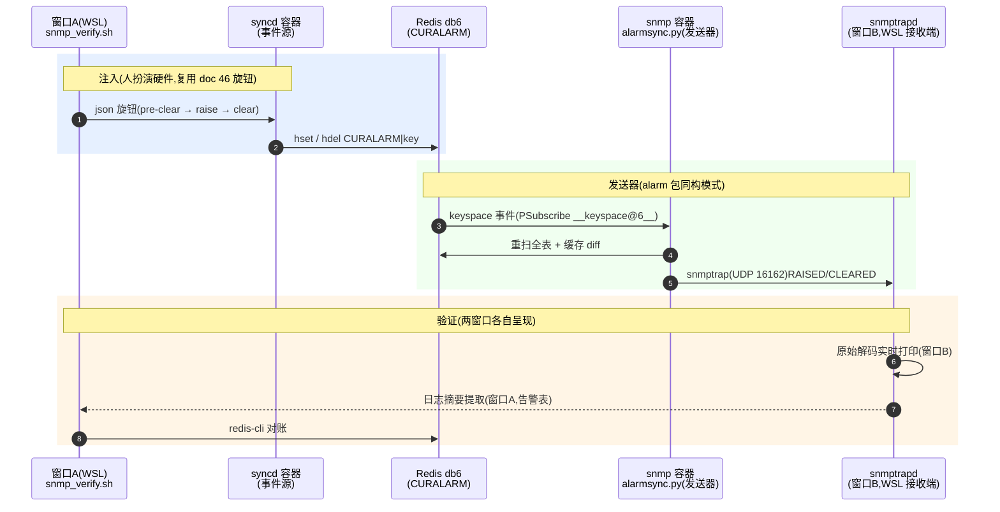

# SNMP 告警通道操作手册(两窗口验证)

---

## §1 整体数据流全景图



图例:蓝=注入(人扮演硬件)· 绿=发送器(复用 alarm 包语义模式)· 黄=验证呈现。一句话:**窗口 B 看原始 trap,窗口 A 看告警表与对账——注入序列由脚本自动完成。**

## §2 逐环解释(执行者 · 文件:行数 · 命令 · 预期输出 · 踩坑)

### ① 接收端启动 🟡(执行者:WSL 窗口 B,常驻)

```bash
# /etc/snmp/snmptrapd.conf 最小形态(一行,多余形式会解析炸)
authCommunity log public
sudo snmptrapd -f -Lf /tmp/opencode/snmptrapd.log udp:16162
```

`-Lf`(直接写文件)而非 `-Lo`(写 stdout):**前台/后台、窗口/tail -f 四种形态下日志与摘要脚本永远一致**;端口 16162 避特权端口(162<1024)与 WSL 保留段(829–831)。

预期:静默常驻;有 trap 到达时,`tail -f` 或直接查看日志文件可见原始解码。

**踩坑**:
- 配置写 `authCommunity log,execute public`(逗号形式)在 net-snmp 5.9.4 解析炸(`cannot resolve IPv4 source hostname`)——用空格分隔形式
- 默认端口 162 与系统 snmpd 冲突(`errno 98`)——显式指定 16162
- 已有后台实例占着端口时再起会报 `errno 98`——先 `ss -ulnp | grep 16162` 查占者,沿用或 pkill

### ② 脚本预检 🟡(执行者:scripts/snmp_verify.sh:26)

`scripts/snmp_verify.sh:26`:

```bash
# 五连检:VM 可达 / snmp 容器 Up / 容器内 alarmsync RUNNING /
# 接收端 udp:16162 监听 / redis keyspace 事件(AKE)
```

任一失败即 die 并提示处置(见 §3)。其中 alarmsync 检查的是**容器内 supervisorctl status**(容器常驻形态,T9 落位后)。

### ③ 注入序列 🟡(执行者:scripts/snmp_verify.sh:44 inject() + vslib 轮询)

`scripts/snmp_verify.sh:45 inject()`:

```bash
# $1=alarm_status $2=alarm_type $3=severity $4=text → 写 syncd 容器内 sim json
# 序列:pre-clear(强制边沿)→ raise → clear;每步 sleep 8(vslib 5s 轮询 + 上报)
```

**踩坑**:pre-clear 是必要的——vslib 按 alarm_status 跳变触发(同值不重发);重置后状态未知,先压到 INACTIVE 保证 raise 必然触发。clear 后摘要需再等(vslib 轮询 + keyspace 事件 + 发送的合计延迟),脚本用 sleep 14。

### ④ 发送器事件循环 🟢(执行者:snmp 容器内 alarmsync.py,复用 alarm 包语义模式)

`dockers/docker-snmp/files/alarmsync.py:65 main` + `:36 scan_entries` + `:45 send_trap`:

```python
# PSubscribe __keyspace@6__:CURALARM*(glob 必须用 PSubscribe,SUBSCRIBE 是精确频道)
# 事件 → scan_entries 全表重扫 → 与缓存 diff:
#   新键 → RAISED;消失键 → CLEARED(字段由缓存补全,redis del 不带内容)
# → send_trap:组 varbind → snmptrap -v 2c 子进程(UDP,一告警一包)
```

**踩坑**:
- syncd 字段名是 **`type-id`**(首版误写 `alarm-type-id`,varbind 空值,snmptrapd 日志实证)
- severity 发整数(`SEV_NUM` 映射,WARNING→3);time-created 以字符串发 ns 原值
- 风暴自限:flush 类批量清除的后续事件因缓存已同步而不再发

### ⑤ 接收与摘要 🟡(执行者:WSL snmptrapd + snmp_verify.sh 摘要段)

窗口 B:snmptrapd 原始解码实时打印(时间戳/来源 UDP/sysUpTime/snmpTrapOID/varbinds)。
`scripts/snmp_verify.sh` 摘要段:解析日志块取**最后 2 个 OTAI trap**(每轮固定 raise+clear)。

**踩坑**:
- 日志文件双写者(root 的 snmptrapd + 脚本):脚本 append 标记会被 snmptrapd 的文件偏移覆盖——**不打标记**,摘要按「最后 2 个」取
- 日志末块无尾换行,块正则 `(?:[^\n]*\n)+` 会吞掉最后一个 trap——改 `splitlines(keepends=True)` 行切片
- CLEARED 帧的 text 是缓存补全的旧内容(不含本次注入文字),勿按注入文字过滤

### ⑥ 对账 🟢(执行者:redis-cli)

```bash
redis-cli -n 6 --scan --pattern 'CURALARM*'          # 终态应无 LOW_TEMPERATURE_ALARM(已清回静默)
redis-cli -n 6 HGETALL 'CURALARM|linecard1#LOW_TEMPERATURE_ALARM'
```

## §3 排障速查(现象 → 先查什么 → 处置)

| 现象 | 先查 | 处置 |
|:--|:--|:--|
| `couldn't open udp:16162 -- errno 98 (Address already in use)` | `ss -ulnp \| grep 16162`、`ps aux \| grep [s]nmptrapd` | 已有后台实例占着——**沿用**:窗口 B 改 `tail -f` 同日志;或 `sudo pkill snmptrapd` 后自己前台跑 |
| snmptrapd 报 `*NOT* accept any incoming notifications` | `cat /etc/snmp/snmptrapd.conf` | 缺 `authCommunity log public` 行——补一行(**勿用逗号形式**,解析炸) |
| snmptrapd 报 `couldn't open udp:162` | 默认端口 162 被占(系统 snmpd) | 显式 `udp:16162`;162<1024 特权端口非 root 不可绑 |
| 脚本预检 `接收端没监听` / `alarmsync 非 RUNNING` | 窗口 B 是否启动 / `supervisorctl status` | 按窗口 B 启动;`supervisorctl start alarmsync`,反复退出看容器内 `/tmp/alarmsync.log` |
| 预检 `redis keyspace 事件未开` | `CONFIG GET notify-keyspace-events` | 需含 K/E/A(SONiC 默认 AKE);临时 `CONFIG SET notify-keyspace-events AKE` |
| 摘要显示旧内容 | 日志双写者覆盖(§2⑤) | 摘要已按「最后 2 个 OTAI trap」修正;确认注入时间戳 |
| 本地端口 bind Permission denied | 829–831(Windows 保留段)或 <1024(特权) | 用 16162 |
| 彻底不通,逐层排查 | 自底向上:alarmsync RUNNING?→ snmptrapd 监听?→ authCommunity?→ keyspace?→ VM `echo probe > /dev/udp/10.0.2.2/16162` 看 WSL 是否收到 | 定位断在哪层 |

## §4 全新环境搭建(从零,已有环境跳过)

```bash
# WSL 侧(接收端)
sudo apt-get install -y snmptrapd
printf 'authCommunity log public\n' | sudo tee /etc/snmp/snmptrapd.conf
sudo snmptrapd -f -Lf /tmp/opencode/snmptrapd.log udp:16162      # 或加 -f 后台化

# VM 侧(发送器;镜像已有,FEATURE 已 enabled)
sudo docker start snmp                                            # 4 天前干净退出的容器直接拉起
sudo docker cp alarmsync.py snmp:/usr/local/bin/alarmsync.py      # 镜像构建后自带,免 cp
sudo docker exec snmp pip3 install redis                          # 容器层;镜像构建后自带(S4 落源)
容器 supervisord.conf 追加 [program:alarmsync](repo: dockers/docker-snmp/supervisord.conf.j2)
sudo docker exec snmp supervisorctl reread && update              # AGENTS.md 铁律 1
```

验收:`./scripts/snmp_verify.sh` 两帧全绿 + DB 终态清回静默。

## §5 交付状态

2026-10-30 实测:RAISED(state=1)/CLEARED(state=2)两帧 varbind 全对(resource/type/severity 整数映射/text/缓存补全);一键脚本复现通过;spec `2026-10-29-otn-alarm-snmp-design.md`、plan `2026-10-30-otn-alarm-snmp.md` 已随 `[snmp]` commit 推送。
