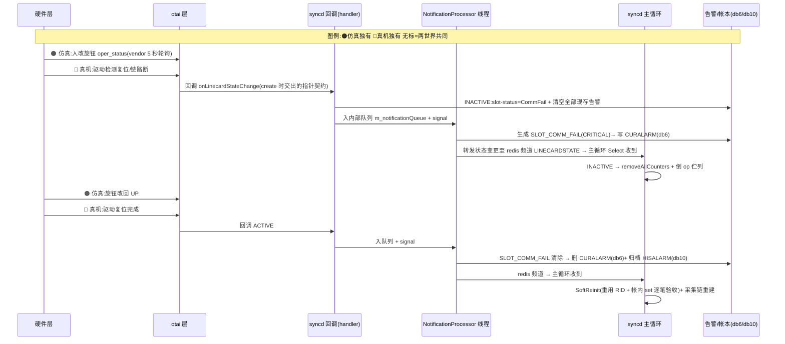

# 重启韧性 ①:单卡死亡/复位验证计划(SoftReinit 首测)

> 属于「重启韧性」四层系列之第一层(卡)(姊妹篇:54 容器重启(②) / 55 warm reboot(③) / 56 冷启自举(④))。

## §1 本维度在需求中的位置

| 需求段 | 原文 | 本维度对应 |
|:--|:--|:--|
| 输入 | 线卡复位或重新上电 | ✓ 本维度的触发事件(syncd 活著,旋钮模拟 DOWN→UP) |
| 处理 | OTAI 心跳检测 + LINECARD_STATE_CHANGE 通知,状态 ready 后 SoftReinit 重建并重配置 | ✓ 本维度的恢复机制 |
| 输出 | 重启后配置与重启前一致;PM/告警历史连续;恢复过程产生的状态变更与告警如实上报 | ✓ 本维度的验收目标 |

## §2 目标表(目标 / 状态 / 验证手段)

状态图例:✅ 已实证 · ⚠️ 代码齐全未实测 · ❌ 缺

| # | 目标 | 状态 | 验证手段 |
|:--|:--|:--|:--|
| G1 | 线卡状态检测 → LINECARD_STATE_CHANGE 通知 | ✅(实现为 5 秒状态轮询,措辞见 §6) | 脚本 test_linecard_restart.sh:DOWN/UP 旋钮 → 通知指纹(复现 10/10 轮 + D2 ×2) |
| G2 | INACTIVE 处置:清计数器、倒 op 队列 | ✅(观测点按 §5 校准:removeAllCounters 拆采集器不清 DB 键,改看 SLOT_COMM_FAIL 自动生成) | 脚本 test_linecard_restart.sh:SLOT_COMM_FAIL 生成指纹 |
| G3 | 状态 ready 后 SoftReinit:重用 RID、账内 set 重放、逐笔验收 | ✅(2026-11-10 首测全过) | 脚本 test_linecard_restart.sh:`set linecard attr` 指纹 + 物件不换 RID(复现 10/10 轮) |
| G4 | 复活后告警如实上报 | ✅(含 SNMP 接收端实证:snmptrapd 日志两对 SLOT_COMM_FAIL RAISED/CLEARED) | 脚本 test_linecard_restart.sh:UP 后告警落地 + snmptrapd 日志 |

## §3 机制全景



一句话:**两世界的分岔点只在「谁扮演检测与硬件」(🟠 vslib+旋钮 / 🔵 SDK+驱动);从回调进 syncd 开始,恢复主干完全同一条。仿真没演的只有一幕:硬件死到回调缺席(总线断)的那个分支。**

## §4 恢复主干逐环解释(按 §3 图序;🟢上游既有 🟡本战役新增)

### 环节1:状态检测 🟡(执行者:vslib 模拟线程)

`src/sonic-otairedis/vslib/OtaiObjectNotificationSim.cpp:73-92`:

```cpp
while (true)
{
    // 每 5 秒读一次旋钮 json;状态变了才发通知——这就是「状态检测」的全部实现
    otai_oper_status_t operStatus = readOperStatus("otai_linecard_notification_sim.json");
    if(operStatus != linecardOperStatus) {
        sendLinecardStateNotification(linecard_id, operStatus);
        linecardOperStatus = operStatus;
    }
    int cfg_status = readAlarmConfig(cfg_type, cfg_severity, cfg_text);
    if (cfg_status >= 0 && cfg_status != last_alarm_status) {
        sendAlarmNotification(linecard_id, cfg_type, (otai_alarm_status_t)cfg_status, cfg_severity, cfg_text);
        last_alarm_status = cfg_status;
    }
    this_thread::sleep_for(chrono::seconds(5));
}
```

**踩坑**:
- 需求写「OTAI 心跳检测」——全库 grep 零 heartbeat 命中;真相:检测在 vendor 侧(syncd 被动收回调),措辞统一为「状态检测」(实测)
- vslib 与 syncd 同进程,「vendor 程序死了 syncd 还活」在仿真里不可发生——真机该场景靠 SDK 健康线程 + 机架层 slot 级监测(架构前提,见 §3 图 else 分支)

### 环节2:回调进入 syncd + 通信失败告警自动生成 🟢(执行者:syncd NotificationHandler)

`src/sonic-otairedis/syncd/NotificationHandler.cpp:250-261`:

```cpp
void NotificationHandler::onLinecardStateChange(
    _In_ otai_object_id_t linecard_rid,
    _In_ otai_oper_status_t linecard_oper_status)
{
    // 两件事:①把状态变化排队转发到 LINECARDSTATE 频道(异步两跳)②顺手合成通信失败告警
    auto s = otai_serialize_linecard_oper_status(linecard_rid, linecard_oper_status);
    enqueueNotification(OTAI_LINECARD_NOTIFICATION_NAME_LINECARD_STATE_CHANGE, s);
    generate_linecard_communication_alarm(linecard_rid, linecard_oper_status);
}
```

**踩坑**:
- 首测日志里 SLOT_COMM_FAIL 看似 vslib 发的——真相:通知在 handler 阶段合成入队,而 **CURALARM 的写入/删除由 NotificationProcessor 的 handler_alarm_generated/cleared(:475/:532)在 NP 线程上执行**(经 synchronizer 与主循环同锁);syncd 的 NotificationHandler 在状态变化时自动合成(`generate_linecard_communication_alarm`,:263-291,severity=CRITICAL,text="SLOT COMMUNICATION FAIL");INACTIVE 生成、ACTIVE 清除,一对呼应(2026-11-06 实测)
- 回调到主循环之间经 redis 频道两跳(回调 → LINECARDSTATE 频道 → 主循环 Consumer)——sairedis 标准异步解耦,别在 vendor 里找「直接调用」

### 环节3:主循环接收 🟢(执行者:syncd 主循环)

`src/sonic-otairedis/syncd/Syncd.cpp:1069-1073`:

```cpp
if (sel == m_linecardStateNtf.get())
{
    SWSS_LOG_NOTICE("linecard state change");
    otai_oper_status_t linecard_state = handleLinecardState(*m_linecardStateNtf);
```

**踩坑**:
- 触发条件是「状态变化」而非「通知到达」——重复同状态通知被 `m_linecardState` 去重跳过(实测:同值旋钮不产生任何日志)

### 环节4:INACTIVE 处置 🟢(执行者:syncd 主循环)

`src/sonic-otairedis/syncd/Syncd.cpp:1075-1085`:

```cpp
if (m_linecardState != linecard_state)
{
    if (linecard_state == OTAI_OPER_STATUS_INACTIVE)
    {
        m_manager->removeAllCounters();          // 拆采集器(内存侧),不清 DB 键
        while (!m_selectableChannel->empty())
        {
            swss::KeyOpFieldsValuesTuple kco;
            m_selectableChannel->pop(kco);        // 倒队列:机器不在,新单作废
        }
    }
```

**踩坑**:
- 首测断言写偏:预期「COUNTERS 键消失」,实测不消失——真相:`removeAllCounters` 拆的是采集器而非 DB 键;那 2 个键(`COUNTERS_EVENTS:*`)是基础设施键,与 PM 采集无关(2026-11-06 实测)→ G2 校准为「INACTIVE 通知指纹 + SLOT_COMM_FAIL 生成/清除对」
- INACTIVE 后 op 队列被清空是有意设计(帐实相符:帐本才是真相,过期命令不补做),勿当 bug

### 环节5:ACTIVE 分支 → SoftReinit 🟢(执行者:syncd 主循环)

`src/sonic-otairedis/syncd/Syncd.cpp:1086-1090`:

```cpp
    else if (linecard_state == OTAI_OPER_STATUS_ACTIVE)
    {
        SoftReiniter sr(m_client, m_translator, m_vendorOtai, m_manager);
        sr.softReinit();                          // 全库唯一调用点,2026-11-06 首测
    }
```

**踩坑**:
- 全库 grep 仅此一处调用——此前从未被任何演示或测试触发;本篇脚本是其首测

### 环节6:SoftReinit 主干 🟢(执行者:SoftReiniter)

`src/sonic-otairedis/syncd/SoftReiniter.cpp:342-379`:

```cpp
void SoftReiniter::softReinit()
{
    readAsicState();                              // 与 hardReinit 同源:读同一份帐本
    for (auto& kvp: m_linecardMap) {
        prepareAsicState(kvp.second);
        processLinecards();                       // 对既有 RID 重放帐内属性(不 create)
        processOids();
        stopPreConfigLinecards();
    }
    auto fgr = std::make_shared<FlexCounterGroupReiniter>(...);
    fgr->hardReinit();                            // 采集链重建(复用 hard 命名的重放逻辑)
    for (auto& kvp: m_linecardMap) {
        auto fr = std::make_shared<FlexCounterReiniter>(...);
        fr->hardReinit();
    }
}
```

**踩坑**:
- FlexCounter 重建在 softReinit 内部复用「hardReinit」命名的方法——名字带 hard 不代表整机级;采集器层只有一种重建法

### 环节7:set 重放与逐笔验收 🟢(执行者:SoftReiniter processLinecards)

`src/sonic-otairedis/syncd/SoftReiniter.cpp:243-246`:

```cpp
status = m_vendorOtai->set(OTAI_OBJECT_TYPE_LINECARD, m_linecard_rid, attr);
if (status != OTAI_STATUS_SUCCESS) {
    SWSS_LOG_THROW("failed to set attribute %s on linecard VID %s: %s", ...);
}
```

**踩坑**:
- all-or-nothing:每笔 set 检查返回值,任何一笔失败 → 抛异常 → syncd 退出(不带着半恢复状态硬撑)
- 「同值重设不报错」是 vendor 幂等,不是 syncd 忽略返回值;真被拒即炸(设计如此)
- 重放范围 = 帐内属性(create 属性为限;线卡 SET 因 isrecoverable 全 false 不入帐)——业务配置恢复走编排层重推,后续工作

## §5 验证脚本与首轮实测

`scripts/test_linecard_restart.sh`(D2 单卡死亡/复活全链验证;SoftReinit 首测):

```bash
# 骨架(全文见脚本;约 110 行)
预检:线卡记帐在(seed 幂等)+ syncd Up + RUNNING
pre-state:RID + db2 计数器键集 + db6 CURALARM + syncd pid
动作①:旋钮 oper_status=1(DOWN)→ 轮询 15s 验收「linecard state change」指纹
动作②:旋钮 oper_status=0(UP)→ 轮询 30s 验收「set linecard attr」指纹
        + 反向断言:不得出现「created LINECARD RID」(RID 应重用)
对账:计数器键集回归 + RID 不变 + 进程 pid 全程不变
动作③:注入告警(alarm_status 0→1)→ CURALARM 落地/清除(如实上报)
```

**首轮实测结果(2026-11-06)**:

```text
PASS:SoftReinit 指纹(set linecard attr)/ RID 重用无 create / 进程全程不死 / 复活后告警如实验收
实测发现:INACTIVE 瞬间自动生成 SLOT_COMM_FAIL(CRITICAL)、UP 后自动清除——
        「恢复过程产生的状态变更与告警如实上报」的直接证据(设计内建,非脚本注入)
FAIL:G2 断言写偏(预期计数器键消失,实测不消失)→ 校准动作见环节4踩坑
SNMP 接收端实证:snmptrapd 日志四条 SLOT_COMM_FAIL trap(两轮测试各一对 RAISED/CLEARED,
间隔 30-40s=旋钮 DOWN→UP 节奏)——「恢复过程产生的状态变更与告警如实上报」在 SNMP 通道
有接收端实证(不只 CURALARM 落地)
```

## §6 横切边界(一行一坑)

- isrecoverable 元数据全 false → 帐内属性 = create 属性;配置重放范围以此为准——业务配置恢复走编排层重推(后续工作,见姊妹篇 54 §6)
- redis 不落盘(save ""/AOF off)→ 帐本宿主在内存,整机重启数据蒸发;唯 CONFIG_DB 由文件重灌(→ 姊妹篇 55/56)
- 「OTAI 心跳检测」统一措辞「状态检测」——syncd 侧无任何主动探测机制

## §7 2026-11-10 并发共享连接故障复盘与修复

### §7.1 故障形态(最小复现:只做 DOWN→UP 窗口,连打 5 轮)

| 轮次 | 形态 | 现场 |
|:--|:--|:--|
| 1/3 | 静默卡死 | 摘牌动作有、SoftReinit 无、无报错、进程活着 |
| 2 | 回复串台 → 例外逃逸 → SIGABRT | `threads=0` 进程死亡(与 2026-11-09 10:00 首炸同签名) |
| 环境 | 宿主容器管理器/monit 扫荡 → orchagent 冲 db1 | 与本 bug 无关,按冷启 SOP 恢复 |

### §7.2 根因:主循环与 NP 线程共用一条 redis 连接

| 层 | 事实 |
|:--|:--|
| redis 服务器 | 无责——保证单位是「一条连接」,每条连接独立、每条命令原子 |
| RESP 协议 | 回复无编号、纯顺序配对 → 一条连接内多线程并发,协议层无解 |
| hiredis 客户端 | 文档明写 redisContext 非线程安全,责任留给使用者 |
| OTN fork | NP 线程经共享翻译器用了主循环的 `m_client`(RedisClient 全类无锁)——事故只在 UP:唯一两线程同时伸向同一连接的时刻(DOWN 主循环不碰 db1、create 单线程) |

### §7.3 现场证据(redis MONITOR 抓到的命令流)

```text
cycle1 UP:147457 HGET RIDTOVID / 147471 HGET RIDTOVID / 147499 HGETALL VIDTORID
         ——42 微秒内三条命令挤进同一条连接(NP 两条 + 主循环一条)
死亡瞬间:HGETALL 拿到字符串(=NP 那题的答案)、HGET 拿到数组(=主循环那题的答案)
         → NP 线程例外无人接 → terminate → SIGABRT(core dumped)
```

### §7.4 修复 🟡

环节A 🟡(执行者:Syncd 构造)——NP 独立连接 + 独立翻译器,共用连接从结构上消失:

`syncd/Syncd.cpp:69-71`:

```cpp
// NP 线程专用的 ASIC_DB 连接,不与主循环共用(共用 = 回复交叉 → SIGABRT)
auto npDbAsic = std::make_shared<swss::DBConnector>("ASIC_DB", 0);
auto npClient = std::make_shared<RedisClient>(npDbAsic, m_dbFlexCounter);
```

`syncd/Syncd.cpp:88-89`:

```cpp
// NP 线程专用的翻译器实例:读路径不回填本地缓存,独立实例 = 纯 redis 查询,零失配
auto npTranslator = std::make_shared<VirtualOidTranslator>(npClient, m_virtualObjectIdManager, vendorOtai);
m_processor->m_translator = npTranslator;
```

环节B 🟡(执行者:NP 线程循环)——保命层,任何漏网异常不再杀死进程:

`syncd/NotificationProcessor.cpp:631-645`:

```cpp
// 原实现:processNotification 抛异常 → 逃出线程函数 → terminate → SIGABRT
// 现实现:捕获、记日志、继续处理队列里下一条
try { processNotification(item); }
catch (const std::exception& e) { SWSS_LOG_ERROR("notification processing failed: %s", e.what()); }
catch (...) { SWSS_LOG_ERROR("notification processing failed: unknown exception"); }
```

**踩坑**:
- 新 deb 直接装 `/usr/bin/syncd`(不再叫 syncd-ot-vs),且 `dpkg -i` 把容器内打过补丁的 `syncd_init_common.sh`/`syncd_start.sh` 覆盖回原版(跳线、linkup 补丁全丢 → syncd EXITED)——修法 = 从 `docker commit` 备份镜像 `docker cp` 取回补丁版脚本(详见 AGENTS.md 规则 3)
- 验证新码是否真进二进制:`dpkg-deb -x` 解包后 `strings` 查新日志串(如 "notification processing failed")

### §7.5 修复后验证

| 测试 | 修复前 | 修复后 |
|:--|:--|:--|
| 最小复现循环(只 DOWN→UP) | 5/5 FAIL(2 次进程死亡、2 次静默卡死) | **10/10 PASS**(零串台、零死亡、每轮 SoftReinit 指纹在) |
| D2 全量(本篇脚本) | FAIL | **PASS ×2** |
| D1 容器重启(姊妹篇 54 同链) | — | **PASS**(hardReinit 记账重放 + 五库零丢失) |

导航:旋钮 DOWN→UP 是入场券,NP 独立连接是出厂行为,复现脚本是探针,查证看 §7.5 对照表。
