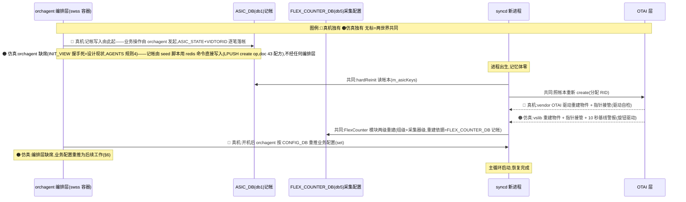

# 重启韧性 ②:syncd 容器重启验证计划(hardReinit 记帐重放)

> 属于「重启韧性」三层系列之第二层(器)(姊妹篇:53 单卡死亡(①) / 55 warm reboot(③))。

## §1 本维度在需求中的位置

| 需求段 | 原文 | 本维度对应 |
|:--|:--|:--|
| 输入 | syncd-ot 容器重启 | ✓ 本维度的触发事件(redis 不死,帐本都在) |
| 处理 | hardReinit 从 asic_db 重建全部 otai 对象与 flexcounter | ✓ 本维度的恢复机制 |
| 输出 | 重启后配置与重启前一致;PM/告警历史连续;恢复过程产生的状态变更与告警如实上报 | ✓ 本维度的验收目标 |

## §2 目标表(目标 / 状态 / 验证手段)

状态图例:✅ 已实证(2026-11-06) · ⚠️ 代码齐全未实测 · ❌ 缺

| # | 目标 | 状态 | 验证手段 |
|:--|:--|:--|:--|
| G1 | hardReinit 从 asic_db 记帐重建 otai 对象 | ✅(仅单物件场景) | 脚本 1:pre/post 状态集合 diff |
| G2 | flexcounter 采集链重建 | ✅(退化场景:0 键) | 脚本 1:采集器指纹 + PM 恢复采样 |
| G3 | PM/告警历史连续 | ✅ | 脚本 1:db10 历史条目数前后一致 |
| G4 | 恢复期告警如实上报 | ✅(+10s 基线警报重发即证) | 脚本 1:重启后新告警帧出现 |

## §3 机制全景



一句话:**hardReinit 本身是两世界共同的主干(读同一份 ASIC_DB 帐、走同一个 create,连 FlexCounter 重建读的也是同一份 FLEX_COUNTER_DB);分岔在三处——谁发起记帐写入(🔵 orchagent 业务操作 / 🟠 seed 脚本直接写 redis)、谁扮演 OTAI 层(🟠 vslib+旋钮 / 🔵 vendor OTAI 驱动),以及开机后谁补推业务配置(🔵 orchagent / 🟠 缺席)。**

## §4 恢复主干逐环解释(按 §3 图序;🟢上游既有 🟡本战役新增)

### 环节1:容器重启触发(执行者:docker/外层)

```bash
sudo docker restart syncd    # SIGTERM → supervisord 停树 → 新容器起(约 10-20s)
```

**踩坑**:
- 重启本身不伤帐本:实测监控 45 秒逐秒采样,db1 全程 4 键不掉(2026-11-06 21:50 实验)
- 真正的杀手在重启之后(见环节6踩坑:orchagent 级联)

### 环节2:新进程出生 → 等待闸门 🟢(执行者:syncd)

`src/sonic-otairedis/syncd/Syncd.cpp:1044-1058`:

```cpp
while (0 == linecardkey.size())
{
    m_linecardtable->getKeys(linecardkey);      // 轮询 STATE_DB 的 LINECARD 表
    SWSS_LOG_NOTICE("Waiting for Linecard...");
    sleep 1 秒;
}
// 过闸后:自己覆写状态并广播
m_linecardtable->hset(value, "oper-status", "ACTIVE");
notifyLinecardStateChange(OTAI_OPER_STATUS_ACTIVE);
```

**踩坑**:
- 「Waiting for Linecard」出现在 starting main loop 之后 = 等待循环末次迭代的良性日志,勿当崩溃(实测误判过)
- 闸门钥匙 = STATE_DB 的 `LINECARD|linecard1` key——redis 不持久,冷启动必缺,需 seed 补(AGENTS.md 规则 5 步骤②);容器重启(redis 活)key 还在,即时过闸

### 环节3:hardReinit 读帐本 🟢(执行者:syncd/HardReiniter)

`src/sonic-otairedis/syncd/Syncd.cpp:876-878`:

```cpp
HardReiniter hr(m_client, m_translator, m_vendorOtai, m_handler, m_manager);
m_linecard = hr.hardReinit();
```

`src/sonic-otairedis/syncd/HardReiniter.cpp:37-46`:

```cpp
void HardReiniter::readAsicState()
{
    // 重放的三份依据,全在 ASIC_DB:对象存在清单 + 双向编号映射
    m_vidToRidMap = m_client->getVidToRidMap();
    m_ridToVidMap = m_client->getRidToVidMap();
    m_linecardKeys = m_client->getAsicStateKeys();
}
```

**踩坑**:
- 帐本的宿主是 redis 内存(save ""/AOF off)——syncd 优雅退出会走 removeLinecard 清帐(设计:线卡移除=删帐),重放只对「非优雅死亡」成立;容器重启(redis 活)帐在,重放成立(2026-11-06 实测 m_asicKeys=1 → created LINECARD)

### 环节4:照帐本重建对象 🟢(执行者:SingleReiniter)

`src/sonic-otairedis/syncd/SingleReiniter.cpp:165-234`(要点):

```cpp
for (const auto& s : m_linecards)
{
    otai_deserialize_object_id(strLinecardVid, m_linecard_vid);
    // 指针占位属性换成 syncd 自家回调
    m_handler->updateNotificationsPointers(OTAI_OBJECT_TYPE_LINECARD, attrCount, attrList);
    // 属性分两批:create 必要属性 + 其余补 set
    std::vector<otai_attribute_t> attrs;         // create 用
    std::vector<otai_attribute_t> attrs_left;    // create 后补 set
}
```

**踩坑**:
- 帐内属性 = create 整单属性(set 因 isrecoverable 全 false 不入帐)——重放后业务 set 级配置不在,恢复靠编排层重推(后续工作)
- 多线卡会 THROW「multiple linecards not allowed」——重复播种即触发(2026-11-06 实测,seed 脚本已加幂等守卫)

### 环节5:FlexCounter 两级重建 🟢(执行者:HardReiniter)

`src/sonic-otairedis/syncd/HardReiniter.cpp:66-82`:

```cpp
auto flexCounterGroupKeys = m_client->getFlexCounterGroupKeys();
auto fgr = std::make_shared<FlexCounterGroupReiniter>(...);
fgr->hardReinit();                              // 组级重建
auto flexCounterKeys = m_client->getFlexCounterKeys();
auto fr = std::make_shared<FlexCounterReiniter>(...);
fr->hardReinit();                               // 采集器级重建
```

**踩坑**:
- 重建范围以 FLEX_COUNTER_DB(db5)记帐为准——冷启动 FLEX_COUNTER_DB 空则退化为 0 键重建(合法),PM 组配置属演示操作需重下(AGENTS.md 持久性表)

### 环节6:主循环 + 基线警报重现 🟡(执行者:syncd + vslib)

`src/sonic-otairedis/syncd/Syncd.cpp:1061`(接续):

```cpp
while (runMainLoop) { ... }                     // 主循环启动,恢复完成
// vslib 侧:对象 create 时启动的模拟线程 10 秒后发基线高温警报 → CURALARM|#HIGH_TEMPERATURE_ALARM
```

**踩坑**:
- 「+10s 基线警报」是无硬件世界的必然触发——汇报措辞注明「模拟器行为,真机为真实告警源」

## §5 验证脚本与实测

`scripts/test_container_restart.sh`(五库键集 diff + 指纹验收 + 恢复期告警端到端):

```bash
# 骨架(全文见脚本)
预检:线卡记帐在 + syncd Up
pre-state:ASIC_DB/COUNTERS_DB/FLEX_COUNTER_DB/STATE_DB/HISTORY_DB 键集快照 + syncd pid
动作:docker restart syncd → 轮询 90s 验收「starting main loop」
指纹:prepareAsicState m_asicKeys / created LINECARD RID / FlexCounterReiniter×2
post-state:五库键集 diff → 零丢失断言
恢复期告警:注入唯一标记(D1RUN-<pid>-<时间戳>,0/1 振荡避边沿)
        → 断言日志指纹 handler_alarm_generated '<唯一文本>'(NP 先写 CURALARM 后打日志=端到端完成)
        → 双保险:STATE_DB CURALARM text 字段 = 唯一文本
收尾:cleanup 还原旋钮静默(alarm_status=1 → 触发清除,不给自己留残留)
```

**实测结果(2026-11-06)**:

```text
PASS:指纹四连 ✓ / 基线警报重现 ✓ / db1(4键)/db2(7键)/db5/db6/db10 键集全部一致 ✓
校准:db6 的 PROCESS_STATS|<pid> 键按进程 PID 记帐,进程重启天然翻动——对账排除该前缀
```

**实测修订(2026-11-10)**:

```text
残留陷阱:旧第 4 步「+10s 基线警报重现」被 CURALARM 残留架空——redis 不死,键跨容器重启存活,
        模拟器重发被 already generated 守卫吞掉(NP.cpp:502-508,日志实证 ×4)——断言沦为验"redis 活着"
修订:第 4 步改唯一标记注入 + STATE_DB text 双保险;注入移到五库对账之后(注入键不参与 diff)
另注:2026-11-10 手测两轮 hardReinit 重启后模拟器 +10s 基线警报未发(机制待查)——注入法不依赖该定时器
新实测:修订版 PASS(五库全名对账零漂移 + handler_alarm_generated 'D1RUN-…' + STATE_DB text 双保险命中)
```

## §6 横切边界(一行一坑)

- **orchagent 级联清帐(本层最大坑)**:syncd 重启后 orchagent 的 INIT_VIEW 无人回应(syncd 跳过通知为设计)→ 60s 超时 → abort → swss 容器重启 → 新 orchagent 冷初始化 **flush ASIC_DB(db1)** → 帐本蒸发(实测 2026-11-06 21:56:03,容器死亡期间 4→0)。后果:每次 syncd 重启后 ~60-90s 需重新 seed;根治 = INIT_VIEW 回应 + 方言兼容(后续工作)
- **radv/monit 循环**:radv 容器退出滞留 → monit container_checker 每轮报「Expected containers not running」→ 每轮强制 SIGTERM 重启 bgp/syncd/snmp/radv → syncd 每 ~40s 被杀(实测死亡证明 21:55:20)。修法:`docker start radv` 断环
- 帐本宿主在内存(save ""/AOF off)——「非优雅死亡才重放、优雅退出自清帐」是设计对称性,勿混
