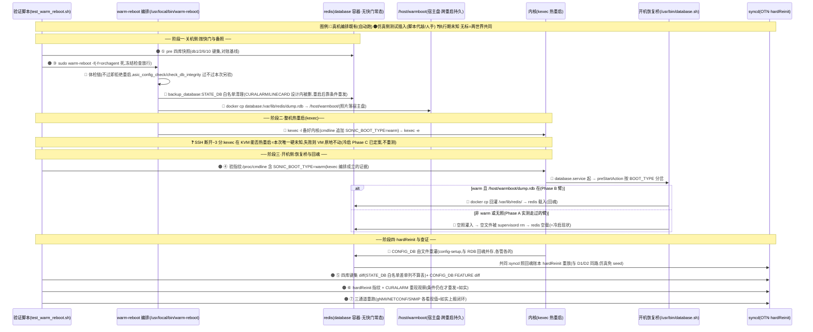

# 重启韧性 ③:整机 warm reboot 验证计划(RDB 快门探险)

> 属于「重启韧性」三层系列之第三层(热)(姊妹篇:53 单卡死亡(①) / 54 容器重启(②))。

## §1 本维度在需求中的位置

| 需求段 | 原文 | 本维度对应 |
|:--|:--|:--|
| 输入 | 整机 warm reboot(优雅重启) | ✓ 本维度的触发事件 |
| 处理 | warm reboot 期间保持配置与 PM/告警历史数据不丢失 | ✓ 本维度的恢复机制 |
| 输出 | 重启后配置与重启前一致(零丢失);PM/告警历史连续 | ✓ 本维度的验收目标 |

## §2 目标表(目标 / 状态 / 验证手段)

状态图例:✅ 已实证 · ⚠️ 代码齐全未实测 · ❓ 机制存在未验证 · ❌ 缺

| # | 目标 | 状态 | 验证手段 |
|:--|:--|:--|:--|
| G1 | 重启前 redis 状态落盘 dump.rdb | ✅(实测:手动 save → 167KB 落盘;编排 backup_database 搬照成立) | 已证(2026-11-13) |
| G2 | 开机快照回魂(恢复桥回灌 + redis 载入) | ✅(实测:cmdline 含 SONIC_BOOT_TYPE=warm → /usr/bin/database.sh preStartAction 回灌 → redis 载入 → db1 帐本/db10 历史回归) | 已证(2026-11-13,真编排) |
| G3 | 运行态数据跨重启不丢(记帐/告警/PM/历史) | ✅(实测:db1 帐本零漂移、db10 历史 49 键零丢失、hardReinit 同 RID 重放;PM 现窗=关机自清扫+组重开恢复,设计内;CURALARM 条件重发=如实) | 已证(2026-11-13,真编排) |
| G4 | CONFIG_DB 文件重灌一致 | ✅(实测:FEATURE 表 18 键一致) | 已证(2026-11-13) |

## §3 机制链条(两端都有代码,中间未验证;流程+测试插入点)



一句话:warm-reboot 编排包办「体检→白名单清理→**centralize 自动重拍**→搬照→kexec 热重启→回魂」(蓝,拍照点已破案见 I1)——**最终照片=清理后状态**(STATE_DB 瞬态被剥,warm 后两步人工是这条链的确定产出);开机恢复桥按 cmdline 分岔:有照回魂(Phase B 臂)/空照冷载(Phase A 实测臂);kexec 在 KVM 能否热重启已实测成立(§8)。

## §4 机制链逐环解释(🟢上游既有 🟡本战役新增;状态:全链待实测)

### 环节1:按快门——显式 save 🟡(执行者:验证脚本 / 真机为 warm-reboot 编排)

```bash
redis-cli save    # SAVE 命令无视 save "" 规则,强制全量落盘
```

落点 = database 容器内 `/var/lib/redis/dump.rdb`(redis.conf `dir` 指定;容器层随 VM 重启持久)。

**踩坑**:
- redis.conf 是 `save ""` + `appendonly no`(Dockerfile.j2:31 刻意激活)——不按快门就永远没有快照;`persistence_for_warm_boot: yes`(database_config.json)只是声明「愿意参与 warm boot 恢复」,不产生快照本身

### 环节2:真机路径对照 🔵(执行者:warm-reboot 编排)

`src/sonic-utilities/build/scripts-3.11/warm-reboot:248-264`:

```bash
function backup_database()
# Backuping up database ... / Advanced reboot: dump state to host disk
# Dump redis content to a file 'dump.rdb' in warmboot directory
```

**踩坑**:
- 真机由 warm-reboot 编排自动按快门;仿真里此编排依赖 orchagent 活着(当前死)——所以仿真用手动 save 代替(Phase A 实验动作)
- (2026-11-12 勘误)上一条两处不准:① 编排**不按快门**——backup_database() 只把既有 dump.rdb docker cp 到 /host/warmboot,save "" 常态下那是一张空照/无照,快门要脚本手动按;② backup_database **不依赖 orchagent**——orchagent 只在冻结检查(orchagent_restart_check)露面,失败用 -f 放行即可

### 环节3:整机优雅 reboot 🟢(执行者:VM)

```bash
sudo reboot    # systemd 优雅关停 → 磁盘上的 dump.rdb 存活(容器层随 VM 重启持久)
```

### 环节4:开机回魂 🟢(执行者:database 容器 init)

`dockers/docker-database/docker-database-init.sh:118-130`:

```bash
# copy dump.rdb file to each instance for restoration
DUMPFILE=/var/lib/redis/dump.rdb
# copy warmboot rdb file into each new instance location
if [[ "$DUMPFILE" != "/var/lib/$inst/dump.rdb" ]]; then
    cp $DUMPFILE /var/lib/$inst/dump.rdb
fi
```

**踩坑**:
- 拷贝目标是「各实例目录」——单实例布局(6379)为主,redis_bmp(6400)同样被拷贝;redis 启动时按 dir 加载 dump.rdb
- (2026-11-12 勘误)回魂第一棒其实是**宿主侧恢复桥**:/usr/bin/database.sh(docker_image_ctl.j2 渲染,VM 实锤 3 处 host/warmboot)preStartAction 在 BOOT_TYPE=warm 且 /host/warmboot/dump.rdb 在时 docker cp 回灌——本环节(init.sh 118-130)只管容器内搬运,单实例下源路径=目标路径,实为 no-op

### 环节5:重放与判定 🟢🟡(执行者:redis + syncd + seed)

```text
redis 载入 dump.rdb → 帐本/告警/PM/历史整体回归
→ syncd hardReinit 有帐可放(不再依赖 seed)
→ CONFIG_DB 由文件重灌(config-setup,与 RDB 并存,各管各的)
→ 判定点:四库键集 diff 一致 = Phase B;不一致/为空 = Phase C
```

**踩坑**:
- `flush_unused_database` 在 database 容器启动 300 秒后一次性执行(supervisord.conf.j2:61,autostart=false,06:26 已跑完)——排查清库嫌疑时排除过,非本案凶手;但它证明「database 容器启动后 5 分钟」是清库动作的敏感窗口,回魂验证的键集 diff 要避开该窗口
- CONFIG_DB 重灌与 RDB 回魂的先后次序未证——若 config 重灌在回魂之后,文件内容为准(覆盖);Phase A 对账按「以文件为准」口径

## §5 验证脚本设计(test_warm_reboot.sh,Phase A/B/C)

**修订(2026-11-12)**:下述骨架为 Phase A 旧版(手动 save + `sudo reboot` 冷路);真编排版改走 `sudo warm-reboot -f`(orchagent 死需 -f 放行)+ 新增 kexec 指纹(/proc/cmdline 含 SONIC_BOOT_TYPE=warm)与 /host/warmboot/dump.rdb 非空核验,判定点见 §3 图 ①-⑦——脚本改造随实测执行同步落地。

```bash
# 骨架(全文见脚本;Phase A 历史版)
预检:线卡记帐在
pre-state:db1/2/6/10 键集快照
按快门:redis-cli save → 确认 /var/lib/redis/dump.rdb 落盘
整机 sudo reboot → 轮询 SSH(~8 分钟)→ 等容器编排收尾
post-state:dump.rdb 存活确认 + 四库键集 diff + CONFIG_DB FEATURE 表 diff
判定:Phase B(RDB 回魂成立,seed 可免)/ Phase C(不成立,备份回灌为后续工作)
```

**实测状态:待执行**(脚本已就绪;执行会重启整台 VM,约 8-10 分钟)

## §6 横切边界(一行一坑)

- redis 持久化「配置上愿、行为上关」:persistence_for_warm_boot=yes(愿)与 save ""(关)并存——快门必须显式按
- orchagent 级联清帐(姊妹篇 54 §6)对本层的干扰:回魂验证的窗口内若 swss 因 syncd 迟到而重启,新 orchagent 会 flush db1——Phase A 的对账要在 swss 稳定后采样
- warm reboot 后 orchestragent 若为冷初始化,业务配置由文件重灌兜底;OTAI 帐内属性由 RDB 兜底——两条兜底通道互不替代


## §7 首轮实测结果(Phase A,2026-11-06;**已被 §8 翻案**)

> **翻案注记(2026-11-13)**:本节实测走的是 `sudo reboot` 冷路——**编排缺席**,开机走恢复桥
> else 分支(空照灌入),照片死活无关紧要;「init.sh 未拷贝即清空源文件」是对现象的错误归因
> (真正的恢复第一棒是宿主侧 /usr/bin/database.sh preStartAction,见 §4 环节4 勘误)。
> 真编排(`sudo warm-reboot -f -d`)实测见 §8:Phase B 成立,本节 Phase C 判决作废。

```text
快门:✓ redis-cli save → dump.rdb 150KB 落盘(/var/lib/redis/)
整机 reboot:✓(~3 分钟 SSH 回来,容器编排 ~5 分钟收尾)
跨重启:✗ dump.rdb 消失——init.sh「echo -n > dump.rdb」清空源文件(恢复一次即作废的设计),
        且单实例布局下 if 条件不成立,根本未拷贝到实例目录
数据:✗ 四库全为文件重灌新态(db1=1/db2=0/db6=49/db10=0);CONFIG_DB FEATURE 表漂移
判定:════ Phase C ════ RDB 回魂未成立——seed SOP 是唯一路;「重启前状态备份/回灌脚本」列为后续工作
```

**Phase C 后续工作(认领项)**:重启前把 db1/2/6/10 dump 成 JSON 文件落盘,开机后按序回灌——不依赖 redis 持久化,可控性高于修复 init.sh 的 RDB 链。真机场景走 warm-reboot 编排 + 标准恢复流程,在仿真范围之外。
(2026-11-13 注:真编排实测成立后,本认领项作废——RDB 链就是标准恢复路,见 §8。)

## §8 真编排实测结果(Phase B,2026-11-13)

> 事件链与测试插入点见 §3 图 ①-⑦;证据目录 `/tmp/opencode/warm_reboot.329500/`(RUN_RECORD.md + 四库 pre/post 快照)。

### 前置修复(本战役新增)

`config` CLI 在本 fork 镜像上 import 即崩(click 8.1.8 已删除 `autocompletion` 参数,config/main.py 等仍在用)→ warm-reboot 第一步 `config warm_restart enable system` 必死。修复:4 处 `autocompletion=` → `shell_complete=`(config/main.py ×2、rcli/rshell.py、dump/main.py;回调签名兼容,补全保留)→ 重编 sonic_utilities wheel → VM `pip3 install --force-reinstall`。修复后 `config warm_restart enable/disable system` exit=0。

### 旗标定案

- `-f`:orchagent 死(swss 容器在、进程死),冻结检查(orchagent_restart_check)必然失败,-f 放行
- `-d`:check_db_integrity 要求 COUNTERS_PORT_NAME_MAP(上游 orchagent 写,本仿真设计内缺席)→ 放行;完整性把关改由脚本四库对账承担(比 schema 检查更严)
- `-i` 不用:asic_config_check 实测 exit=0(注意:测量要直接取退出码,`cmd | tail; $?` 量到的是 tail——首轮「体检双过」即栽在这上面)

### 实测时间线(VM 时钟)

```text
20:28:16 Starting warm-reboot(config warm_restart enable ✓)
20:28:51 RESTARTCHECK failed(-f 放行,预期)
20:29:06 ~OtaiGaugeCollector: Clear gauge data(优雅关机自清扫:清 pm_current 现窗+组置 disable)
20:30:11 Backing up database → STATE_DB 白名单清理 → docker cp → /host/warmboot/
20:30:12 redis「DB saved on disk」(神秘 SAVE,35840 字节;开放问题见下)
20:30:20 Rebooting with /sbin/kexec -e(KVM 热重启成立,内核 ~20 秒回来)
20:30:57 determine-reboot-cause: /proc/cmdline indicates reboot type: warm-reboot
20:30:54 database 容器起 → 恢复桥回灌 dump.rdb → redis 载入
20:31:25 syncd hardReinit:读回魂帐本 → created LINECARD RID oid:0x10100000001(同 RID)
         → hard reinit 0.037s → main loop → 等 LINECARD key(白名单删了闸门 key)
20:41:38 人手补 hset LINECARD|linecard1 → 闸门过 → notify ACTIVE(队列 0,无重复 create,无 SEGV)
20:4x 人手重开 1S_STAT_GAUGE 组 → 8 个 pm_current 键重现,instant=35.0
```

### 四库对账(pre 20:28 vs post 20:4x)

| 库 | pre | post | 结论 |
|:--|:--|:--|:--|
| ASIC_DB(db1) | 5 | 4+补 | 仅少 GETRESPONSE_KEY_VALUE_OP_QUEUE(空队列壳自动消失,良性) |
| COUNTERS_DB(db2) | 20 | 9→重开后 17 | pm_current=关机自清扫(设计内,非丟失);name map 回魂;组重开后 8 键重现 |
| STATE_DB(db6) | 99 | 99+3 | 仅缺 ETHERNET\|eth1(守护域,无人重建);**CURALARM 由 syncd 重发重现=如实**;LINECARD 补 hset 后健在 |
| HISTORY_DB(db10) | 49 | 49 | **零丢失(需求核心:PM/告警历史连续)** |
| CONFIG_DB FEATURE | 18 | 18 | 键集一致 |

### 判定:════ Phase B ════ 真编排 warm reboot 成立

warm reboot 后人工动作仅两步(均秒级,种子 SOP 的子集):①补 hset LINECARD(闸门)②重开 GAUGE 组(采集器不自启)。对比冷启动(全量 LPUSH create+指针+hset):帐本来自 RDB 回魂,无需重放 create。

开放问题与改进项统一收口到 §9(I1 神秘 SAVE / I2 快门原子性与自动快门)。

## §9 问题与改进项(issues)

| # | 主题 | 状态 | 影响 |
|:--|:--|:--|:--|
| I1 | 20:30:12 神秘 SAVE 成因 | **已破案(2026-11-13 二轮取证)** | 照片=清理后状态是**确定性**行为(centralize_database 自带 save),非幽灵 |
| I2 | 快门原子性缺口——停写入与拍照非原子 | 方案已定,待实施(分析已按 I1 结论修正) | 手动 save 被确定覆盖;真正决策=照片拍清理前还是清理后 |

### I1:神秘 SAVE——已破案:centralize_database 自带 r.save()

**结论**:神秘 SAVE = `centralize_database` 脚本结尾的**无条件 `r.save()`**(为多实例集中化设计
——把各实例数据迁进 APPL_DB 实例后拍一张全量照)。`backup_database()` 在 STATE_DB 白名单
清理**之后**调用它 → 每次必把「清理后内存」重拍成新照,盖掉手动快门——**确定性行为,非偶发**。

**证据链(二轮实测,MONITOR+tcpdump 布控宿主盘)**:
```
06:02:59.087 手动 save(redis-cli,RESP "save" 报文)→ 174877 字节,含 CURALARM
06:04:56.77 白名单清理 eval(MONITOR 第 4550 行)→ 内存中 CURALARM/LINECARD 被删
06:04:57.29 centralize 的 r.save()(tcpdump 裸 SAVE 报文,源=host 127.0.0.1)→ 44667 字节,无 CURALARM
06:04:5x  docker cp → /host/warmboot/ = 44667(照片本体 grep CURALARM=0,LINECARD 记帐=1)
06:16:12  手动单独跑 centralize_database → dump.rdb mtime 当场更新 = 机制现场再现
```
**排除项**(取证过程一并钉死):SIGTERM 落盘(redis 8.0.2 实测 save "" 下 SIGTERM 不落盘,
一次性实例验证);redis 进程重启(MONITOR 存活贯穿拍照时刻);syncd_request_shutdown(编译
二进制,字符串仅 RESTARTQUERY);部署版脚本/eval 内藏 save(全文比对干净)。

**副作用澄清**:中央化的 r.save() 使「照片=清理后状态」成为**每次必然**——warm 后两步人工
(hset LINECARD+重开组)不是运气差,是这条链的确定产出。I2 决策点 a 由此更清晰:要「零人工」
需 fork 补丁把拍照挪到清理**前**(偏上游语义);维持现状则两步人工是契约。

### I2:快门原子性(分析已按 I1 修正)

**原问题**:手动 save(远早)→ 停服务 → 搬照,中间新写入只靠神秘 SAVE 兜底。
**I1 破案后**:「神秘 SAVE」= centralize 的 r.save(),**确定性地**在清理后重拍——它本身就是
一枚「清理后自动快门」,手动 save 每次都被它覆盖(手动 save 降级为 centralize 失败时的保险)。

**剩余决策点(待拍板)**:
- a) 照片语义:维持「清理后」(贴上游,warm 后两步人工)vs fork 补丁改「清理前」(backup_database
  里 cleanup eval 前加显式 save,且需压制 centralize 的后置 save;warm 后零人工,偏上游设计意图)
- b) 手动 save 定位:**已定(2026-11-13):移除**——centralize 失败场景下手动照片同样无人
  消费(cp 路径随 target_db_inst 为空而失效,恢复桥只认宿主盘),保险价值为零,纯冗余;
  test_warm_reboot.sh 已删该步骤

**实施清单(若选 a=清理前)**:backup_database() cleanup eval 前加 `docker exec database
redis-cli save` + centralize_database 的 r.save() 加开关或移除 → scp 部署 VM → 重跑
test_warm_reboot.sh 复审(预期:warm 后零人工,CURALARM/LINECARD 随照片回归)→ 更新本档
§3/§5/§8 与 AGENTS.md 5b。
