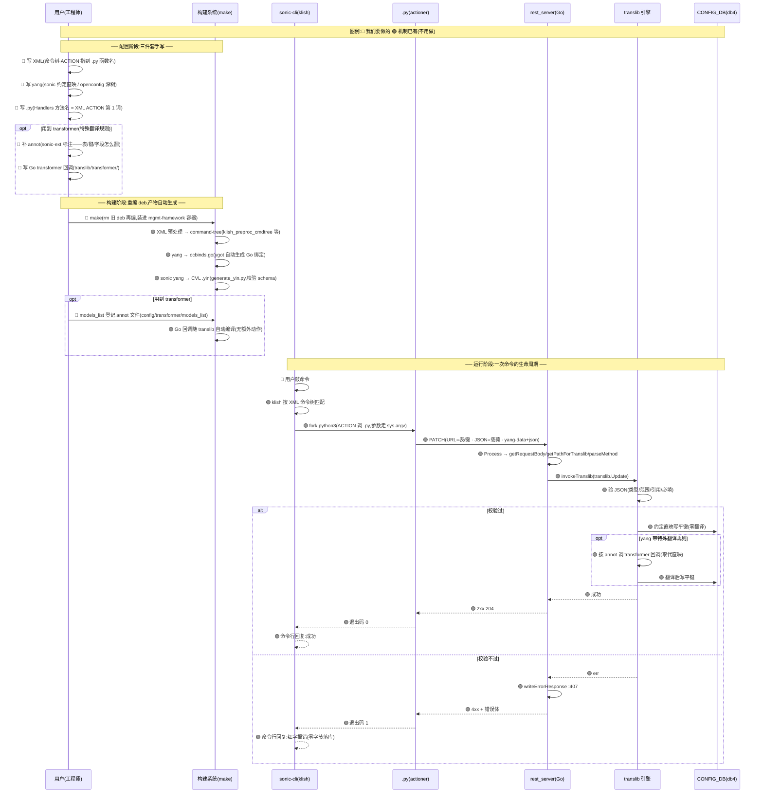

# sonic-cli 命令配置到 CONFIG_DB

## §1 完整流程

```
① XML 注册命令树(VIEW / COMMAND / PARAM / ACTION)
② 敲命令 → klish 匹配 → ACTION → .py 收参数
     → 组装 RESTCONF 请求(本机 HTTPS + yang-data+json)
③ REST server(同容器独立进程)→ 转交 translib 引擎:
     ├─ 按 URL 定位 YANG 节点 → 全量校验(类型/范围/必填)
     ├─ 映射:OpenConfig 树 → CONFIG_DB 平键(表|主键 的 hash)
     └─ ★ translib 自己写 CONFIG_DB(db4·redis)
④ server 返回 HTTP 响应 → .py 显示成功/失败 → 流程结束
```

一句话:XML 是命令树、klish 是形、.py 是信使、REST server 是闸门+写手;`.py` 全程不碰 redis——校验、映射、写库三件事全部在 server 端一次完成。以下各节按流程关键点逐个细化:§2(①)/§3(②·④)/§4(③)。

## §2 XML + klish 式命令

### 2.1 XML 元素与角色

XML 源文件在仓库 **`src/sonic-mgmt-framework/CLI/clitree/cli-xml/`**(每个文件一个功能域,见 §2.3);构建期经 `clitree/scripts/` 预处理(klish_preproc_cmdtree 等)后,复制进 `${SONIC_CLI_ROOT}/target/command-tree/` 装入 clish(clitree/Makefile:34-38)。

| 元素 | 角色 | 实例(interface.xml) |
|:--|:--|:--|
| `<VIEW name="X">` | 模式(可敲命令的白名单分组+上下文变量作用域) | `enable-view` / `configure-view` / `configure-if-view` |
| `<COMMAND>` | 一条命令;嵌套在 VIEW 内=该模式可打 | `show interface` / `description` |
| `<COMMAND view="Z">` | 执行后**切换到模式 Z** | `interface Ethernet0` 带 `view="configure-if-view"` |
| `<PARAM>` | 参数(同行位置参数,值绑定 `${变量}`;ptype 定类型) | `<PARAM name="iface">` |
| `<ACTION>` | 敲完执行的后端(builtin 或脚本) | `python3 sonic-cli-if.py patch_... ${iface} ${desc}` |

XML 示例——节选自 interface.xml,正好覆盖 §2.2 那三条命令(`configure terminal` → `interface Ethernet0` → `description uplink-1`;行尾注释为文档所加):

```xml
<CLISH_MODULE xmlns="http://www.dellemc.com/sonic/XMLSchema">

  <VIEW name="configure-view">
    <!-- §2.2 第二条命令:interface Ethernet0 -->
    <COMMAND name="interface" help="Select an interface"
             view="configure-if-view"                    <!-- 执行后切到 configure-if-view -->
             viewid="iface=Ethernet${phy-if-name}">      <!-- 变量 ${iface} 在此绑定 -->
      <PARAM name="phy-if-name" ptype="UINT"
             help="Physical interface(Multiples of 4)"/> <!-- 位置参数:Ethernet0 → ${phy-if-name}=0 -->
      <ACTION builtin="clish_nop"/>                      <!-- 纯切模式,后端不干活 -->
    </COMMAND>
  </VIEW>

  <VIEW name="configure-if-view" depth="2"
        prompt="${SYSTEM_NAME}(conf-if-${iface})# ">     <!-- 提示符里就引用了 ${iface} -->
    <NAMESPACE ref="configure-view"/>                    <!-- 继承外层:本层也能敲 configure 命令 -->
    <!-- §2.2 第三条命令:description uplink-1 -->
    <COMMAND name="description" help="Textual description">
      <PARAM name="desc" ptype="STRING"/>                <!-- 值绑定 ${desc} -->
      <ACTION>python3 $SONIC_CLI_ROOT/sonic-cli-if.py patch_openconfig_interfaces_interfaces_interface_config_description ${iface} ${desc}</ACTION>
    </COMMAND>                                           <!-- ${iface} 外层 + ${desc} 本层,同帧可见 -->
  </VIEW>

</CLISH_MODULE>
```

对照 §2.2 的走读:第一条 `configure terminal` 不在本文件(在 enable_mode.xml/configure_mode.xml,进 configure-view);后两条分别由上面 `<COMMAND name="interface">` 与 `<COMMAND name="description">` 承接——`view=` 负责进层,`viewid=` 负责把参数固化成变量,ACTION 拿两个变量拼出函数调用。

### 2.2 交互走读(同一行参数、VIEW 变量作用域)

```
sonic# configure terminal           ← 进 configure-view(enable_mode.xml:52-56)
sonic(config)# interface Ethernet0  ← 命令+参数同行:iface="Ethernet0"(clish_nop 纯切模式)
                                      → view= 生效 → 进 configure-if-view,${iface} 留在作用域
sonic(config-if)# description uplink-1
                                      ← 命令 description + 参数 desc="uplink-1"
                                      → ACTION 可同时用 ${iface} 与 ${desc}(外层变量内层可见)
```

- 参数是**同一行位置参数**,不是 enter 后提示输入;缺参数=报错/帮助,不交互追问
- VIEW 既是命令白名单分组,也是**变量作用域**——分层配置的「层」就是它

### 2.3 已支持配置对象

| XML 文件(clitree/cli-xml/) | 配置对象 | 支持能力(实录) |
|:--|:--|:--|
| interface.xml | 物理接口(OpenConfig) | 配置:description、shutdown/no shutdown、mtu、ipv4/ipv6 地址;show interface 族 |
| acl.xml | ACL | 配置:ip access-list、permit/deny、seq;接口侧 ip access-group |
| ipv4.xml / ipv6.xml | 接口 IP 子命令 | configure-if-view 下 `ip`/`no ip` 入口(address 等);show ip 族、clear ip / debug ip |
| ip.xml | 全局 IP 命令入口 | configure-view 下 `ip` / `no ip`(子命令经 include 展开) |
| mclag.xml | MCLAG | 配置:mclag domain、keepalive-interval、peer-ip(及 no * 撤销) |
| lldp.xml | LLDP | 只读:show lldp / neighbor / table |
| platform.xml | 平台 | 只读:show platform、show platform syseeprom |
| system.xml | 系统 | 只读:show system cpu/memory/processes |
| show_techsupport.xml | 技术支持包 | show tech-support(带 since 选项) |
| enable_mode.xml / configure_mode.xml | 模式骨架 | enable / configure terminal 等进模式命令(非业务对象) |
| sonic_types.xml | 共享参数类型 | ptype 类型定义,被其余 XML 引用(非业务对象) |

- **OTN 对象(optical-amplifier 等)缺席**:命令树 XML 与 YANG 模型双零命中;要支持需 YANG+klish XML+翻译器三件套(见 §4)

## §3 .py 如何组装 RESTCONF 请求

### 3.1 脚本结构(actioner)

一个 actioner .py 没有常驻服务,就是一个被 klish 拉起的普通 python 脚本——本节按执行顺序走读(sonic-cli-if.py,全文 119 行)。

#### 3.1.1 进程模型

```
XML 早已定好「命令 → 行动」的映射:description → 下面的 ACTION(XML 示例见 §2.1)
|
▼
python3 sonic-cli-if.py patch_openconfig_interfaces_interfaces_interface_config_description ${iface} ${desc}
|
▼
klish fork 出一个【短命 python3 进程】(每次敲命令都新起一个)
|
▼
sys.argv = ["sonic-cli-if.py", "patch_openconfig_interfaces_interfaces_interface_config_description", "Ethernet0", "uplink-1"]
|
▼
sonic-cli-if.py 跑 main
```

- 第二行命令 = XML ACTION 原文(interface.xml:140;`${iface}`/`${desc}` 绑定见 §2.1)
- 以下 3.1.2 从 main 开始,按执行顺序走读

#### 3.1.2 按执行顺序走读(main → 打包 → 发 server → 响应)

```python
# ① 一开始跑的:main = 文件尾四行(sonic-cli-if.py:116-119),进程一启动就执行
if __name__ == '__main__':
    pipestr().write(sys.argv)   # 先把整行喂给管道工具(show 命令支持 | grep)
    func = sys.argv[1]          # 函数名只是个字符串
    run(func, sys.argv[2:])     # 剩余 argv 全是参数,原样转交

# run 全文就一行(:112-113):按字符串名字从 Handlers 类捞出同名方法 = 反射 dispatch
def run(func, args):
    return getattr(Handlers, func)(*args)
#   ↑ 硬约束:XML ACTION 第 1 个词必须与 Handlers 方法名一字不差(:140 ↔ :53)
```

```python
# ② 真实打包:Handler 只做翻译——CLI 参数 → RESTCONF 的 URL 段 + JSON 载荷(sonic-cli-if.py:52-54)
class Handlers:
    @staticmethod
    def patch_openconfig_interfaces_interfaces_interface_config_description(name, value, *args):
        return config_intf(name, "config/description", {"description": value})
        #                           ↑ URL 后半段          ↑ JSON 载荷:字段名=YANG leaf 名(OpenConfig 方言)
```

```python
# ③ 传 REST server:拼 URL + 发请求,所有 config 命令共用这一个出口(sonic-cli-if.py:28-33)
def config_intf(name, sub_path, value):
    path = Path("/restconf/data/openconfig-interfaces:interfaces/interface={name}", name=name).join(sub_path)
    #      ↑ 完整 URL = /restconf/data/openconfig-interfaces:interfaces/interface=Ethernet0/config/description
    #        本机 HTTPS(§3.2);server 端校验+映射+写 db4(§4)
    if value is None:
        resp = ApiClient().delete(path, ignore404=True)    # no shutdown / no description 走删
    else:
        resp = ApiClient().patch(path, value)              # PUT/GET 同款:ApiClient().put / .get
```

```python
# ④ 响应处理:接 config_intf 尾部(:34-37);退出码就是 klish 的红字开关
    if not resp.ok():                  # 2xx → ok
        print(resp.error_message())    # 4xx/5xx:解析 RESTCONF 标准错误体,红字
        return 1                       # 非 0 → klish 红字报错,零字节落库
    return 0                           # 0 → klish 渲染成功
```

### 3.2 关键函数/类/变量(cli_client.py)

全部住在共享库 cli_client.py,7 个 actioner 脚本共用——§3.1.2 ③④ 调的就是这里的零件。用户自己写 .py 时只会用到 `ApiClient` 这一个类;`__session`/`request()` 是库内部零件,不需要认识。

| 项 | 类型 | 作用 | 示例 |
|:--|:--|:--|:--|
| `__api_root` | 成员 | ApiClient 的类级成员(全类共用一份):server「大楼地址」;环境变量 `REST_API_ROOT` 可覆盖,默认**本机 HTTPS,不出机器** | `os.getenv('REST_API_ROOT', 'https://localhost')` |
| `Path` | 类 | 印 URL 的模板:构造时把 `{name}` 留白填真值并 quote 编码,`.join()` 续尾段;**路径即 YANG 树**——URL 里 `openconfig-interfaces:` 是 module 名,层级=树层级 | `Path(".../interface={name}", name="Ethernet0").join("config/description")` → `.../interface=Ethernet0/config/description` |
| `ApiClient` | 类 | REST 客户端(快递员):对本机 REST server 的增删改查都从这进;PATCH/PUT/DELETE/GET 四动词即 RESTCONF 语义——**校验+映射+写库都在 server 端**(§4) | `ApiClient()`——新雇一个快递员,用完即弃(短命进程) |
| `ApiClient().patch` | 成员函数 | **改**字段:dict 打包成 JSON 发 PATCH | `ApiClient().patch(path, {"description": "uplink-1"})` |
| `ApiClient().put` | 成员函数 | **建**整条(RESTCONF PUT) | `ApiClient().put(path, payload)` |
| `ApiClient().delete` | 成员函数 | **删**记录;`ignore404=True`=本来就没有≠失败 | `ApiClient().delete(path, ignore404=True)`(no ip address 走这) |
| `ApiClient().get` | 成员函数 | **查**(show 类;depth 控嵌套深度) | `ApiClient().get("/restconf/data/openconfig-interfaces:interfaces")`(全表) |
| `Response` | 类 | 签收回执;content 是 JSON 就自动解析成 dict | `resp.content["openconfig-interfaces:interfaces"]` |
| `resp.ok` | 成员函数 | 状态码 200-299=成功 | `if not resp.ok(): return 1` |
| `resp.error_message` | 成员函数 | 从错误体抽人话,自动补 `%Error:` 前缀 | `print(resp.error_message())` → klish 红字 |
| `ErrorData` | 类 | RESTCONF 标准错误体逐字段解析(error/error-info/status_code) | `ErrorData(resp).message` |

## §4 REST server

### 4.1 部署

- **在哪个容器**:`docker-sonic-mgmt-framework`(mgmt-framework 容器,VM 实录 Up)——rest_server 与 klish CLI 同容器;代码在仓库 `rest/main`(入口)+ `rest/server`(路由/处理)
- **如何启动**(真实启动链,三步):
  1. 容器 supervisord 程序条目 `[program:rest-server]` → 跑 `/usr/bin/rest-server.sh`(supervisord.conf:39-41;autorestart=true、autostart=false——首拉由容器启动流程完成,机制级)
  2. rest-server.sh 先读 CONFIG_DB:经 sonic-cfggen + 模板 mgmt_vars.j2 取 REST_SERVER 段(port/client_auth/证书路径)(rest-server.sh:13-25);没配证书就用 generate_cert 造临时证书落 /tmp(:40-45)
  3. 拼好参数后 `exec /usr/sbin/rest_server`(并 export `CVL_SCHEMA_PATH=/usr/sbin/schema` 给校验引擎)(:48-61)
- **启动参数**(main.go:58-64 + rest-server.sh:48-54):

| 参数 | 作用 |
|:--|:--|
| `-port` | 监听端口,默认 443(main.go:58) |
| `-cert` / `-key` | 服务器 TLS 证书/私钥;缺任一 fatal 退出(main.go:135-153) |
| `-cacert` | 验客户端证书的 CA 文件;`-client_auth cert` 时必配(main.go:190-192) |
| `-client_auth` | 客户端认证:none(默认)\|cert\|user(main.go:63);user=按用户名认证(main.go:91-93) |
| `-readtimeout` | 读完整请求时限,默认 15s(main.go:53) |
| `-v` | 日志级别(rest-server.sh:50,值来自 CONFIG_DB 的 log_level) |

- 监听地址 = `https://<eth0 IP>:<port>`(main.go:94-96 取管理口 IP);CLI 客户端以 `REST_API_ROOT`(默认 https://localhost)对准它(§3.2)

### 4.2 yang 模型:server 如何解释 RESTCONF 请求

#### 4.2.1 模型目录与载入

**目录**(两家族):

| 家族 | 仓库源头 | 特点 |
|:--|:--|:--|
| openconfig-* | src/sonic-mgmt-common/models/yang/ | 业界标准**深嵌套树**;CLI 走的就是它 |
| sonic-* | src/sonic-yang-models/yang-models/ | SONiC 自家 **CONFIG_DB 直映**模型(container 名=表名) |

- 构建期集中打包进 deb(sonic-mgmt-common.install:`usr/models/yang`);VM 实录容器内 `/usr/local/yang-models/`;CVL 校验 schema 另在 `/usr/sbin/schema`(rest-server.sh:59)
- **不是每请求读文件**:启动时全部模型载入引擎(常驻内存),请求按 **URL 的 module 名**查树——模型入池一次,查树千万次

#### 4.2.2 请求解剖:URL 分行与 JSON 分行

**URL 分行**(sonic 家族句式逐段拆开——每段对应 YANG 树一层;RESTCONF 标准句式,sonic 模块路径未实测,机制级):

```
/restconf/data/sonic-interface:sonic-interface/INTERFACE/INTERFACE_IPPREFIX_LIST=Ethernet0,10.0.0.1/24

sonic-interface:            ← module(:1)=URL 前缀
sonic-interface/            ← container(:35,表域层,与模块同名)
INTERFACE/                  ← container(:37)=表名
INTERFACE_IPPREFIX_LIST=Ethernet0,10.0.0.1/24
                            ← list(:91)+key(:95)的值:两段键,逗号分隔,顺序=key 声明序
family                      ← 要打具体 leaf 时再续一段(终点,:123)
```

**JSON 分行**(机制级:按 RESTCONF 标准句式 + yang 结构实录组装):

```
GET 形状(整表读取的形状):
{
  "sonic-interface:INTERFACE": {           ← 顶层键:module:表名 container
    "INTERFACE_LIST": [                    ← list → 数组(一条记录一个元素)
      { "name": "Ethernet0", "vrf_name": "Vrf_RED", "nat_zone": 0 }
    ],
    "INTERFACE_IPPREFIX_LIST": [           ← 同表的第二种键形(2 段键)
      { "name": "Ethernet0", "ip-prefix": "10.0.0.1/24",
        "scope": "global", "family": "IPv4" }
    ]
  }
}

PATCH 载荷(打一条 IP 记录):
{
  "sonic-interface:INTERFACE_IPPREFIX_LIST": [
    { "name": "Ethernet0", "ip-prefix": "10.0.0.1/24",
      "scope": "global", "family": "IPv4" }
  ]
}
→ 落库:INTERFACE|Ethernet0|10.0.0.1/24(hash:scope=global、family=IPv4)
```

#### 4.2.3 yang 示例(全量)

真实文件 src/sonic-yang-models/yang-models/sonic-interface.yang,全文 141 行,与上面 URL/JSON 逐段对位(行尾注释为文档所加):

```yang
module sonic-interface {                                      // :1  module 名 = URL 的 sonic-interface: 前缀

	yang-version 1.1;                                         // :3  sonic 家族用 YANG 1.1

	namespace "http://github.com/sonic-net/sonic-interface";  // :5
	prefix intf;                                              // :6  本文件自称 intf

	import sonic-types {                                      // :8  公共类型库
		prefix stypes;
	}

	import sonic-extension {                                  // :12 标注词汇库(sonic-ext 的定义,要内联标注就从这引)
		prefix ext;
	}

	import sonic-port {                                       // :16 跨表引用的对象(name 的 leafref 指向它)
		prefix port;
		revision-date 2019-07-01;
	}

	import sonic-vrf {                                        // :21 vrf_name 的 leafref 指向它
		prefix vrf;
	}

	description "INTERFACE yang Module for SONiC OS";

	revision 2021-03-30 {                                     // :27 版本日记
		description "Modify the type of vrf name";
	}

	revision 2019-07-01 {
		description "First Revision";
	}

	container sonic-interface {                               // :35 表域层:与模块同名,不进键

		container INTERFACE {                                 // :37 表名 = INTERFACE(约定:这一层直接就是 CONFIG_DB 表)

			description "INTERFACE part of config_db.json";

			list INTERFACE_LIST {                             // :41 记录列表(1 段键)

				description "INTERFACE part of config_db.json with vrf";

				key "name";                                   // :45 键段 1 个 → INTERFACE|<name>

				leaf name {                                   // :47 键段声明(顺序与 key 语句一致)
					type leafref {                            // :48 跨表外键:必须已存在于 PORT 表
						path /port:sonic-port/port:PORT/port:PORT_LIST/port:name;
					}
				}

				leaf vrf_name {                               // :53 又一个跨表外键:VRF 表
					type leafref {
						path "/vrf:sonic-vrf/vrf:VRF/vrf:VRF_LIST/vrf:name";
					}
				}

				leaf nat_zone {                               // :59 普通字段
					description "NAT Zone for the interface";
					type uint8 {
						range "0..3" {                        // :62 值域校验,超范围报错
							error-message "Invalid nat zone for the interface.";
							error-app-tag nat-zone-invalid;
						}
					}
                                        default "0";          // :67 没写→按 0 落库
				}

				leaf mpls {                                   // :70 枚举字段
					description "Enable/disable MPLS routing for the interface";
					type enumeration {
						enum enable;
						enum disable;
					}
				}

				leaf ipv6_use_link_local_only {               // :78
					description "Enable/Disable IPv6 link local address on interface";
					type stypes:mode-status;
					default disable;                          // :81 第二个 default 实例
				}

                leaf loopback_action {                        // :84
                    description "Packet action when a packet ingress and gets routed on the same IP interface";
                    type stypes:loopback_action;
                }
			}
			/* end of INTERFACE_LIST */

			list INTERFACE_IPPREFIX_LIST {                    // :91 同表第二种键形(2 段键)

				description "INTERFACE part of config_db.json with ip-prefix";

				key "name ip-prefix";                         // :95 键段 2 个,顺序=段序 → INTERFACE|<name>|<ip-prefix>

				leaf name {                                   // :97 键段 1
					/* This node must be present in INTERFACE_LIST */
					must "(current() = ../../INTERFACE_LIST[name=current()]/name)"
					{                                         // :99 跨 list 一致性断言(标准语法,引擎直接执行)
						error-message "Must condition not satisfied, Try adding PORT: {}, Example: 'Ethernet0': {}";
					}

					type leafref {
						path /port:sonic-port/port:PORT/port:PORT_LIST/port:name;
					}
				}

				leaf ip-prefix {                              // :109 键段 2
					type union {                              // :110 union:v4 或 v6 前缀都合法
						type stypes:sonic-ip4-prefix;
						type stypes:sonic-ip6-prefix;
					}
				}

				leaf scope {                                  // :116
					type enumeration {
						enum global;
						enum local;
					}
				}

				leaf family {                                 // :123 DB 对照例 2 的 family=IPv4 就是它

					/* family leaf needed for backward compatibility
					   Both ip4 and ip6 address are string in IETF RFC 6021,
					   so must statement can check based on : or ., family
					   should be IPv4 or IPv6 according.
					 */

					must "(contains(../ip-prefix, ':') and current()='IPv6') or
						(contains(../ip-prefix, '.') and current()='IPv4')";   // :131 跨字段断言:family 必须与前缀形状一致
					type stypes:ip-family;
				}
			}
			/* end of INTERFACE_IPPREFIX_LIST */

		}
		/* end of INTERFACE container */
	}
}
```

#### 4.2.4 读 yang 的规则

URL/JSON/CONFIG_DB 三处能对应的;全部锚定上面这份 sonic-interface.yang:

| YANG 规则 | 在 URL 里 | 在 JSON 里 | 在 CONFIG_DB 里 | 实证 |
|:--|:--|:--|:--|:--|
| `module` | `sonic-interface:` 前缀 | `"sonic-interface:INTERFACE"` 顶层键 | ——(不落库,只是名字) | :1 |
| `container` | `sonic-interface`(表域)、`INTERFACE`(表名)段 | 一层嵌套 | **container 名=表名,直接**:`INTERFACE`(零翻译) | :35 / :37 |
| `list`+`key` | `INTERFACE_IPPREFIX_LIST=Ethernet0,10.0.0.1/24`(多段逗号,按声明序) | 数组 + key 字段 `"name"`/`"ip-prefix"` | 主键:`INTERFACE\|Ethernet0\|10.0.0.1/24`(段序=key 声明序) | :91 / :95 |
| `leaf` | 终点 `family` | 键值 `"family": "IPv4"` | hash 字段:`family=IPv4` | :123 / DB 对照例 2 |
| `type` | ——(不出现) | 值按类型验:union(sonic-ip4/ip6-prefix 二选一) | 不过 = 零字节落库 | :110-113 |
| `mandatory true` | ——(不出现) | 缺键→拒(本文件无必填字段;sonic-acl.yang:88 有实例) | 拒,零落库 | sonic-acl:88 |
| `default` | ——(不出现) | 没写键→引擎补默认 | 按默认值写进 hash(`nat_zone=0`) | :67 / :81 |
| `leafref` | ——(不出现) | 值必须已存在于 path 指向的表(name→PORT 表;vrf_name→VRF 表) | 不过 = 零落库 | :48-50 / :54-56 |
| `must` | ——(不出现) | 跨字段断言:family 必须与 ip-prefix 的 v4/v6 形状一致 | 不过 = 零落库 | :131-132 |

#### 4.2.5 DB 与 yang 内容对照

键形 → 落库形状;段数 = key 声明的字段个数

**增删改查的 URL/JSON 规则**(四动词一张表;查/改/删的 URL 完全相同——动词决定行为,URL 不变):

| 操作 | 动词 | URL 打到哪 | JSON 载荷 |
|:--|:--|:--|:--|
| 查 | GET | `list=键段`(单条);list 本身(整表) | 无;响应带内容 |
| 改 | PATCH | `list=键段` | 只带要改的字段(键可省——URL 已定位) |
| 加 | PATCH / POST | 同上 / list 本身(无键段) | **键字段+字段一起带**(创建要知道键值);PATCH 打不存在的条目=建(upsert,translib 实录:klish 的 ip address 新增走的就是 patch) |
| 删 | DELETE | `list=键段` | 无载荷 |

- 键值里的 `/` 要 URL 编码成 `%2F`(§3.2 Path.quote 的活);下图示为省眼写原文

**例 1:**

yang:(sonic-interface.yang:37-68 节选;由 container INTERFACE 开始)

```yang
container INTERFACE {                  // :37 表名 = INTERFACE
  list INTERFACE_LIST {                // :41 记录列表
    key "name";                        // :45 键段 1 个
    leaf name { type leafref {...} }   // :47 键段 = <name>
    leaf vrf_name { ... }              // 非键字段 → hash 的 field
    leaf nat_zone { ... default "0"; } // :59 非键字段,带默认值
  }
}
```

CONFIG_DB 键:

```
INTERFACE|Ethernet0
```

CONFIG_DB 值(hash):

```
vrf_name = Vrf_RED
nat_zone = 0                           ← 载荷没写时按 default 补
mpls     = ...
```

查/改/删 URL(三者相同):

```
/restconf/data/sonic-interface:sonic-interface/INTERFACE/INTERFACE_LIST=Ethernet0
```

改的 JSON(PATCH,只带要改的字段):

```json
{"sonic-interface:INTERFACE_LIST": [
  { "name": "Ethernet0", "nat_zone": 2 }
]}
```

加的 URL:

```
PATCH 同上(条目不存在 → 建,upsert)
POST /restconf/data/sonic-interface:sonic-interface/INTERFACE/INTERFACE_LIST
```

加的 JSON(键字段+字段一起带):

```json
{"sonic-interface:INTERFACE_LIST": [
  { "name": "Ethernet0", "vrf_name": "Vrf_RED", "nat_zone": 0 }
]}
```

**例 2:**

yang:(sonic-interface.yang:91-134 节选;由 container INTERFACE 开始,同表第二种键形)

```yang
container INTERFACE {                  // :37(同表)
  list INTERFACE_IPPREFIX_LIST {       // :91
    key "name ip-prefix";              // :95 键段 2 个,顺序=段序
    leaf name { ... }                  // :97 键段 1 = <name>
    leaf ip-prefix { type union {...} }// :109 键段 2 = <ip-prefix>
    leaf scope { ... }                 // :116 非键字段
    leaf family { ... }                // :123 非键字段
  }
}
```

CONFIG_DB 键:

```
INTERFACE|Ethernet0|10.0.0.1/24
```

CONFIG_DB 值(hash):

```
scope  = global
family = IPv4
```

查/改/删 URL(三者相同):

```
/restconf/data/sonic-interface:sonic-interface/INTERFACE/INTERFACE_IPPREFIX_LIST=Ethernet0,10.0.0.1/24
```

改的 JSON(PATCH,只带要改的字段):

```json
{"sonic-interface:INTERFACE_IPPREFIX_LIST": [
  { "name": "Ethernet0", "ip-prefix": "10.0.0.1/24", "scope": "local" }
]}
```

加的 URL:

```
PATCH 同上(条目不存在 → 建,upsert)
POST /restconf/data/sonic-interface:sonic-interface/INTERFACE/INTERFACE_IPPREFIX_LIST
```

加的 JSON(键字段+字段一起带):

```json
{"sonic-interface:INTERFACE_IPPREFIX_LIST": [
  { "name": "Ethernet0", "ip-prefix": "10.0.0.1/24",
    "scope": "global", "family": "IPv4" }
]}
```

**例 3:**

yang:(照约定新加一个 list,配方=上轮三步;由 container INTERFACE 开始)

```yang
container INTERFACE {                  // 同一张表下再加第三种键形
  list MYTHING_LIST {                  // 新 list(约定:大写 + _LIST 后缀)
    key "A B C";                       // 三段,顺序=段序
    leaf A { type leafref {...} }      // 键段 1(首段若是接口名,学 name 加 leafref)
    leaf B { type string; }            // 键段 2
    leaf C { type uint16; }            // 键段 3
    leaf extra { type string; }        // 非键字段
  }
}
```

CONFIG_DB 键:

```
INTERFACE|<A>|<B>|<C>
```

CONFIG_DB 值(hash):

```
extra = ...
```

查/改/删 URL(三者相同):

```
/restconf/data/sonic-interface:sonic-interface/INTERFACE/MYTHING_LIST=<A>,<B>,<C>
```

改的 JSON(PATCH,只带要改的字段):

```json
{"sonic-interface:MYTHING_LIST": [
  { "A": "<A>", "B": "<B>", "C": "<C>", "extra": "新值" }
]}
```

加的 URL:

```
PATCH 同上(条目不存在 → 建,upsert)
POST /restconf/data/sonic-interface:sonic-interface/INTERFACE/MYTHING_LIST
```

加的 JSON(键字段+字段一起带):

```json
{"sonic-interface:MYTHING_LIST": [
  { "A": "<A>", "B": "<B>", "C": "<C>", "extra": "..." }
]}
```

| 键形 | list | key 声明 | CONFIG_DB |
|:--|:--|:--|:--|
| 1 段 | INTERFACE_LIST | "name" | `INTERFACE\|Ethernet0` |
| 2 段 | INTERFACE_IPPREFIX_LIST | "name ip-prefix" | `INTERFACE\|Ethernet0\|10.0.0.1/24` |
| 3 段 | MYTHING_LIST | "A B C" | `INTERFACE\|<A>\|<B>\|<C>` |

### 4.3 新增 sonic-cli 命令的操作流程

三阶段全景;🔴=我们要做的,🟢=机制已有不用做:



- **持久化**:server 写入同样要 `config save`(或 klish 的 copy running-config startup-config)才持久

