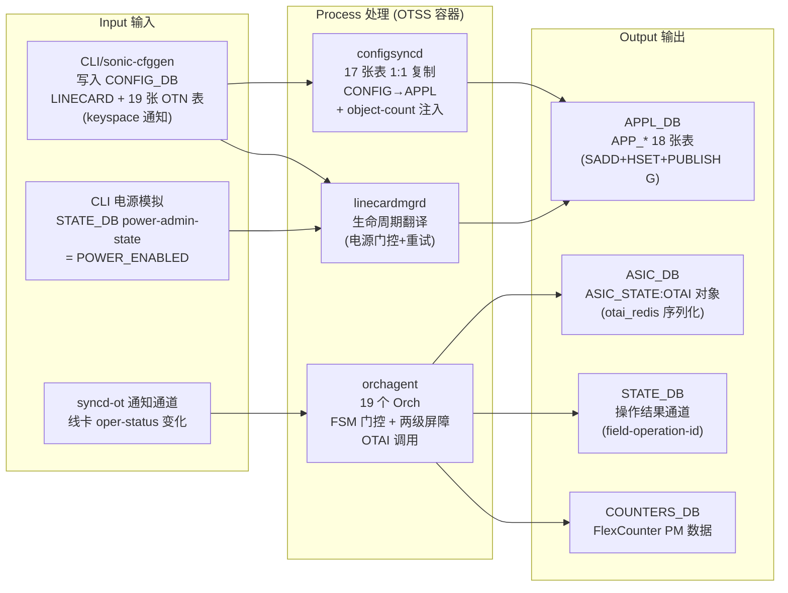
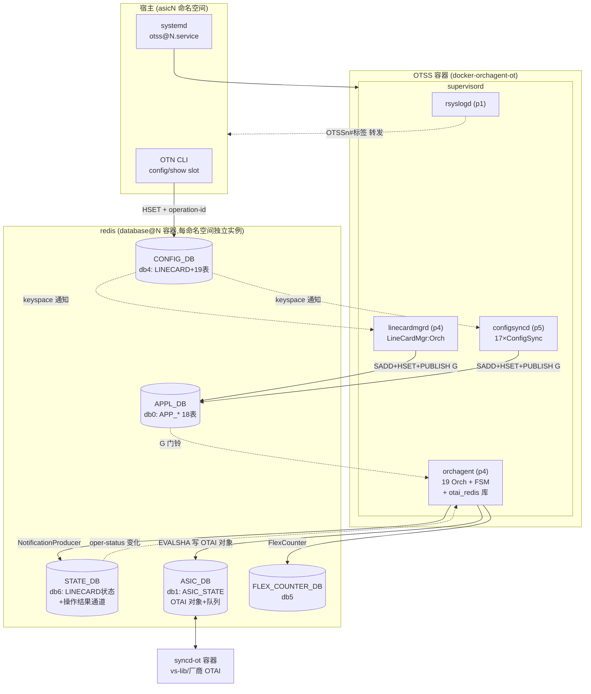
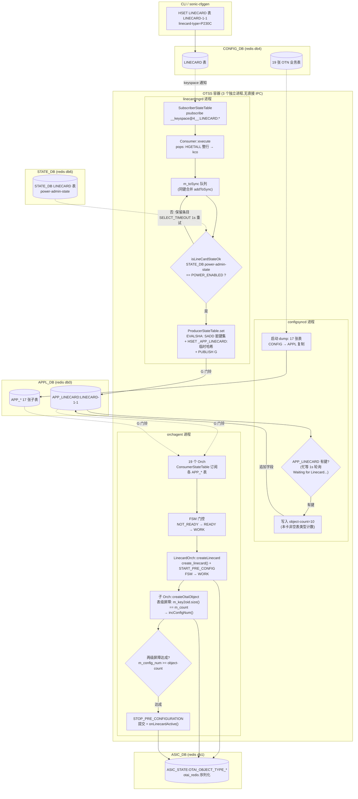
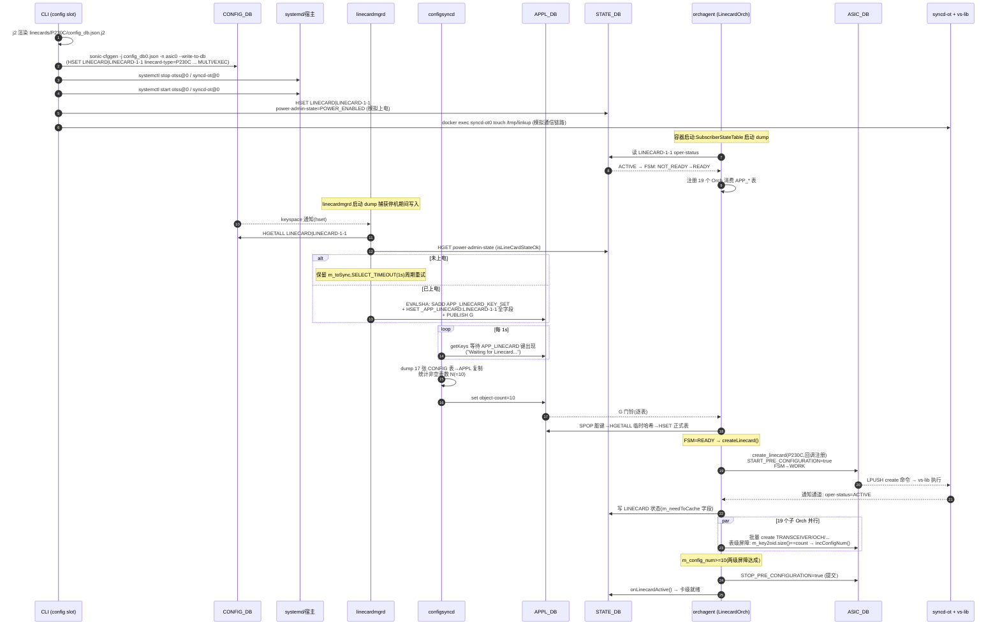
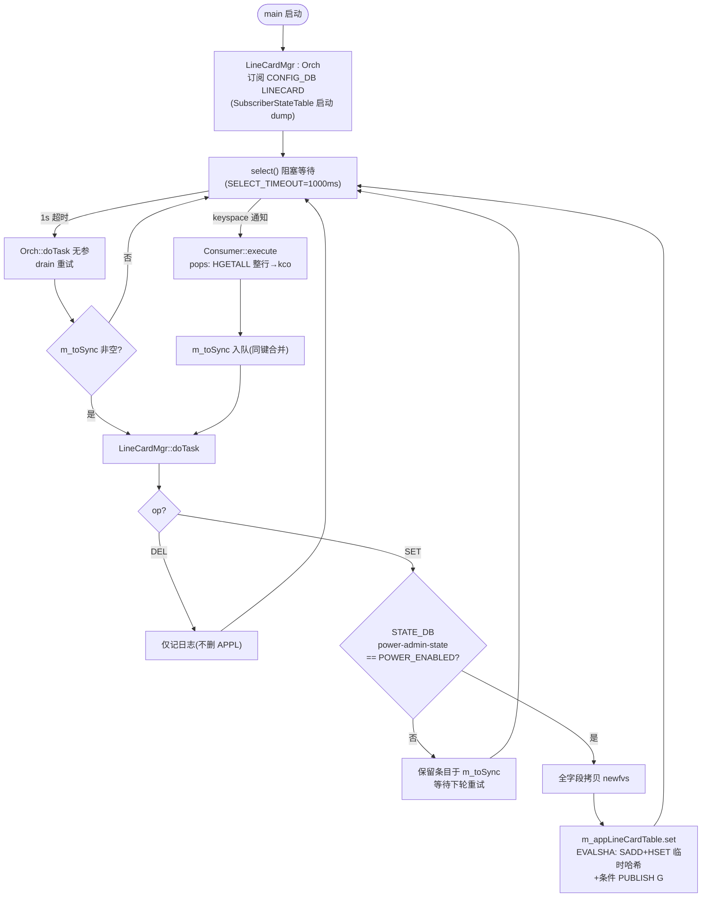
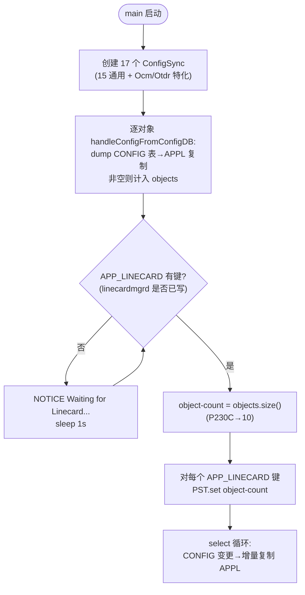
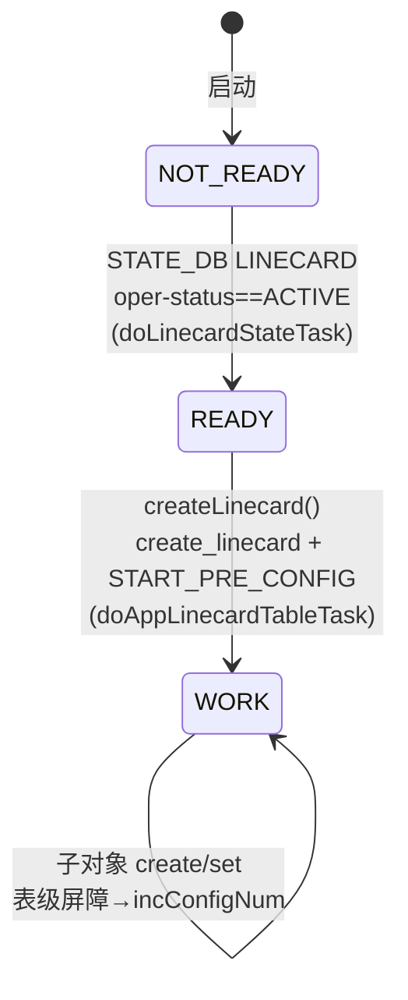
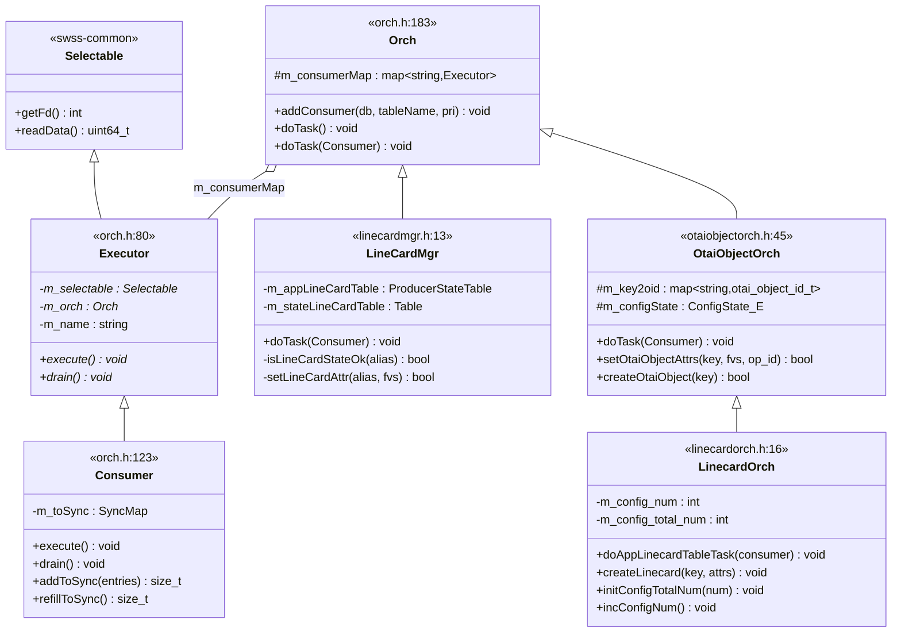
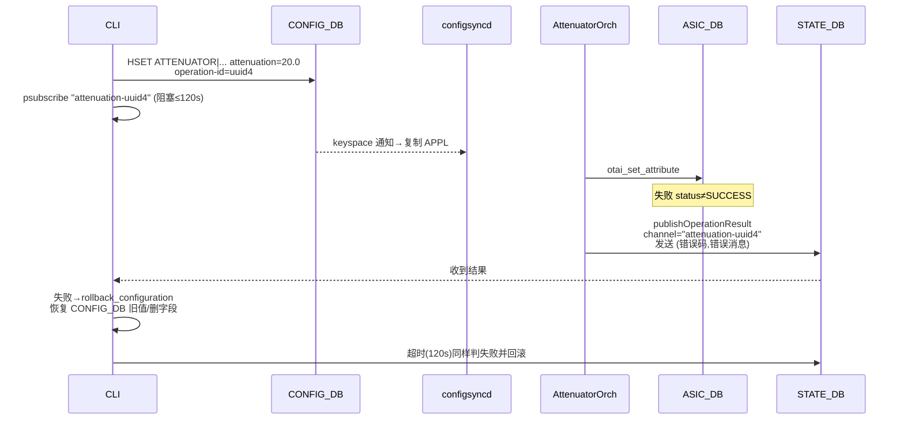

# OTSS 容器功能设计文档
## ——基于 OTN 业务配置下发流程

> 文档版本:v1.0
> 代码基线:sonic-otn `otn_pre_202411` 分支
> 平台:`ot-vs`(KVM 4-ASIC)
> 相关文档:`docs/linecard-config-flow.md`(配置下发链路解析)、`docs/distributed-chassis-architecture.md`(分布式机架架构)

---

## 1. 概述

### 1.1 功能定位

OTSS(Optical Transport Switch State Service,光传输状态服务)是 SONiC-OTN 对标准 SONiC SWSS 容器的 OTN 化改造容器(镜像 `docker-orchagent-ot`)。在多业务槽位系统中,**每个业务槽位/ASIC 命名空间运行一个 OTSS 实例**(otss0~otssN,槽位 N ↔ 命名空间 asicN-1),承担该槽位线卡的业务配置下发、状态汇聚与硬件抽象。

OTSS 是配置下发链路的**中间枢纽**:

```
CLI / 网管 → CONFIG_DB → [OTSS] → APPL_DB → [orchagent] → ASIC_DB → syncd-ot → 硬件/vs-lib
                                    ↑                                          |
                                    └── 状态/告警/PM ←── OTAI 通知 ←──────────┘
```

### 1.2 需求背景

- 标准 SONiC SWSS 面向包交换 ASIC(SAI 模型),无 OTN 传送网对象(光模块、放大器、ODU 通道、保护倒换等);
- SONiC-OTN 定义了 OTAI(OTN Abstraction Interface)及 LINECARD/TRANSCEIVER/OA/APS 等约 19 类 OTN 对象,需要一套守护进程将 CONFIG_DB 中的业务配置翻译为 OTAI 调用,并反向接收硬件通知;
- 复用 SONiC 成熟的 redis 事件驱动框架(Orch/Consumer/Producer)可最小化开发量,并保持与 SONiC 运维体系(日志、CLI、systemd)的一致性。

### 1.3 使用场景

| 场景 | 入口 | 说明 |
|---|---|---|
| 线卡业务开通 | `config slot N type P230C/E110C` | 全量模板下发,触发容器重启 + 全对象创建 |
| 单属性配置 | `config slot 2 voa 1 attenuation 20.0` 等 | 增量字段修改,同步确认(成功/失败/回滚) |
| 状态/告警/PM 查询 | `show slot N ...` | 读 STATE_DB/COUNTERS_DB,OTSS 负责持续写入 |
| 板卡去激活 | `config slot N type NONE` | 清空该槽位全部数据 |

### 1.4 方案特点与价值

- **完全复用 SONiC 事件驱动框架**:CONFIG_DB/STATE_DB 采用 redis keyspace 通知(SubscriberStateTable),APPL_DB 采用 'G' 门铃+脏键集合(ConsumerStateTable/ProducerStateTable),与标准 SWSS 行为一致;
- **三进程职责分离**:配置翻译(configsyncd)、生命周期管理(linecardmgrd)、硬件抽象(orchagent)解耦,单进程故障可独立重启;
- **同步确认协议**:CLI 写入携带 `operation-id`,OTSS 处理完成后向 STATE_DB 通道发布结果,CLI 阻塞等待(120s 超时)并支持失败回滚;
- **两级就绪屏障**:表级 count + 卡级 object-count,解决无序事件流下的"配置到达完毕"判定,支撑 OTAI 两阶段提交(START/STOP_PRE_CONFIGURATION);
- **状态机门控**:NOT_READY→READY→WORK 三态 FSM 保证线卡对象先于子对象创建、子对象配置先于卡级激活。

### 1.5 符合的标准/协议

- SONiC SWSS 数据库规范(SWSS schema,redis DB 0/1/2/4/5/6 布局);
- OTAI(OTN Abstraction Interface,对 SAI 的 OTN 扩展,SAI-redis 同构的 VID/ASIC_STATE 模型);
- systemd 服务模型(模板实例单元 `otss@.service`)、supervisord 进程管理、rsyslog 容器日志规范(`OTSSn#proc` 标签)。

### 1.6 IPO 简要描述



一句话:**OTSS 以事件驱动方式消费本槽位 CONFIG_DB/STATE_DB 的业务配置,经电源门控、FSM 门控与两级就绪屏障后,将其翻译为 OTAI 对象操作写入 ASIC_DB 交由 syncd-ot 执行,并将操作结果与运行状态持续回写 APPL_DB/STATE_DB/COUNTERS_DB。**

---

## 2. 功能设计

### 2.1 逻辑运行架构

#### 2.1.1 部署粒度与进程形态

**部署粒度**:按线卡槽位部署——每个槽位/ASIC 命名空间(asicN)运行一个 OTSS 容器实例(otss0~otssN,槽位 N ↔ 命名空间 asicN-1)。同一 docker 镜像(`docker-orchagent-ot`)的多实例共享镜像分层,仅 RW 层独立(单实例 RW 层 ~10 MB 级)。

**进程形态**:linecardmgrd、configsyncd、orchagent 框架为**三个独立的 C++ 守护进程**(各有 main() 入口、独立地址空间、独立事件循环),由容器内 supervisord 统一拉起并管理依赖顺序:

| 进程 | 可执行文件 | supervisord 优先级 | 依赖启动条件 | 职责 |
|---|---|---|---|---|
| orchagent | `/usr/bin/orchagent.sh` → orchdaemon | p4 | rsyslogd:running | 19 个 Orch 实例、FSM 门控、OTAI→ASIC_DB |
| linecardmgrd | `/usr/bin/linecardmgrd` | p4 | orchagent:running | LINECARD 表 CONFIG→APPL 翻译(电源门控) |
| configsyncd | `/usr/bin/configsyncd` | p5 | orchagent:running | 17 张表 CONFIG→APPL 复制 + object-count 注入 |

三进程之间**没有任何直接 IPC**(无 socket/共享内存/信号),完全通过共享的 redis 数据库(APPL_DB/STATE_DB/ASIC_DB)以事件方式异步协作。任一进程崩溃由 supervisord(systemd RestartSec=30)独立拉起,重启后经启动 dump 自动补漏停机期间的事件。

#### 2.1.2 容器与进程视图

OTSS 为 systemd 模板实例服务(`otss@.service`:Requires `database@%i`、`config-setup.service`,BindsTo `sonic.target`,StartLimitBurst=3/1200s),由宿主 `otss.sh start %i` 拉起容器,容器内 supervisord 管理四个进程(依赖启动:rsyslogd→orchagent→{linecardmgrd, configsyncd}):



各数据库访问方式(由 swss-common 框架决定):

| 数据库 | 消费方式 | 机制 |
|---|---|---|
| CONFIG_DB / STATE_DB | `SubscriberStateTable` | redis keyspace 通知(`notify-keyspace-events AKE`)+ 启动全表 dump 补漏 |
| APPL_DB | `ConsumerStateTable` | 生产者 SADD 脏键集 + HSET 临时哈希(`_APP_*` 前缀)+ 条件 PUBLISH 'G';消费者 SPOP→搬运至正式表 |
| APPL_DB(写) | `ProducerStateTable` | 单 EVALSHA 原子完成三动作 |
| ASIC_DB | `otai_redis` ProducerTable | VID 分配 + `ASIC_STATE:OT:oid` 哈希 + LPUSH 命令队列 |

### 2.2 三进程协作流程图(linecardmgrd / configsyncd / orchagent)

下图从数据流视角展示三进程如何协同完成一次线卡配置下发,标注了各进程的内部机制(m_toSync 合并、电源门控、忙等、FSM 门控、两级屏障):



关键协作时序:

| 步骤 | 生产者 | 消费者 | 同步点 |
|---|---|---|---|
| CONFIG_DB LINECARD 写入 | CLI | linecardmgrd | keyspace 通知(实时) |
| APP_LINECARD 写入 | linecardmgrd | configsyncd(忙等)+ orchagent(G 门铃) | linecardmgrd 受电源门控;configsyncd 轮询等到键出现后写入 object-count |
| APP_* 子表写入 | configsyncd | orchagent 各子 Orch | G 门铃(实时) |
| ASIC_DB 写入 | orchagent(otai_redis) | syncd-ot | 命令队列(实时) |

**重要说明**:linecardmgrd 等待的是 `power-admin-state == POWER_ENABLED`(电源门控),而非 object-count;`object-count` 的消费者是 orchagent 侧的 LinecardOrch(卡级就绪屏障)。二者是不同层面的两个独立等待。

### 2.3 主时序图:线卡业务开通(`config slot 1 type P230C`)



### 2.4 模块一:linecardmgrd 处理逻辑

职责:LINECARD 表(卡生命周期属性)CONFIG→APPL 翻译,带电源门控与周期重试。



要点(对应 `linecardmgr.cpp:71-110`):

- 事件载荷为**整行重发**(HGETALL),非增量;
- HSET 合并语义,不删除 APPL 侧多余字段(如 configsyncd 写入的 object-count);
- DEL 分支仅记日志,**字段删除不向 APPL 传播**。

### 2.5 模块二:configsyncd 处理逻辑

职责:17 张 OTN 业务表通用 CONFIG→APPL 1:1 复制 + 卡级就绪计数(object-count)注入。



要点:

- object-count 仅在进程启动时计算一次(容器重启/重新开通时刷新);
- Ocm/Otdr 为特化子类(带扫描触发);
- 忙等待存在的原因:linecardmgrd 受电源门控约束可能尚未写 APP_LINECARD。

### 2.6 模块三:orchagent FSM 与两级屏障



FSM 门控规则(`linecardorch.cpp:226-232`):

| FSM 状态 | 允许操作 | 说明 |
|---|---|---|
| NOT_READY | 仅消费 STATE 状态事件 | 线卡未激活,APP 事件入队等待 |
| READY | `createLinecard()` | 创建线卡 OTAI 对象 + START_PRE_CONFIGURATION |
| WORK | `setOtaiObjectAttrs()` | 子对象创建与属性设置 |

**两级就绪屏障**(防止无序事件流误判"配置到达完毕"):

- 内层(表级):每张表有 `count` 字段,`m_key2oid.size() == m_count` 时该表计入完成(`otaiobjectorch.cpp:598-604`);
- 外层(卡级):`m_config_num >= object-count` 时触发 `stopPreConfigProc()`(发送 STOP_PRE_CONFIGURATION)+ `onLinecardActive()`;
- 顺序无关:`initConfigTotalNum`(object-count 后到)与 `incConfigNum`(表先完成)双向检查收敛(`linecardorch.cpp:126-158`)。

**为什么需要卡级屏障**:OTN 对象图存在交叉引用(ASSIGNMENT→LOGICAL_CHANNEL+OCH),10 张表以任意顺序独立到达;pre-config 两阶段提交让 OTAI 库暂存全部对象后在 STOP 时一次性做依赖解析与应用,避免半配置状态触发瞬态告警/保护误动作,同时支撑 syncd 暖启动(SingleReiniter 复用同一 STOP_PRE_CONFIGURATION 语义)。

### 2.7 orchagent 的编排职责:配置下发时序保障

**问题**:上层 APPL_DB 事件经 redis 门铃/脏键集机制投递,**不保证表间顺序**——LOGICAL_CHANNEL 可能先于 LINECARD 被处理、ASSIGNMENT 可能先于其引用的 OCH 到达。而 OTAI 对象图有严格的创建依赖:

```
LINECARD (根对象)
 ├── TRANSCEIVER / PORT          ← 依赖 LINECARD 存在
 │     └── LOGICAL_CHANNEL       ← 依赖 TRANSCEIVER
 │            └── ASSIGNMENT ──► OCH   ← 依赖两端 LOGICAL_CHANNEL
 └── AMPLIFIER / ATTENUATOR / APS / OSC / OCM / OTDR ...
```

orchagent 作为**编排层**,通过三层机制把无序事件流重排为满足 OTAI 时序约束的操作序列:

| 机制 | 保障的时序约束 | 实现 |
|---|---|---|
| FSM 门控 | 线卡对象先于一切子对象创建 | NOT_READY 丢弃 APP 事件(仅消费 STATE 状态);READY 仅 createLinecard;WORK 才处理子表(linecardorch.cpp:226-232) |
| 表级状态机(CONFIG_MISSING→CONFIG_CREATED→CONFIG_DONE) | 每张表的对象**全部创建完毕**后才接受该表的属性变更;表内对象批量创建 | otaiobjectorch.cpp:580-630:`m_key2oid.size()==m_count` 且 `m_configState==CONFIG_MISSING` 时跳过 set |
| 两级屏障(表级 count + 卡级 object-count) | 全部表配置到位后才向硬件**提交**(而非逐对象生效),规避半配置状态 | STOP_PRE_CONFIGURATION 两阶段提交 |

**m_toSync 合并的时序贡献**:Consumer::addToSync 对同一 key 的多次写**合并为最新值**(字段覆盖),意味着下游 Orch 看到的是合并后的最终状态——既消除重复处理,也保证乱序到达的旧值不会覆盖新值(orch.cpp:120-145)。

**对 syncd 的意义**:orchagent 下发 create 顺序在单线程 doTask 循环内天然串行(每命名空间),syncd 从 ASIC_DB 命令队列按序消费——整条链路最终时序由 orchagent 的编排决定,上层写入顺序无关紧要。

### 2.8 为什么经 otai_redis 序列化,而非直接把 APPL 内容写进 ASIC_DB

orchagent 从不直接拼 ASIC_DB 的键值,而是调用 OTAI C API(`otai_linecard_api->create_linecard(...)`),由链接进 orchagent 的 **otai_redis 适配器**完成序列化。原因有六:

1. **进程边界(IPC)**:orchagent 与 syncd-ot 位于不同容器/进程,无共享内存;ASIC_DB(redis)是二者唯一通道,任何数据必须先变为 redis 可存储的字符串;
2. **OTAI 是类型化 C API**:属性为 `otai_attribute_t` 结构体(枚举、union、oid、函数指针、定长字符串),redis 只能存字符串——`OtaiAttributeList::serialize_attr_list` 完成 C struct ↔ 字符串的双向转换,消费侧 syncd 反序列化还原;
3. **VID/RID 分离**:orchagent 只见**虚拟对象 ID**(VID,如 linecard 固定 `oid:0x1000000000000`,VirtualObjectIdManager 分配);syncd 侧 VirtualOidTranslator 映射为厂商**真实 ID**(RID)。ASIC_DB 键名携带 VID,使两侧 ID 空间解耦,orchagent 不需要了解厂商 ID 编码;
4. **命令语义而非数据语义**:一次事件翻译为 `create/set/remove` **操作码**+属性列表,而非仅最终键值——syncd 需要区分"创建新对象"(可能触发厂商 SDK 的初始化路径)与"修改既有对象属性";原始 APPL 内容无法表达这种操作意图;
5. **暖启动恢复基础**:ASIC_DB 因此成为**已编程状态的持久化记录**——syncd 重启时 HardReiniter/SingleReiniter 从 ASIC_STATE:* 哈希重放对象图(配合 START/STOP_PRE_CONFIGURATION),实现 warm boot 不重新下发配置;若存储 APPL 原始内容则无法重建 OTAI 状态;
6. **适配器可替换**:otai_redis 与(未来的)直连厂商库实现同一 OTAI 接口——同一份 orchagent 代码无需修改即可切换"redis 间接模式"与"进程内直连模式"(消除 redis 中转的时延)。

**实例**(可在 VM 验证):`HGETALL "ASIC_STATE:OTAI_OBJECT_TYPE_LINECARD:oid:0x1000000000000"` 输出的 `OTAI_LINECARD_ATTR_LINECARD_TYPE=P230C` 及四个 `0x55a2...` 回调指针值,即 create_linecard 调用的完整序列化记录(指针值跨进程无意义,syncd 消费前会替换为自己的处理函数,仅作订阅登记)。

### 2.9 类图与通用事件循环(select → execute → doTask)

**类继承关系**(swss-common 提供 Selectable,otss 的 orchagent 框架提供 Orch 体系):



**模板方法模式**:Orch 基类实现通用事件循环与订阅管理,子类只需实现 `doTask(Consumer&)` 策略钩子。三个 OTSS 进程的主循环形状完全一致(select → execute → doTask),差异仅在子类策略。

**select → execute → doTask 通用流程**(所有 Orch 子类共享):

```
main():
  构造 Orch 子类(LineCardMgr 或 19 个 OtaiObjectOrch 派生)
    → Orch::addConsumer(db, tableName, pri)              [orch.cpp:605]
        → db 为 CONFIG_DB/STATE_DB ? new SubscriberStateTable : new ConsumerStateTable
        → 包装为 Consumer(Executor 派生),注册进 m_consumerMap["表名"]
  while (true):
    select(&sel, SELECT_TIMEOUT=1000ms)
      ├── TIMEOUT → Orch::doTask()                       [orch.cpp:491]  // 周期重试
      │     └── 遍历 m_consumerMap → 每个 Consumer::drain()
      │           └── m_toSync 非空 → m_orch->doTask(*this)             // 子类策略
      └── OBJECT  → ((Executor*)sel)->execute()           // 事件驱动
            → Consumer::execute()                        [orch.cpp:199]
                ├── getConsumerTable()->pops(entries)     // Lua EVALSHA 解码→kco 列表
                ├── addToSync(entries)                    // 同键合并入 m_toSync
                └── drain()
                      └── m_toSync 非空 → m_orch->doTask(*this)          // 虚函数分派
```

**两个触发、一个门**:事件驱动路径处理到达的变化;1s 周期路径仅在 m_toSync 有**保留条目**时生效(如 linecardmgrd 等待上电的条目),稳态下为空操作。doTask(Consumer&) 由虚函数分派到具体子类——LineCardMgr 实现电源门控+APPL 复制,OtaiObjectOrch 派生类实现 FSM/屏障门控后的 OTAI 调用。

### 2.10 异常分支子流程

**分支 A:同步操作失败与回滚**

以 `config slot 2 voa 1 attenuation 20.0` 失败为例:



**分支 B:属性变更(工作态)主路径**

与 2.3 主时序后半段相同,但走 `setOtaiObjectAttrs`(`otaiobjectorch.cpp:287`):逐字段构造 `channel = field + "-" + operation_id` → OTAI set → 成功字段缓存 STATE_DB(m_needToCache)→ 每字段独立发布结果。

**分支 C:服务级故障恢复**

- 容器内:supervisord `autorestart=false`,进程退出触发宿主;
- 宿主:systemd `RestartSec=30 / StartLimitBurst=3 / StartLimitIntervalSec=1200`(3 次内自动拉起,超出进入 failed 需人工 `systemctl reset-failed`);
- 数据补漏:进程重启后 SubscriberStateTable 启动 dump 自动重放停机期间写入,无需重新下发配置。

---

## 3. 接口设计

### 3.1 输入接口

| # | 接口 | 来源 | 机制 | 内容 | 前提条件 |
|---|---|---|---|---|---|
| I-1 | CONFIG_DB `LINECARD` 表 | CLI/sonic-cfggen | keyspace 通知+启动 dump | `linecard-type`/`board-mode`/`admin-state`/温度阈值/`baud-rate`/`hostname` 等 | 业务翻译需 `power-admin-state=POWER_ENABLED` |
| I-2 | CONFIG_DB 19 张 OTN 表(PORT/TRANSCEIVER/LOGICAL_CHANNEL/OTN/ETHERNET/PHYSICAL_CHANNEL/ASSIGNMENT/OCH/LLDP/INTERFACE/AMPLIFIER/OSC/APS/APS_PORT/ATTENUATOR/OCM_GROUP/OCM/OTDR) | CLI 直写 | keyspace 通知 | 各对象配置字段 + `count`(对象数)+ 可选 `operation-id` | FSM=WORK 才产生 OTAI 调用 |
| I-3 | STATE_DB `LINECARD` 表 | CLI 电源模拟/syncd 通知 | keyspace 通知 | `power-admin-state`(门控)、`oper-status`(FSM 驱动) | — |
| I-4 | ASIC_DB 通知通道 `OT_LINECARD_NOTIFICATION` | syncd-ot | NotificationConsumer | 序列化 (vid, oper_status) | 驱动 FSM 状态迁移 |

### 3.2 输出接口

| # | 接口 | 承载 | 机制 | 内容/格式 | 消费方 |
|---|---|---|---|---|---|
| O-1 | APPL_DB `APP_*` 18 张表 | redis db0 | ProducerStateTable EVALSHA | 如 `APP_LINECARD:LINECARD-1-1`;KEY_SET 集合 + `_APP_*` 临时哈希 | orchagent 各 Orch |
| O-2 | ASIC_DB `ASIC_STATE:OTAI_OBJECT_TYPE_*:oid:*` | redis db1 | otai_redis ProducerTable | create/set 命令 + 序列化属性(如 `OTAI_LINECARD_ATTR_LINECARD_TYPE=P230C`、回调注册指针) | syncd-ot |
| O-3 | STATE_DB 操作结果通道 | redis db6 | NotificationProducer | channel=`<field>-<operation-id>`,payload=(状态码, 消息) | CLI(同步确认) |
| O-4 | STATE_DB `LINECARD` 缓存字段 | redis db6 | Table.set | m_needToCache 只读属性回写 | show CLI |
| O-5 | FLEX_COUNTER_DB | redis db5 | FlexCounterOrch | PM 计数器组 | pmon/counter 展示 |

### 3.3 使用前提、约束和限制

- **实例前提**:`database@N` 服务已就绪(otss@.service Requires);容器位于 asicN 网络命名空间,经本命名空间 unix socket 访问 redis;
- **时序约束**:syncd-ot 先完成 linecard 注册(oper-status=ACTIVE)→ OTSS FSM=READY;linecardmgrd 先写 APP_LINECARD → configsyncd 才能注入 object-count;
- **数据约束**:LINECARD 表写入为整行重发+HSET 合并,字段删除不向 APPL 传播;`board-mode` 由 orchagent 本地消费,不出现在 OTAI create 参数中;`operation-id` 处理完成后残留在 CONFIG_DB 行内;
- **同步语义**:单字段配置为同步操作,CLI 侧 120s(CONFIG_TIMEOUT,`constants.py:13`)超时即判失败并回滚;
- **重启语义**:otss 进程重启安全(启动 dump 补漏);object-count 仅启动时计算,动态增删表类型不触发刷新。

---

## 4. 可测试性

| 手段 | 说明 | 观测点 |
|---|---|---|
| 分级日志 | SWSS_LOG_NOTICE/ERROR → 容器 rsyslogd → 宿主 syslog,标签 `OTSSn#进程名` | `grep 'OTSS0#' /var/log/syslog`;关键锚点:`fvField is`(逐字段)、`Create a linecard, id:`(创建)、`Set X to Y`(属性)、`publishresult ... on channel`(确认)、`Config total number=N`(屏障)、`Waiting for Linecard...`(依赖等待)、`Pre-Config Finished.`(卡级提交) |
| 数据库观测 | `sonic-db-cli -n asicN <DB> KEYS/HGETALL/MONITOR` | MONITOR 可见 CLI 的 HSET、linecardmgrd/configsyncd 的 EVALSHA(含全部参数)、orch 的 ASIC_DB EVALSHA,全链路逐命令回放 |
| operation-id 全链路追踪 | uuid 在 CONFIG_DB 行、syslog(publishresult)、STATE_DB 通道三处出现 | 单次操作的端到端关联键 |
| 同步失败注入 | 向 vs-lib 不支持的字段/值下发 → 触发 otai set 失败 → 验证回滚路径 | CLI 报错 + CONFIG_DB 旧值恢复 |
| vs-lib 数据定制 | 容器内 `/usr/include/vslib/otai_sim_data/*.json` 可改属性初值;`otai_linecard_notification_sim.json` 可驱动 oper-status 跳变(通知线程 5s 轮询) | 状态/告警/PM 场景构造 |
| FSM 状态观测 | syslog 中 `Orchagent go into ready state` / `linecard state change oper_status=` / `Pre-Config Finished.` | 三态迁移逐跳验证 |
| 服务级测试 | `systemctl restart otss@N` | 验证启动 dump 补漏与 object-count 重算 |

---

## 5. 内存 & Flash 资源开销评估

### 5.1 Flash(镜像/存储)

| 项 | 数值 | 说明 |
|---|---|---|
| 镜像压缩包 docker-orchagent-ot.gz | ~111 MB | 基于 docker-config-engine-bullseye 分层共享 |
| otss 功能 deb | 178 KB(otss_1.0.0);含调试符号 7.5 MB(otss-dbg) | 增量极小,大头为基镜像 |
| 多实例开销 | 同一镜像运行 4~6 实例,仅 RW 层独立(每实例 ~10 MB 级) | docker 分层共享 |

### 5.2 内存(单线卡实例口径,估算与实测)

#### 5.2.1 估算

| 进程 | 估算 | 依据 |
|---|---|---|
| orchagent | ~50–100 MB | 19 个 Orch 实例 + OTAI 元数据表 + otai_redis 上下文 + 每个 Consumer 的订阅连接与 m_toSync 队列 |
| linecardmgrd | ~10–20 MB | 单表消费,单订阅连接 |
| configsyncd | ~10–20 MB | 17 个 ConfigSync 订阅连接 |
| rsyslogd + supervisor | ~10 MB | — |
| **单实例合计** | **~100–150 MB** | **4 ASIC 全配置约 0.4–0.6 GB** |

#### 5.2.2 实测(ot-vs 4-ASIC,-m 3072,2026-09-28)

测试环境:ot-vs VM(客户机 2967 MB,19 个容器),4 槽位满配(slot1/3=P230C、slot2/4=E110C,均 ACTIVE);采样方式为 2s 周期 `free -m` + `docker stats`(终值为 3 轮 15s 间隔采样,读数稳定至 ±0.1 MiB),辅以进程 RSS 与 `smaps_rollup` PSS。

**(1)单线卡实例资源开销(部署粒度视角)**

每槽位 N(↔ 命名空间 asicN-1)固定占用一组"三容器 + 宿主看护"资源栈,与是否插卡无关;插卡下发仅带来小幅增量:

| 组件 | 空闲·未插卡(MiB) | 满配稳态(MiB) | 说明 |
|---|---|---|---|
| otssN(OTSS 实例) | ~40 | 37–45 | 进程明细见 (2);P230C 槽 orchagent +2.3 MB |
| syncd-otN | 34–38 | 43–52 | P230C 槽最高 |
| databaseN(本命名空间各 redis DB) | 59–65 | 57–67 | used_memory:空闲 ~2 MB → 满配 6.6(P230C)/ 3.7(E110C)MB |
| **容器小计** | **~135–145** | **~140–160** | 4 槽位合计 ~0.6 GiB |
| 宿主侧看护进程 ×2 | ~80–90(RSS 加和) | ~80–90 | `docker-wait-any -s otssN` + `container wait syncd-otN`,各 ~40–46 MB;python 解释器页共享后 unique 约 50–60 |
| **单线卡实例合计** | **~135–145 MiB + 看护** | **~140–160 MiB + 看护** | — |

插卡业务增量(单槽下发前后差值):P230C ~20 MB / E110C ~15 MB —— orchagent RSS +2.3 / +0.5 MB,其余落在 syncd-ot(+5~14 MiB)与 redis;即**随卡成本主要由 syncd-ot 与 redis 承担,OTSS 增量极小**。

**(2)OTSS 实例进程明细(满配稳态)**

| 指标 | otss0(P230C) | otss1(E110C) | otss2(P230C) | otss3(E110C) |
|---|---|---|---|---|
| 容器(docker stats,MiB) | 37.1 | 45.1 | 41.1 | 41.6 |
| 单槽容器栈(otss+syncd+db,MiB) | 144.9 | 148.5 | 159.6 | 142.1 |
| orchagent RSS / PSS(MB) | 11.2 / 4.0 | 9.5 / 2.2 | 11.3 / 4.0 | 9.1 / 2.2 |
| linecardmgrd RSS(MB) | 7.3 | 7.2 | 7.4 | 7.2 |
| configsyncd RSS(MB) | 7.6 | 7.6 | 7.5 | 7.6 |

空闲态 orchagent RSS ~9.1 MB / PSS ~2.0 MB(共享库页 ~7.8 MB 由 4 实例分摊,docker 分层共享收益显著)。容器内内存大头为基础设施进程:python3(~26 MB)+ supervisord(~25 MB),高于三个 OTN 业务守护进程之和。

**(3)整机内存(客户机视角)**

| 状态 | used | available |
|---|---|---|
| 空闲(无线卡配置) | 2104 MB | 863 MB |
| 4 槽位满配稳态 | 2167 MB | 800 MB |
| 下发过程瞬时峰值 | 2231 MB | 736 MB |
| 运行 ~40 min 趋稳 | ~2.35 GB | ~600 MB |

容器分组(docker stats,满配稳态):

| 组 | 合计(MiB) |
|---|---|
| 共享功能容器 ×6(bgp/gnmi/lldp/pmon/mgmt-framework/eventd) | 508.4 |
| database ×5(4 命名空间 + 1 全局) | 313.1 |
| syncd-ot ×4 | 182.5 |
| OTSS ×4(四组中最小) | 164.9 |
| **容器合计(19 个)** | **~1.14 GiB** |

满配较空闲仅 +63 MB(~16 MB/槽),峰值为首启镜像解包+全对象创建的瞬时开销;运行期漂移(+180 MB)来自宿主看护进程堆增长与 bgp(114→151)/gnmi(108→131)运行期增长,OTSS×4 全程稳定,漂移后趋稳(±25 MB 波动)。容器外另有 dockerd/containerd/hostcfgd/sonic-host-services 等宿主进程,及 14 个容器看护进程(RSS 加和 570 MB)。全程无内存压力(未配置 swap 且未触发)。

**(4)宿主机开销**:QEMU 进程 RSS 3.08 GB = 客户机 2967 MB + QEMU 自身 ~110 MB。

**(5)估算与实测对照**

| 指标 | 估算 | 实测 | 评价 |
|---|---|---|---|
| orchagent | 50–100 MB | 9–11 MB RSS / 2–4 MB PSS | 保守 5–10×(vs 环境对象规模小,真机大规模对象时上探) |
| linecardmgrd | 10–20 MB | 7.2–7.4 MB | 接近,略低 |
| configsyncd | 10–20 MB | 7.5 MB | 接近,略低 |
| OTSS 单实例 | 100–150 MB | 37–45 MiB(容器)/ ~65 MB(RSS 加和) | 偏低 |
| 单线卡实例容器栈(otss+syncd+db) | —(估算未覆盖) | 空闲 ~135–145 / 满配 ~140–160 MiB | 新增口径 |
| 整机稳态 used | ~2.0 GB | 2.10(空闲)→ 2.17(满配)→ ~2.35 GB(趋稳) | 吻合 |
| OTSS×4 占容器总量比 | 约 1/4(占 used) | 14%(164.9/1168.9) | 原估偏高 |

**结论(单线卡实例口径)**:单个线卡实例满配开销 ≈ **140–160 MiB 容器 + ~80–90 MB 宿主看护 RSS**,其中 OTSS 本体仅 37–45 MiB(约占资源栈 1/4);随卡业务增量 15–20 MB 且大头在 syncd-ot 与 redis;4 槽位全套容器 ~0.6 GiB。`-m 3072` 可支撑 4 槽满配(available 最低 ~600 MB,无 swap 且未触发)。注意 `docker stats` 含页缓存波动(同容器前后可差 ±15 MiB),精确评估应以进程 RSS/PSS 为准;真机部署仍建议按 §5.2.1 估算上限规划,vs 实测数据仅代表仿真规模。

---

## 6. 规格 & 约束

| 类别 | 规格/约束 | 出处 |
|---|---|---|
| 表规格 | 消费 CONFIG 表 19 张 + LINECARD;产出 APPL 表 18 张(APP 前缀,OCM_GROUP 不出 APPL) | schema-ot.h |
| 对象规格 | 每命名空间 1 个 linecard 对象(VID 固定 oid:0x1000000000000,暖启动可复现);子对象类型由卡型模板决定(P230C→10 表类型) | VirtualObjectIdManager.cpp:197 |
| FSM 约束 | NOT_READY→READY→WORK 严格顺序;READY 仅 create,WORK 仅 set;卡级提交需两级屏障全部达成 | linecardorch.cpp:226-232 |
| 服务约束 | RestartSec=30;StartLimitIntervalSec=1200 内 StartLimitBurst=3(连续 3 次失败进入永久 failed,需人工 reset-failed) | otss@.service |
| 同步约束 | operation-id 确认协议超时 120 s(CONFIG_TIMEOUT);超时/失败触发 CLI 回滚 | otn/utils/constants.py:13 |
| 事件语义 | CONFIG/STATE 为 keyspace 通知+启动 dump;APPL 为 G 门铃(同键合并去抖:`if added>0` 条件发布);ASIC 为队列命令 | swss-common |
| 写语义 | HSET 合并;LINECARD 整行重发;字段删除不传播(linecardmgrd DEL 仅记日志) | linecardmgr.cpp:105 |
| 依赖约束 | object-count 由 configsyncd 启动时一次性计算;依赖 APP_LINECARD 先出现(1s 轮询等待);orchagent 先于两守护进程启动(supervisord dependent_startup) | configsyncd.cpp:143 |
| 平台约束 | 当前基线镜像基于 bullseye(bookworm 构建树已具备);vs-lib 不实现 STOP_PRE_CONFIGURATION 语义(屏障在仿真环境下仅影响时序) | vslib 源码 |
| 并发约束 | 同 namespace 内 doTask 串行(单线程 select 循环);跨 namespace 天然并行(独立 redis 实例) | orchdaemon.cpp |

---

## 附录 A:关键源码文件索引

| 文件 | 内容 |
|---|---|
| `src/sonic-otss/cfgmgr/linecardmgrd.cpp` | linecardmgrd 主循环 + LineCardMgr::doTask |
| `src/sonic-otss/configsyncd/configsyncd.cpp` | 17 个 ConfigSync + object-count 注入 |
| `src/sonic-otss/orchagent/orchdaemon.cpp` | 19 个 Orch 注册 + 主 select 循环 |
| `src/sonic-otss/orchagent/linecardorch.cpp` | FSM 门控 + createLinecard + 两级屏障 |
| `src/sonic-otss/orchagent/otaiobjectorch.cpp` | 子对象通用 create/set + operation-id 发布 |
| `src/sonic-otss/orchagent/notifications.cpp` | OTAI 回调(状态变更→FSM WORK) |
| `src/sonic-swss-common/common/schema-ot.h` | 全部 OT 表名定义 |
| `src/sonic-swss-common/common/producerstatetable.cpp` | APPL 写入 Lua 协议 |
| `src/sonic-otairedis/lib/RedisRemoteOtaiInterface.cpp` | OTAI→ASIC_DB 序列化 |
| `src/sonic-otairedis/vslib/OtaiObjectNotificationSim.cpp` | 通知模拟线程 |
| `src/sonic-utilities/otn/slot/slot.py` | config/show slot CLI |
| `src/sonic-utilities/otn/utils/config_utils.py` | operation-id 同步确认 + 回滚 |
